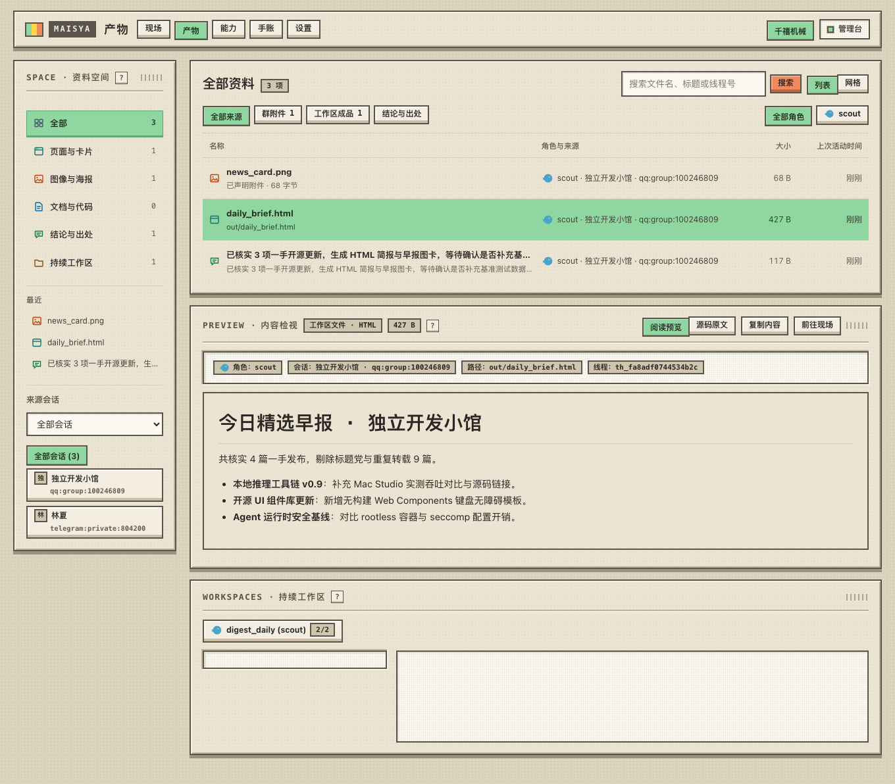
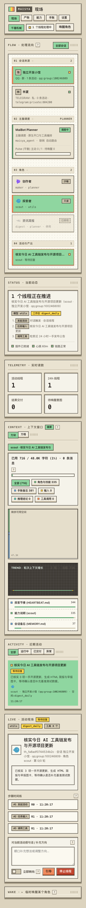

<div align="center">


# Maisya

**以 MaiBot 自身决策模型为调度中枢，通过多个通用与专用角色，为 MaiBot 提供灵活、可编排的 Agent 能力**

[](https://github.com/CharTyr/Maisya)
[](https://github.com/Mai-with-u/MaiBot)
[](https://github.com/Mai-with-u/MaiBot)
[](LICENSE)
[](https://github.com/CharTyr/Maisya/stargazers)

[项目特色](#项目特色) • [使用范例](#使用范例) • [与 MaiWork 怎么选](#与-maiwork-怎么选) • [快速开始](#快速开始) • [管理工作台](#管理工作台) • [详细文档](#详细文档)

</div>

> Maisya 是 MaiBot 插件（ID `chartyr.maisya`）。它**不另起第二套机器人，也不抢日常聊天的话筒**——**MaiBot 自己的决策模型（Planner）就是唯一的调度者与发言人**。平时闲聊一切照旧；遇到查证、作图、跑工作区、定时巡检或跨步协作时，MaiBot 自主挑选并编排背后的通用或专用 Agent 角色，做好后仍用自己的语气和群聊习惯交回对话。

---

## 项目特色

- **MaiBot 自身即调度者**：日常聊天、接梗与原有记忆（`A_Memorix`）完全保留；需要动真格时再由 MaiBot 自己决定调用哪个角色、同轮快查还是后台慢跑，完事后通过原生说话或准确链接/图卡/群文件一次交付。
- **通用底座 + 专用角色，按需衍生**：开箱提供 **`scout`**（只读搜源核实）、**`maker`**（工作区创作、出图做网页与沙箱执行）两个通用角色，以及 **`digest`**（每日资讯简报）等专用角色；可随时挂载 `SKILL.md` 技能、绑定外部 MCP / API、配置多模型顺次替补（主模型报错自动切换备选），或克隆定制画师、运维、跑团主持等专用角色，并打包为「能力配方」分享导入。
- **灵活可编排，轻重皆宜**：小到群聊中一句话十秒查证，中到挂着工作区多轮原位改图改稿，大到同轮并行派出多个角色分头调研、汇总后接力成片，以及按固定钟点自动巡检。
- **私聊一句话统管 & 内嵌工作台**：管理员在私聊发一段话即可跨群开白名单、改角色、订资讯源、先私聊试跑预览再推往目标群；同时免开新端口直接嵌入 MaiBot WebUI 顶栏，全流程透明可控。

---

## 使用范例

### 1. 轻型快查：聊到一半随手核实
- **怎么触发**：`「@MaiBot 刚聊到的那个新开源库真比原版快一倍吗？帮我查下实测反馈」`
- **怎么运转**：MaiBot 调起通用角色 **`scout`** 快速搜源并打开原文核对，十来秒内拿回带出处的结论，直接顺着当下群聊自然接话，不打断聊天节奏。

### 2. 创作与连续改稿：查完直接出图卡或报告页
- **怎么触发**：`「@MaiBot 把大家刚提的这三款两千内显示器拉张优缺点对比图发群里」` → 收到图后再追一句 `「把接口规格和护眼认证那栏补上」`
- **怎么运转**：MaiBot 派出 **`maker`** 查实参数并在持续工作区渲染成图片卡发出；你后续追加或调整要求，会原位续接进同一条工作区修改重出，不用推倒重做。

### 3. 多角色并行与接力编排：分头调研 → 汇总成片
- **怎么触发**：`「@MaiBot 帮社团做一份本周独立游戏新品与开发工具盘点，国内外分开查，最后合成一份带摘要图的完整网页报告发群文件」`
- **怎么运转**：MaiBot 在同一轮**并行启动两个 `scout` 线程**分头检索海外新品与工具更新；两路后台完成后自动汇合唤醒 MaiBot，MaiBot 再把两份已核实的结果**接力交给 `maker`** 合成网页报告与封面图卡，一次性打包交付到群里。

### 4. 专用角色值守与私聊全局编排
- **每日资讯简报（`digest`）**：按固定钟点巡检本群关注方向、自动试订与淘汰 RSS 并硬筛水文，有好内容才出图卡，没有就安静跳过。
- **长期驻场活动**：基于通用角色克隆出专用 `dm`（跑团主持）或项目助手，绑定命名工作区跨天保存设定、数值表与状态，随时接着上次进度往下推。
- **管理员私聊一段话配齐**：不用挨个进群发命令，管理员直接私聊 MaiBot（哪怕这段私聊不在白名单里）：
  > 「帮 `qq:group:100246809` 打开白名单和 `digest` 角色，记一下这个群关注 AI 工具与独立游戏、不要标题党水文，设成每天 08:30 推一期简报；现在先试跑一期发我私聊看看效果。」

---

## 与 MaiWork 怎么选？

作者同时维护了 [MaiWork](https://github.com/CharTyr/MaiWork) 与 Maisya 两个插件，定位侧重不同，按自己的使用习惯选即可：

- **[MaiWork](https://github.com/CharTyr/MaiWork)**：偏向**预先定制好的群生产力栏目（资讯 / 构想 / 长期目标）+ 偏重型、工单式的任务审批与验收交付**，自带独立管理端口网页与一次性云端/本机重型执行环境。
- **Maisya**：**更类似 Grok Bot 的灵活、可编排多 Agent 在 MaiBot 框架下的原生实现**，以 **MaiBot 自身的决策模型（Planner）作为唯一调度者与发言人**，既能在闲聊中十秒顺手查证，也能挂工作区多轮改图改稿、同轮并行派出通用（`scout` / `maker`）与专用角色（`digest` / 自定义角色）接力成片，还可由管理员私聊一句话动态配模型、技能与定时。

| 对比维度 | Maisya | [MaiWork](https://github.com/CharTyr/MaiWork) |
|:-----|:-----|:-----|
| **定位与模式** | 类似 Grok Bot 的灵活、可编排多 Agent 原生实现 | 预先定制好的群生产力栏目 + 工单式审批交付 |
| **调度与发言主体** | **MaiBot Planner 本身**唯一调度并按原人设开口 | 独立主模型调度、审单、验收并对外交付 |
| **任务与交互形态** | 10 秒快查、工作区原位续改、同轮并行与接力成片、私聊配齐 | 资讯 / 构想 / 长期目标栏目、审批放行、群内连续追改 |
| **扩展与复用方式** | 通用底座衍生专用角色，按群按人动态配 `SKILL.md` / MCP / 配方 | 围绕既定群栏目沉淀群理解、个人画像与任务流 |
| **界面与执行环境** | 零新端口直嵌 MaiBot WebUI；免容器开箱即用，按需配沙箱 | 独立管理端口网页；一次性云端机或本机隔离环境 |

- **选 Maisya**：希望完全保留 MaiBot 原生说话节奏与人设，把多 Agent 当成可自由编排、轻重皆宜的「手脚与分身」，随时用技能和配方扩展角色能力。
- **选 MaiWork**：希望直接拥有成套群生产力栏目（资讯、构想、长期目标）以及明确的工单审批、验收交付与重型执行环境。

---

## 快速开始

### 第一步：安装插件（三种方式任选）

1. **从 MaiBot 插件市场直接安装（推荐）**
   打开 **MaiBot WebUI → 插件市场**，搜索 **「Maisya」** 点击安装。

2. **填入仓库地址安装**
   在 **MaiBot WebUI → 插件管理** 页面填入仓库地址 `https://github.com/CharTyr/Maisya.git` 安装。

3. **命令行克隆**
   在 MaiBot 的 `plugins/` 目录下执行：
   ```bash
   git clone https://github.com/CharTyr/Maisya.git CharTyr_Maisya
   ```

### 第二步：开启插件总开关

直接在 **MaiBot WebUI → 插件配置** 中打开 Maisya 的启用开关并保存（或手动将插件目录的 [`config.example.toml`](config.example.toml) 复制为 `config.toml`，确认 `enabled = true`）。

默认 `enabled_chats = []`，未放行会话零读取、零调用、零打扰。

### 第三步：放行目标会话即可开用

- **网页点选**：登录 MaiBot WebUI，点顶栏 **Maisya → 设置**，按 `平台:类型:id` 添加启用会话并保存（兼容 QQ 群/私聊 `qq:group:12345678`、QQ 官方区分大小写 OpenID，以及 Telegram 话题群 `telegram:group:-100...::tg-topic::mt=...`）。
- **管理员私聊一句话交代**：直接用管理员账号私聊 MaiBot，发一段大白话让它开通指定群、调整角色或安排定时任务。

#### 跨平台运行说明（Windows / macOS / Linux / Docker）

- **全平台免容器开箱即用**：直接复用 MaiBot 已配好的模型和联网来源，默认启用无容器轻量工作区与 HTML 渲染出图。
- **缺浏览器内核时补装一次**：若精简镜像或新系统首次做图提示缺少 Chromium，在**运行 MaiBot 的宿主**执行 `playwright install chromium` 即可（Linux 环境按需补充 `playwright install-deps chromium`）。
- **Docker + NapCat 跨容器传群文件**：若 MaiBot 与 NapCat 不共享磁盘目录，群文件发送会自动触发 `base64://` 兜底上传。
- **Docker 沙箱按需选配**：仅当需要运行不受信任代码或挂载 `secrets` / 受控网络白名单时，再按[运行环境与沙箱指南](docs/guide/sandbox-and-services.md)启用 `Docker + gVisor`。

---

## 管理工作台

无需另开端口或额外密码，登录 MaiBot 控制台后顶栏会出现 **Maisya** 五页工作台（**现场 / 产物 / 能力 / 手账 / 设置**），默认采用协调宿主的**千禧机械风**，顶栏支持一键切换**清朗手账风**。

<table>
<tr>
<td width="50%"><br /><sub><b>现场 · 主脑与线程</b>：<code>01→04 FLOW</code> 展现 MaiBot Planner 如何调度各角色，联动上下文分布与实时步骤流</sub></td>
<td width="50%"><br /><sub><b>能力 · 角色与技能</b>：围绕 <code>SKILL.md</code> 画廊、多模型顺次替补链、角色专属小鱼头像与能力配方导入</sub></td>
</tr>
</table>

<details>
<summary>展开查看更多页面截图（产物资料空间、分层手账、设置、清朗手账主题与手机端）</summary>

<table>
<tr>
<td width="50%"><br /><sub><b>产物 · 资料空间</b>：集中收纳各会话附件、成品图卡、网页与持续工作区</sub></td>
<td width="50%"><br /><sub><b>手账 · 分层记忆</b>：各群独立 <code>MEMORY.md</code>、7 天近况、探索脾性与待唤醒队列</sub></td>
</tr>
<tr>
<td width="50%"><br /><sub><b>设置 · 一般与高级</b>：<code>平台:类型:id</code> 条目白名单、主动分寸、整点免打扰与定时预设</sub></td>
<td width="50%"><br /><sub><b>清朗手账风</b>：顶栏一键切换并持久保存</sub></td>
</tr>
</table>

<div align="center">
<br />
<sub>手机端窄屏自适应布局（以上截图群名、账号、对话与工作区均为虚构演示数据）</sub>
</div>

</details>

---

## 详细文档

- **用户与配置指南**：[核心功能与交互详解](docs/guide/features.md) · [配置、定时与私聊管理说明](docs/guide/configuration.md)
- **环境与跨平台指南**：[运行环境、沙箱、Docker 与外部接入](docs/guide/sandbox-and-services.md)
- **开发与架构参考**：[开发入门与防跑偏红线](docs/00-开发入门.md) · [架构蓝图](docs/01-架构蓝图.md) · [宿主接口事实](docs/06-宿主接口事实.md) · [代码地图](codemap.md) · [开发规则](AGENTS.md)

---

## 许可证与致谢

本项目基于 **GPL-3.0-or-later** 开源（详见 [LICENSE](LICENSE)）。感谢 [MaiBot](https://github.com/Mai-with-u/MaiBot) 与 [gVisor](https://gvisor.dev)。

[@CharTyr](https://github.com/CharTyr)
