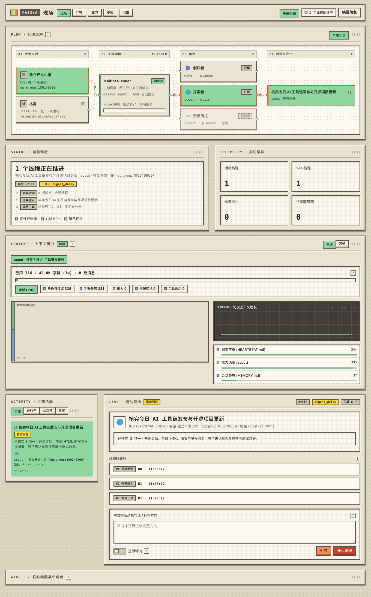
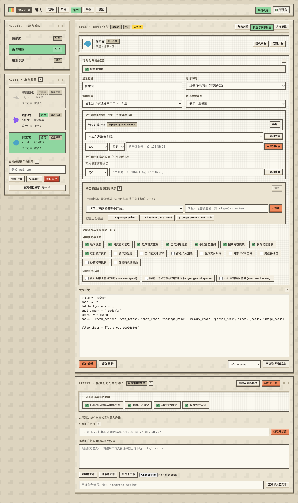
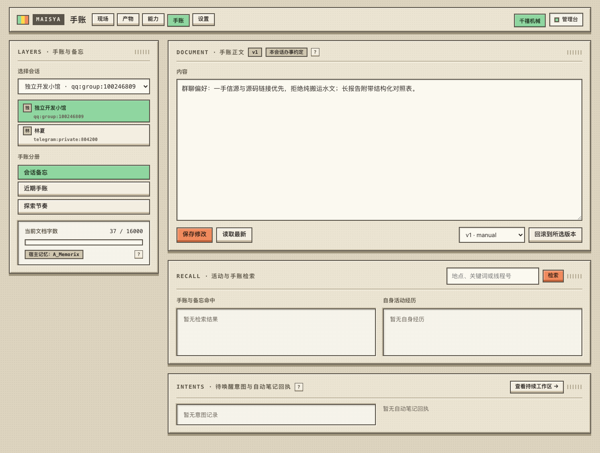
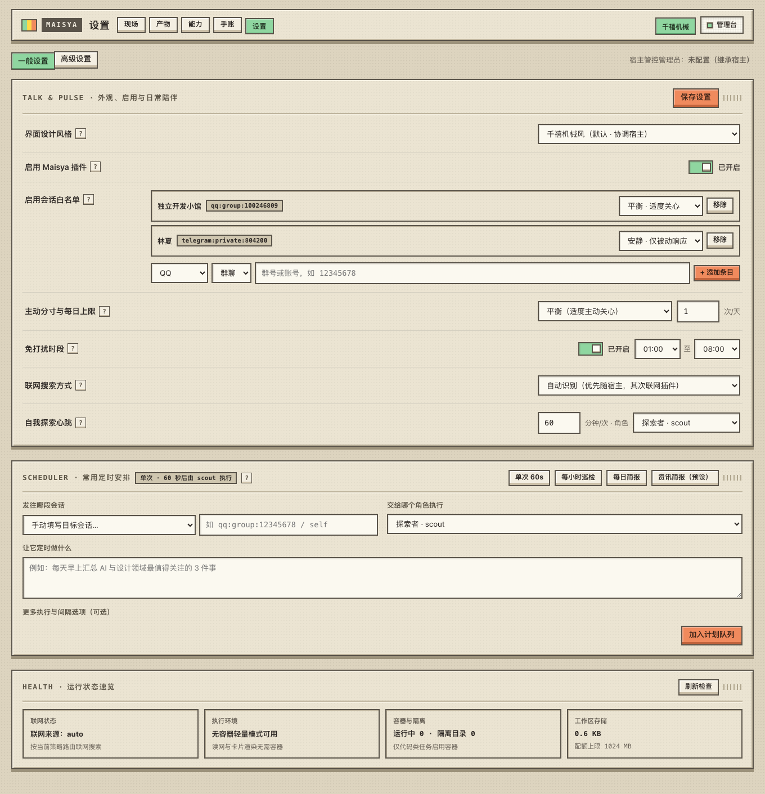
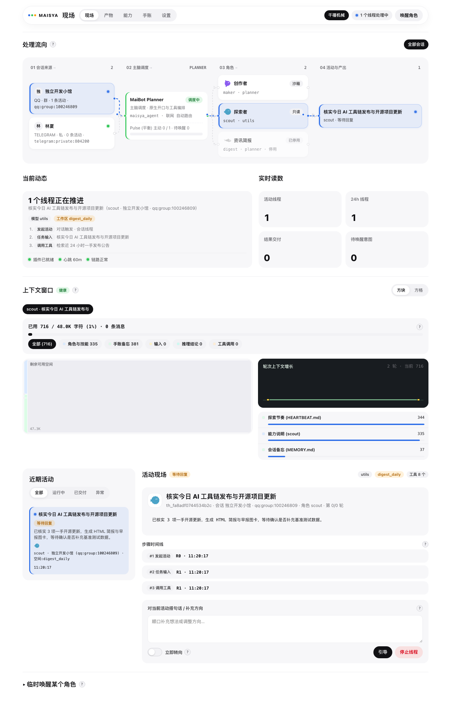

<div align="center">


# Maisya

**给 MaiBot 接上可调度的 Agent 手脚与透明工作台**：主脑仍是 MaiBot · 查证做图跑工作区 · 盯每日资讯 · 攒技能传配方 · 私聊一句话管全局

[](https://github.com/CharTyr/Maisya)
[](https://github.com/Mai-with-u/MaiBot)
[](https://github.com/Mai-with-u/MaiBot)
[](LICENSE)
[](https://github.com/CharTyr/Maisya/stargazers)
[](https://github.com/CharTyr/Maisya/issues)

[它能干什么](#核心特性) • [界面一览](#界面一览) • [运行环境](#运行环境) • [三步用起来](#快速开始) • [一句话管理](#一句话管理) • [安全与隐私](#安全与隐私) • [常见问题](#常见问题) • [详细指南](#详细文档)

</div>

> Maisya 是 MaiBot 插件（ID `chartyr.maisya`）。它**不另起炉灶、不抢话筒、不破坏 MaiBot 的原有人设**：**MaiBot 自己的 Planner 就是唯一主脑与唯一发言人**。平时聊天还是 MaiBot 正常聊；遇到查证、做图、写网页、盯每日资讯、维护长期项目时，MaiBot 自己决定调用哪个角色，做完后再用自己的语气和本群表达习惯接回对话。

<div align="center">

</div>
<div align="center">

</div>

---

## 核心特性

| 能干什么 | 具体怎么做 |
|------|------|
| **主脑合一，不抢话筒** | 保留 MaiBot 原有日常聊天、接梗、情绪交流与 `A_Memorix` 长期记忆；需要干重活时再由 MaiBot 自己决定开启或续接 Agent 线程，做完后用自己的语气说出来 |
| **开箱三角色，多模型自动替补** | 内置只读查证 **`scout`**、工作区创作 **`maker`**、以及默认停用的每日资讯简报 **`digest`**（自带 RSS 试订/打分与图文简报卡）；每个角色可按顺次配置主选与多个备用模型，首位报错自动切换 |
| **持续线程与工作区，随时打断转向** | 每件事都跑在一条可持续的线程里，支持挂着命名工作区长期积累；中途加要求、补充材料、提问追问、立即转向（`steer`）或接力上次产物继续改，不用从头再来 |
| **Skill 技能画廊，拖入压缩包即用** | 内置双列 `SKILL.md` 画廊与工作台，自带核验、持续工作区与资讯方法技能；支持 `.zip` / `.skill` / `.tar.gz` 拖放导入，伴随的 `references/`、`scripts/`、`assets/` 自动挂载到工作区 |
| **每日资讯简报与多源联网** | 启用 `digest` 后，支持按钟点定时巡检群口味、自动试订与淘汰 RSS、结合联网搜索硬筛水文与旧闻并渲染出图；联网路由默认自动复用宿主统一联网或第三方搜索插件 |
| **管理员私聊一句话管全局** | 管理员即使在与 MaiBot 的**未加白名单私聊**里，也能直接用一句话开关群白名单、配置角色/技能/RSS 源、先在私聊试跑预览再推到目标群、检索全流手账或设个人提醒 |
| **能力配方（Recipe）安全分享** | 把做顺手的角色连同技能、工作区模板、角色小鱼形象与例行定时打包成配方，自动剔除群号和账号清单、拦死私钥与密码；对方粘贴链接或上传压缩包即可预览缺件、平滑升级 |
| **统一资料空间（`产物`）** | 把所有群附件、工作区 `out/` 成品、结论与出处收拢到同一资料空间；按页面卡片/图片海报/文档代码分类，支持列表/网格视图、安全阅读预览与源码复制 |
| **克制主动，守住分寸** | 后台定时与唤醒全部先落意图队列，过免打扰时段、「未回不连戳」会话锁、按群主动度（`quiet`/`care`/`lively`）、熟人边界与每日主动额度闸门，不无端刷屏 |
| **内嵌双主题五页工作台** | 不用另开端口也不另设密码，直接嵌入 MaiBot WebUI 顶部工作区（**现场 / 产物 / 能力 / 手账 / 设置**）；默认协调宿主千禧机械风，顶栏一键切清朗手账风，设置区分「一般 / 高级」 |

每项功能的细节见[功能详解](docs/guide/features.md)。

---

## 界面一览

<table>
<tr>
<td width="50%"><br /><sub><b>产物 · 资料空间</b>：左侧按文件形态归类与快速回跳，右侧列表/网格检索，下方直接阅读预览与翻看持续工作区</sub></td>
<td width="50%"><br /><sub><b>能力 · 角色与技能</b>：围绕 `SKILL.md` 的画廊与工作台、角色专属程序化小鱼头像、`平台:类型:id` 作用域、多模型顺次 Fallback 与配方导入</sub></td>
</tr>
<tr>
<td width="50%"><br /><sub><b>手账 · 分层记忆</b>：每个群独立一份会话备忘（`MEMORY.md`）与版本回滚，搭配近 7 天手账、探索脾性、统一检索与待唤醒意图</sub></td>
<td width="50%"><br /><sub><b>设置 · 一般与高级</b>：三段式 `平台:类型:id` 条目白名单、每群独立主动分寸、整点免打扰、常用定时一键预设与运行健康检查</sub></td>
</tr>
</table>

### 现场与双主题切换

**现场（Now）** 从左到右把完整运行链路摊开给你看：`01 会话来源 → 02 主脑调度（MaiBot Planner + Pulse 节律） → 03 角色 → 04 活动与产出`，紧接着展示实时读数、五段上下文占有率与示波器增长趋势、活动步骤流与「立即转向」引导。

顶栏随时可以在**千禧机械风（默认，协调 MaiBot 宿主）**与**清朗手账风**之间切换：

<div align="center">

<br /><sub>以上截图来自虚拟演示环境数据，群名、账号、对话和工作区内容均为演示生成。</sub>
</div>

---

## 运行环境

- **MaiBot 与插件 SDK**：实测兼容 **MaiBot `1.3.20`** / **`maibot_sdk 2.21.0`**（支持宿主 `1.0.0–1.4.99`、SDK `2.8.1–2.21.0`）；清单声明的轻量依赖（`cryptography`、`jsonschema`）由 MaiBot 插件依赖管理处理。
- **大模型（开箱复用，无需重复配 Key）**：直接使用你已经在 MaiBot 后台配好的模型与任务槽位；想省钱或防超时时，可以在「能力 → 角色管理」里给单个角色选一条自己的主选 + 备用模型链。
- **联网搜索**：`web_provider` 默认选 `auto`（优先走宿主统一联网，没配时自动兼容已装的第三方搜索插件，或在「高级设置 → 外部服务」里绑定你的只读搜索 MCP / 跨插件接口）。
- **代码与命令行工作区（免装容器也能先用）**：
  - 未开启 Docker 沙箱时，`maker` 等无私有凭据的工作区角色会自动启用**无容器轻量工作区模式**（写网页、整理项目文档、HTML 渲染海报图卡、组织输出文件照常运行，仅关闭任意命令执行）。
  - 需要安全运行群友代码、安装第三方依赖时，可开启可选的 **Docker + gVisor（`runsc`）** 隔离沙箱（详见[运行环境、沙箱与外部接入](docs/guide/sandbox-and-services.md)）。

---

## 快速开始

最快用起来只需三步：**装插件 → 开总开关 → 在后台或私聊配白名单**。

### 第一步：安装插件

二选一：

- **MaiBot 后台安装**：在 MaiBot WebUI 插件管理页填入本仓库地址 `https://github.com/CharTyr/Maisya.git` 安装。
- **手动克隆**：进入 MaiBot 的 `plugins/` 目录执行：
  ```bash
  git clone https://github.com/CharTyr/Maisya.git CharTyr_Maisya
  ```

### 第二步：开启插件总开关

把插件目录下的 [`config.example.toml`](config.example.toml) 复制成 `config.toml`（或在 MaiBot 后台插件配置里打开开关）：

```toml
[plugin]
enabled = true
config_version = "0.1.0"

enabled_chats = []   # 可留空先打开管理台；或直接写 ["qq:group:12345678"]
```

保存后 MaiBot 会热加载插件。**为了不乱打扰真群，默认 `enabled_chats = []`、`[sandbox] enabled = false`、`digest` 角色默认停用——装好后未加入白名单的群连消息都不会读。**

### 第三步：打开内嵌管理台，或者直接在私聊里交代 MaiBot

无需记忆新端口或额外密码：登录 MaiBot 控制台后，顶部工作区导航会出现 **Maisya（现场）** 与 **产物 / 能力 / 手账 / 设置**。

- **在网页上点两下**：打开 **`设置 → 一般设置 → 启用会话白名单`**，用下拉选择器按 `平台 + 群聊/私聊 + 群号或账号` 添加条目（如 `qq:group:12345678`），点右上角 **保存设置** 即生效。
- **或者直接私聊 MaiBot**：用管理员账号私聊 MaiBot，发一段大白话让它一次配好（哪怕私聊本身还没加白名单也能直接用）。

### 第四步：回群里或私聊试试

- 普通聊天：直接在启用群里像平时一样跟 MaiBot 聊天，语气温和接梗完全照旧。
- 派活查证/出图：直接在群里说 `@MaiBot 帮我把最近 GitHub 上这三个热门开源项目的核心差异查清楚，做一张对比简报页发来看看`。
- 调出每日资讯：去 **`能力 → 角色管理`** 打开 **`资讯简报 (digest)`**，再到 **`设置 → 常用定时安排`** 点一下右上角的 **`资讯简报（预设）`** 填入目标会话即可。

---

## 一句话管理

只要你是 MaiBot 配置里的管理员，即使正在与 MaiBot **私聊**（且这段私聊不在 `enabled_chats` 白名单里），也可以直接把整段管理要求交给它，不用专门跑到目标群里发指令：

- **帮还没聊过的新群提前配好全套**：
  > 「先把 `qq:group:100246809` 记进会话手账：这个群关注开源 AI 工具与独立游戏，拒绝标题党水文；再帮它加上这两条 RSS 源，打开 `digest` 角色、开启这个群的白名单，设成每天 `08:30` 和 `19:30` 巡检简报。」
- **先在私聊试跑预览，确认满意再发群里**：
  > 「帮我用 `digest` 在 `qq:group:100246809` 的工作区先试整理一期今日资讯，结果**先发到我私聊预览**，别直接发群里；等我看过再推过去。」
- **跨全部会话找资料、停卡住的任务**：
  > 「查一下所有群里最近做过的对比网页或跑偏的任务线程，把卡住那个直接停掉。」
- **顺便给自己设个人提醒**：
  > 「明天早上 09:00 在私聊提醒我看一眼昨天各群简报效果。」

### 原生保险箱指令

若要录入第三方 API 密钥、签名密钥等敏感凭据，可在管理台 **`设置 → 高级设置 → 凭据保险箱`** 录入，或在**管理员私聊**使用显式原生命令（入库前先脱敏替换，不在聊天库和日志里留下明文）：

| 管理员私聊发送 | 作用 | 谁能用 |
|:-----|:-----|:-----|
| `/vault set <句柄名> <密钥明文>` | 加密存入或更新一条凭据 | 仅宿主核验通过的管理员 |
| `/vault delete <句柄名>` | 删除对应凭据 | 仅宿主核验通过的管理员 |

---

## 安全与隐私

- **非服务群零接触**：不在 `enabled_chats` 白名单里的普通群和私聊，**零消息落盘、零模型调用、零主动发送**（仅管理员在私聊触发管理操作时启用带 300 秒过期的有界内存引导）。
- **防攒批串号验证**：MaiBot 把多条消息攒批送入 `planner` 时，上下文里的发言人可能不是原指令发出者；所有管理操作、受限角色和跨群操作都必须通过 `source_msg_id` 反查收消息钩子记录的**真实发言人**（并剔除其他插件代投消息与全员艾特）。
- **密钥只进不出**：保险箱凭据使用 `Fernet` 加密并设 `0600` 权限存放在插件目录外的 `<宿主根>/data/maisya/vault/`；线程输出、配方导出与日志统一自动脱敏，仅 `admins` 角色在核验管理员后才单次挂载 `/run/secrets/<句柄>`。
- **跨会话隐私边界**：各群 `MEMORY.md` 互相隔离；跨群分享产物时禁止携带原会话消息引用；自身探索活动禁止引入任何单群聊天记录、人名或主机路径；配方包导出自动剥离本机白名单与账号。
- **玻璃盒严守宿主 CSP**：五个管理页面完全内联零外链、零 ``、零 `<iframe>`、零 `localStorage`，静态接口复用宿主 `maibot_session` 登录鉴权与并发保护。

---

## 常见问题

**Q：会跟我原来的 MaiBot 人设、闲聊插件或 `A_Memorix` 冲突吗？**

A：不会。Maisya 只剔除宿主内置的 `subagent` / `subagent_status` / `subagent_stop`，100% 保留宿主原生记忆查询、人设表达与其他第三方插件工具。聊天人情与群友印象仍归 `A_Memorix`，Maisya 手账只记办事约定与 Agent 工作区成果。

**Q：必须开启 Docker / gVisor 沙箱才能用吗？**

A：不是必需的。默认 `sandbox.enabled = false` 时，只要你不要求在容器内执行任意 shell 命令，`scout`、`digest` 和无容器轻量工作区下的 `maker` 都能查网页、写报告/网页文件、渲染图片卡并直接交付；只有需要安全跑陌生代码或绑定私有出站白名单时，再按指南配好 `Docker + runsc`。

**Q：为什么配置里的群号要用 `qq:group:12345678` 这种写法？以前只写了纯数字怎么办？**

A：统一用 `平台:类型:id`（如 `qq:group:12345678`、`qq:private:10001`、`telegram:group:-100123`）可以避免 QQ 群、QQ 私聊和 Telegram 之间撞号。如果你以前在配置或角色里写过纯群号或旧版 32 位哈希 `session_id`，后台双向别名解析会自动兼容，不必重配。

**Q：我在私聊里配了还没聊过的新群，不会漏掉这个群的第一条消息吗？**

A：不会。管理员在私聊里给冷群写好记忆、订阅好资讯源再开白名单（或者反过来先开白名单），等群里第一条消息进来时，插件入口直接按 `platform + group_id/user_id` 命中白名单，并把预置的工作区与手账平滑合并到该群会话上。

**Q：更新插件代码会把我配好的角色、手账、保险箱和工作区清掉吗？**

A：不会。所有运行期数据全部保存在插件目录之外的 `<宿主根>/data/maisya/`，而且 `config.toml`、`settings.json` 与 `settings.base.json` 采用三路智能合并：你单独手改的 `config.toml` 和网页里保存过的配置都会妥善保留。

**Q：为什么 `digest`（每日资讯）装好以后默认没自动发群消息？**

A：为了避免刚上线就打扰大家，`digest` 默认设为停用（`enabled = false`）。想开启时直接在管理台启用它并加上每日定时，或在私聊里对 MaiBot 说一句要给哪个群、几点发即可。

**Q：模型总在某个主选模型超时报错时卡住怎么办？**

A：去 **`能力 → 角色管理 → 模型与权限配置`**，按顺序给该角色多选几个宿主模型（例如 `#1 模型A → #2 模型B`）；运行中只要前一个模型限流或报错，线程会保留当前进度和工作区，当场切换到下一个模型继续跑。

**Q：管理台在哪打开？需要改端口或反代吗？**

A：完全不需要。Maisya 通过宿主原生的 `webui.json` v2 直接嵌进 MaiBot WebUI 顶栏，和 MaiBot 共用同一登录态与地址，也不存在额外开放端口的问题。

---

## 详细文档

### 用户与配置指南

| 指南 | 讲什么 |
|:-----|:-----|
| [功能详解](docs/guide/features.md) | 主脑如何调度线程与回接、三角色分工、持续工作区接力、`digest` 每日资讯筛选、私聊跨流管理、配方分享与五页工作台 |
| [配置说明](docs/guide/configuration.md) | `平台:类型:id` 规范、一般设置与高级设置、多模型顺序 Fallback、联网路由、`MEMORY.md` 与 `A_Memorix` 边界、三路合并及配置表速查 |
| [运行环境、沙箱与外部接入](docs/guide/sandbox-and-services.md) | 无容器轻量模式 vs `Docker + gVisor (runsc)` 沙箱、构建镜像、`/vault` 保险箱、MCP / 跨插件 `@API` / 文件读取器 / 签名外部事件 |

### 开发与架构参考

| 文档 | 定位 |
|:-----|:-----|
| [开发入门](docs/00-开发入门.md) | 本地与宿主隔离契约验证命令、核心不变量（防跑偏清单）、安全部署到线上的标准流程 |
| [架构蓝图](docs/01-架构蓝图.md) | 四个核心概念、工具与钩子边界、线程生命周期、Bridge/Share 与 Pulse 社交闸完整设计 |
| [宿主接口事实](docs/06-宿主接口事实.md) | 基于 `MaiBot 1.3.20` / `maibot_sdk 2.21.0` 源码核实与契约实测基线 |
| [代码地图](codemap.md) 与 [开发规则](AGENTS.md) | 模块职责边界、目录映射与开发/线上红线 |

---

## 支持与致谢

如果 Maisya 对你和你的群有帮助，欢迎点亮一颗 Star；遇到问题或有新点子，欢迎提交 [Issue](https://github.com/CharTyr/Maisya/issues) 或 [Pull Request](https://github.com/CharTyr/Maisya/pulls)。

- [MaiBot](https://github.com/Mai-with-u/MaiBot) 开源聊天机器人框架
- [gVisor](https://gvisor.dev) 用户态隔离沙箱运行时

## 许可证与作者

本项目采用 **GPL-3.0-or-later** 开源协议，详见 [LICENSE](LICENSE)。

[@CharTyr](https://github.com/CharTyr)
