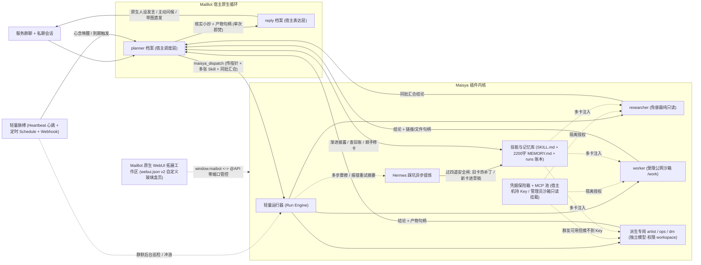

# Maisya 全景骨架与核心处理蓝图（瘦身定稿版）

> **一句话定位**：不改 MaiBot 一行宿主源码，以极致纯粹的插件形态赋予 MaiBot **「有专岗干活、有心跳惦记人、懂实战复盘、全链路透明可见」**的完整 Agent 生命力——不造第二张嘴、不抢聊天节奏、不堆砌工单赘肉。

> [!IMPORTANT]
> **五条设计铁律（剃刀原则）**
> 1. **零工单、零旁路抢麦**：不做审批流、不做工单状态机、不在收消息钩子里另造旁路攒批器；所有发言一律走目标会话原生的 `planner -> reply`。
> 2. **万物皆档案（Profile）**：`planner` 只做调度与收口，`reply` 只按人设开口；开箱只给 `researcher`（免容器只读）和 `worker`（沙箱读写）两个底座，支持克隆派生专用档案（如画图 `artist`、运维 `ops`、带团 `dm`）。
> 3. **有脉搏但极度克制**：保留独立的轻量**心跳（Heartbeat）**赋予活人主动性（想念熟人、借物思人、事后回访），但无事发生即 `HEARTBEAT_OK` 静默跳过，并用代码焊死「睡眠免打扰 + 对方未回绝不连戳 + 熟人边界」。
> 4. **硬底座 + 软技能，不重复造轮子**：密钥隔离统一归口到 **Secret Vault + MCP / 沙箱挂载**（不另造网关）；交付策略、画图写词、心跳习惯全部写成可进化的 Markdown 文件（`SKILL.md` / `HEARTBEAT.md`）。
> 5. **指针化省流 + 零端口玻璃盒**：全程传消息 ID、运行编号与产物短句柄，媒体二进制旁路直通；管理台直接嵌进 MaiBot 原生 WebUI 拓展工作区（`webui.json` v2），默认零额外监听端口。

---

## 一、全景骨架图（5 大精悍内核模块）

---

## 二、角色档案体系（预设双底座 + 可派生专岗）

`Maisya` 对**「白名单服务群 + 管理员及熟人私聊」**生效（`chat_scope="all"`，陌生人私聊静默）：

| 角色档案 | 归属 | 核心职责 | 能力与安全边界 | 谁能触发 |
|---|---|---|---|---|
| **`planner`** | 宿主原生改造 | 理解语境、查历史任务与经历、挑多张调度 Skill、派专岗或调其他插件工具、设惦记/行程、拍板交付 | **常驻仅 3 个工具 + 2 个延迟工具**；仅剔除宿主内置黑箱 `subagent*`，**100% 保留宿主原生工具与其他第三方插件 `@Tool`**；零慢执行、零 MCP | 启用会话自然触发 / 心跳原生唤醒 |
| **`reply`** | 宿主原生保留 | 用 MaiBot 的人设、黑话和表情习惯把结果或问候说出来 | 只读观测；有专岗产出时单次垫入核实小抄（发完即清），日常闲聊零干预 | 由 `planner` 调用 |
| **`researcher`** | 预设只读底座 | 免容器极速查证、翻公开会话、查宿主记忆/人物印象、识图读文档 | **100% 纯只读**（免容器秒开）：搜索/抓网页、会话检索、记忆查询、只读 MCP 与受权宿主插件 `@API`；零写权限、零命令 | 服务群全员可用 |
| **`worker`** | 预设读写底座 | 查算一体（搜资料+写脚本算数据/画图/解析群文件/生成网页/远程运维/多站旅行推进） | **100% 容器沙箱隔离 + 内置只读联网搜索**（免跨房二传手）：读写执行仅限 `/work`，受限公网（封死宿主机本机与内网），内置 `here.now` 预览与文件收尾 | 可切换：「全员可用」或「仅管理员」 |
| **派生专岗** （如 `artist` / `ops` / `dm`） | 对话自塑形或管理台克隆 | 承接定制工作流（如小模型写词调生图 MCP、带私钥配服务器、持模组真相带团、虚拟旅行漫游） | 存于插件目录外的 `<宿主根>/data/maisya/profiles/<id>/`（更新零丢失、支持**管理员在聊天中让 `planner` 直接生成/调整**或管理台编辑）；独立绑模型、MCP、宿主 `@API`、`/work/preset/` 资产与频控；支持**无明文密钥 `.zip` 配方包**一键导出/导入 | 每档案独立配置 |

---

## 三、六条核心处理链路

### 处理 1：20 秒黄金快窗、全能入参、热转向/续聊与零重影交付

1. **闲聊常识默认直回 + 跨插件工具原样保留**：注入给 `planner` 的静态说明块保持字节级恒定，约定**日常水群、接梗与已知常识 100% 直接调 `reply` 秒回**；同时完整保留宿主 `query_memory` 及其他 MaiBot 插件提供的 `@Tool`（如发空间说说 `send_feed`、TTS 语音等），`planner` 可把 `Maisya` 专岗结果直接喂给其他插件工具组合出招。
2. **「20 秒黄金快窗同轮直出 + 超时/并发自动转后台」双模态 + 全能入参装载（`ref_msg_ids`）+ 半途热转向（`cancel_run_id`）**：
   - **默认 20 秒同轮直出**（对齐宿主 `@Tool` 默认 `60s` RPC 超时〔源码已核〕）：单任务默认在 `maisya_dispatch` 内等待 `20 秒`（可配 `15～30s`）。**80%+ 的日常查询、识图、画图、算表或单站旅行交互都在 20 秒内直接完成**，当轮直接把核实结论与产物句柄交还给当前 `planner` 紧接着调 `reply` 一次性发出——**零二次唤醒、零“稍等我去查”的机械客套话、省一半 `planner` Token**；
   - **超时或并发无缝转后台**：若满 20 秒仍未跑完（如配服务器、长代码调试），或同轮需并发派多个任务而显式传入 `background=true`，任务不中断、无缝转入后台并返回 `RUNNING_IN_BACKGROUND` 交给汇合闸；
   - 底座在本地把引用的**原图、递归展开的合并转发对话 `.md`、以及通过适配器下载的群文件（Excel / PDF / 压缩包）**直接装进专岗 `/work/in/`；
   - 若群友半途改主意或喊停，`maisya_dispatch` 传入可选 `cancel_run_id` 即可**原子级掐死在途旧任务并换新要求重开**。
3. **同轮并发「汇合闸」（Batch Barrier）、两步接力（`then_profile`）、15 分钟原房续聊（`resume_run_id`）与严限硬阻断的 `NEEDS_INPUT`**：
   - 后台并发的多个 `maisya_dispatch` 由 Python 确定性状态机守卫，等全部收尾（含单路超时/异常兜底防死锁）后**合并为唯一一次唤醒**交回 `planner`；
   - `worker` 已内置联网搜索实现查算一体；跨权限/跨模型场景仍支持 `then_profile` 轻量接力，中间**不唤醒 `planner` 当二传手**；
   - **反审讯病红线**：检索、画图与开放创作缺细节一律自己拿主意做完，严禁反问填表；`NEEDS_INPUT` 仅限「高危不可逆分岔」或「核心输入文件彻底缺失」，且单任务最多反问 **1 次**；
   - 专岗刚收尾或返回 `NEEDS_INPUT` 挂起后的 **15 分钟热窗口内**，传入 `resume_run_id` 直接唤醒**原专岗温热会话 + 原 `/work`** 接着改或回答反问（100% 命中前序缓存免重读；超 15 分钟再退回 `from_runs` 冷挂文件）；
   - **429 / 崩服带记忆热换模续跑（Hot Model Switch）**：专岗跑到中途遭遇限流、额度耗尽或网关报错时，保留已完成的工具步骤上下文与 `/work` 半成品，原地切至 `fallback_models` 从断点接着跑完。
4. **专岗收尾准备 + 零双发重影交付（纯文字收尾永远是一等公民）**：
   - **绝不强制要求产出文件**：算个数、查句话、跑团过检定或改配置等纯文字结论 100% 直接秒收尾；仅当专岗**主动挂载了附件路径**时做一次「文件确实存在且非 0 字节」防拼错路径检查（最多提示 1 次，绝不卡死简单任务）；
   - 需要发大产物时，专岗可直接返回文件句柄（图/音视频/普通文档直传）或调 `publish_preview` 推上 `here.now` 拿到 24 小时一次性预览 `siteUrl`；
   - 回流文本强制做防注入标签转义与隔离包裹，出站层硬性剥离非管理员触发的 `@全体成员`；
   - **严防双发重影**：纯文字或 `here.now` 链接交付完全不调 `send.hybrid`（仅由原生 `reply` 发唯一一条）；带图片/媒体句柄时优先经 `send_service.before_send` 合并进当次原生消息同条发出，无法合并的平台只补发纯媒体/文件，绝不重复发文字。

---

### 处理 2：三源头会话原生心跳（Heartbeat + `JOURNAL.md`）、多站行程推进与 Webhook

用**唯一一条干净的后台脉搏循环**同时托起「活人感主动性」「多站虚拟旅行等长线体验」与「自动化盯事」：

| 脉搏来源 | 干什么用 | 怎么做到既像活人又绝不烧钱扰民 |
|---|---|---|
| **1. 三源头会话原生心跳（`HEARTBEAT.md` + `JOURNAL.md`）** | • **对话余韵（Afterglow）**：聊完未完大事或忙完大活后的自然回访 • **冲浪偶遇（Serendipity）**：先让只读分身刷到真正对味的新鲜事/好图，再借物思人去分享（绝不空手尬聊） • **久违想念 / 状态流露**：熟人或活跃群冷场多日后的自然冒泡（或自发开启一场虚拟旅行） | • **会话分 3 档主动度（`quiet` / `care` / `lively`，支持对话动态改）** • **会话原生觉醒**：后台极轻筛选挑出 1 个到期会话，调 `maisaka.proactive.trigger` 唤醒**该会话自己的 `planner`**，由它结合完整聊天上下文决定直接静默 `stop`、先派专岗搜东西还是调 `reply` 开口 • **`JOURNAL.md`（`<= 1,500` 字近 7 天滚动）**：只记 MaiBot **自身视角的主观近况与心境**（如“今天正在镰仓淋着小雨逛街”，脱敏具体群友隐私），实现克制的跨群/跨消息流连续感 |
| **2. 延时惦记、多站行程推进与定时巡检（`maisya_schedule`）** | • **闲聊事后惦记**：无明确要求时全局每天上限 **1 条**（防逢话必记闹钟） • **长线活动 / 虚拟旅行站点推进（绑持久 `workspace`）**：如 `workspace="trip_kamakura"` 按站点查真实地图/实时天气/店评推进下一站，联动生图或空间说说插件 • **静默盯事**：盯降价、余票或巡检服务器 | 到点先看目标会话是否已聊过此事；绑定 `workspace` 的行程推进允许按站接力（单场活动每天上限如 6 跳，**中间站点可静默只更新 `/work` 游记与 `JOURNAL.md`，不强制每站往群里刷屏**）；盯事类无变化返回 **`[NO_CHANGE]` 直接静默结束** |
| **3. 外部事件入口（`Webhook`，可选按需开）** | 监控告警、GitHub 推送主动打进来，先触发专岗查清根因，再由 MaiBot 用人话汇报 | **插件默认零监听端口**；仅在设置里显式开启 Webhook 时，才按需起一个极薄纯 JSON 验签接收口（`POST /webhooks/<id>`，不托管任何网页） |

> [!TIP]
> **代码级焊死的「社交分寸硬闸」（不靠模型自觉）**
> 主动跨会话找人一律通过宿主原生 `chat.open_session` + `maisaka.proactive.trigger`〔源码已核〕走对方会话自己的 `planner -> reply` 开口，并受三条硬规则约束：
> 1. **按 `session_id` 独立隔离的「未回不连戳」**：**仅约束后台脉搏的无事主动搭话**（绝不拦用户触发的聊天与任务交付回执）；主动搭话后按 `session_id` 锁死，私聊必须对方在**该私聊**回话才解锁（群内水群绝不解私聊锁），群聊有真人接话即解锁该群。
> 2. **熟人边界与隐私隔离**：主动私聊仅限管理员与已建立私聊互动的熟人/白名单，绝不骚扰陌生群友；私聊内容与记忆硬隔离，绝不反向外泄进公开群聊。
> 3. **作息免打扰**：睡眠时段（如 `01:30–08:30`）跳过所有人格心跳与普通推送（仅管理员显式标记紧急的运维告警除外）。

---

### 处理 3：凭据保险箱、MCP 密钥隔离与双道管理员验身

1. **两种零泄密凭据用法（不重造网关、绝不盲吞日常私聊）**
   - **给全群群友玩的带 Key 工作流（如 `artist` 画图 / TTS）→ 走宿主机 MCP**：API Key 经管理台「保险箱」录入并注入宿主机侧运行的生图 MCP 进程；`artist` 专岗绑便宜快模型写好提示词后调 MCP 拿回图片短句柄 `img_09`。**模型与群友全程碰不到明文 Key，图片字节不进模型上下文**。
   - **管理员自己的重度实操（如给服务器和私钥配环境）→ 走沙箱只读挂载**：凭据录入以管理台为主，私聊快捷录入**仅认显式 `/vault` 原生命令拦截消费**（不进数据库与大模型）或明确 `-----BEGIN ... PRIVATE KEY-----` 块脱敏（绝不用宽泛正则误吞普通私聊）；仅**管理员真身触发**时，单次沙箱挂入 `/run/secrets/ssh_hk_dev`（`0400` 只读内存文件，用完即焚），容器输出强制过密钥脱敏闸。
2. **免重配名册 + 双道防串号硬锁**（防宿主攒批 `context.user_id` 串号〔源码已核：[06-宿主接口事实](06-宿主接口事实.md)〕）
   - 自动只读继承宿主 `plugin.permission` 操作员名单与 `local_operator`，开箱认主人；
   - **锁一（请求前门禁）**：本轮新消息无管理员发言时，直接在工具列表中隐藏 `maisya_memory`（写）与仅管理员专岗；
   - **锁二（执行时验真身）**：管理员级操作必填指令原消息 `source_msg_id`，反查可信消息表确认确属管理员本人所发（排除 `relayed_by_plugin` 代投）才放行。

---

### 处理 4：受限公网沙箱与可选持久工作区（`workspace`）

用同一套容器笼子支持「单次快活」与「长线带团/开发」：
1. **单次即焚 vs 持久 `workspace`（同名自动排队防撞车）**：默认新建空白 `/work` 全速并发、跑完即焚；传入 `workspace="<name>"`（如嘈杂群聊跑团 `coc_hotel_01`，玩家通过原生引用回复/`@` 互动）则挂载本会话专属持久盘，并由底层按 `workspace` 名自动加轻量串行排队锁（防两人同时说话写坏存档），把模组真相本、绑定真实账号的角色状态表与真随机掷骰脚本稳锁在专岗房内，跨周续团零失忆。
2. **受限公网与资源笼**：`--read-only`、`--cap-drop=ALL`、无 root `1000:1000`、零宿主环境变量；放行外部公网但硬封死宿主机本机、局域网与云元数据网段（`127/8`、`10/8`、`172.16/12`、`192.168/16`、`169.254.169.254`）；严格校验软链接防越界；无容器运行时自动置灰沙箱专岗，绝不裸跑。

---

### 处理 5：多技能协同、对话自塑形、Hermes 双轨复盘与双层任务/经历记忆

1. **多张 `SKILL.md` 叠加 + 对话自塑形 + 半自动进化（严禁混入单群私货）**
   - 支持 `skills: [...]` 多卡组合，按 `roles` 区分调度卡与专岗卡；**全局 `SKILL.md` 只准写跨群通用的技术做法与工具避坑经验**（凡带特定群称呼、抬头、偏好或服务器代号的规矩一律只准进本会话隔离的 `MEMORY.md`，防跨群串味社死）。
   - **对话式自塑形**：管理员无需每次开后台填表，直接在聊天里交代即可由 `planner` 调用 `maisya_skill` 调整技能卡或创建/更新派生专岗档案。
   - **双轨复盘**：聊天明确指正时 `planner` 直接调 `maisya_skill` 修卡；顺畅一步查询零复盘，仅当专岗 `≥ 5` 步、报错重试成功或同轮返工补派 `≥ 2` 次时，后台用 `< 500` token 动作摘要异步提炼。
   - **四道安全闸治理**：**已有卡小补丁过闸自动生效并留版本一键回滚；新建卡一律进草稿箱（`pending`）等管理员点确认**，从源头杜绝垃圾卡泛滥。
2. **双层任务与经历记忆（与宿主闲聊记忆 `A_Memorix` 互补）**
   - **`MEMORY.md`（每会话 2,200 字硬上限）**：记本会话明确规矩与资产索引（如「`hk-dev` 凭据 `ssh_hk_dev`」「当前跑团工作区 `coc_hotel_01`」），仅管理员可写，冻结在静态前缀最末尾保缓存。
   - **`maisya_runs`（本地 SQLite FTS5 `< 5ms` 线程搜索 = 任务账本 + 自身经历记忆）**：
     - 普通群务默认 `scope="session"`（仅本会话可搜，防跨群泄密），支持 `from_runs` 在上次产物上接着改；
     - **MaiBot 自身经历线程（`scope="self"`，如「虚拟旅行」多站漫游线程、自主冲浪见闻）** 永久保留游记文本索引且**跨会话可检索**——无需另建冗余经历表，任何群问起「你之前去哪旅行过」，调 `maisya_runs` 即可毫秒级召回当时的完整行程足迹、真实天气遗憾与旅途见闻。

---

### 处理 6：全链路省 Token 账本

1. **专岗独立绑便宜快模型**：`planner` 只花几十 token 翻译群聊语境，扩词、抓取、巡检交给高性价比小模型。
2. **媒体二进制旁路直通**：图片/大文件全程传短句柄 `img_09`，零 Base64 进出上下文。
3. **空白房间销毁脏数据 + 全程 ID 指针**：几万字网页和报错阅后即焚，入参与接力靠 `ref_msg_ids` / `from_runs` 本地挂载。
4. **死守静态前缀保 50%～90% 缓存**：`planner` 工具收敛为 **3 常驻**（`maisya_dispatch`、`maisya_runs`、`maisya_skill`）+ **2 延迟**（`maisya_memory`、`maisya_schedule`），剔除宿主 3 个内置 `subagent*`，零 MCP 负担。
5. **心跳与巡检默认静默**：`HEARTBEAT_OK` 与 `[NO_CHANGE]` 原地收工，不白跑主会话与 `Replyer`；交付小抄单次即焚。

---

## 四、玻璃盒管理台：直接嵌入 MaiBot 原生 WebUI 拓展页（零独立端口）

经核实线上宿主源码（[06-宿主接口事实](06-宿主接口事实.md)），直接采用 MaiBot 原生 **`webui.json`（`schema_version: 2`, `mode: "custom"`, `placement: "workspace"`）**，在 MaiBot 官方后台顶部工作区挂出 `Maisya` 专属空间——**零独立 HTTP 端口、零额外登录密码、自动同步宿主亮/暗主题与字体，且修改 `.html` 支持页面级热刷新、绝不触发跨插件重载**：

- **严格对齐宿主沙箱契约〔源码已核〕**：
  1. **自包含单文件 HTML**：宿主 CSP 锁死 `connect-src 'none'` 且禁一切外链，每页做成内联 CSS/JS 的纯净原生单文件（单页 `< 150 KB`，远低于宿主 `2 MiB` 上限）。
  2. **避开「2 并发硬顶」的单路游标轮询**：宿主对每插件 WebUI 请求硬限同时最多 **2 个在途**（超限返 `429`），单次超时 `10s`、返回上限 `512 KiB`；因此「现场」页采用 **单路串行增量轮询**（`window.maibot.query("live_poll", { since_seq })` 每 1.5～2 秒拉一次），永远只占 1 个槽位，把第 2 个槽位留给用户随时点击「中止专岗 / 查看详情 / 确认操作」，危险操作直接复用宿主原生 `confirmation` 弹窗。

| 工作区页面（`workspace`） | 核心内容 |
|---|---|
| **1. 现场（`live.html`）** | • 实时流向圆点动画（消息 / 心跳 → `planner` → 专岗接力 → `reply`） • 运行中/挂起中专岗每步实况流、**后台无痕「递纸条（Live Steer）」实时纠偏**与一键中止 + 最近心跳脉搏与 `JOURNAL.md` 心境随笔 • 任意节点 **上下文方块地图（Context Map）**，按面积看清每块上下文的 token 占比与原文 |
| **2. 档案（`profiles.html`）** | • `planner` / `reply` / `researcher` / `worker` 及自定义派生专岗（`artist`、`ops`、`dm`）卡片管理，支持**无明文密钥 `.zip` 专岗配方包**一键导入导出 • 在线编辑 `HEARTBEAT.md` 心跳守则、各专岗 `AGENTS.md` / `NOTES.md` / `/work/preset/` 预设文件、各会话 2,200 字 `MEMORY.md` 与持久 `workspaces` |
| **3. 技能与工具（`skills.html`）** | • 技能库（按角色筛选）、待确认草稿箱（`pending`）、自动补丁 Diff 与一键回滚 • 内置工具开关、**MCP 服务池配置（支持注入保险箱密钥）**、定时任务（`schedule`）与可选 `Webhook` 列表 |
| **4. 设置（`settings.html`）** | • 服务群白名单、熟人主动触达边界、睡眠免打扰时段与心跳随机间隔 • 继承宿主管理员与增补协管、模型与**凭据保险箱（Secret Vault，只进不出）**、沙箱健康自检灯 |

---

## 五、与 MaiBot 宿主的精确挂载表（零改宿主源码）

| 宿主接点 | `Maisya` 用途 | 安全与性能要点 |
|---|---|---|
| `chat.receive.after_process` + `/vault` | 记录真实发言人映射、按当前 `session_id` 解锁该会话「未回不连戳」；私聊仅对显式 `/vault` 命令拦截存凭据（绝不盲猜吞普通私聊） | `< 5ms` 极短有界处理，普通消息永远返回 `continue`，零旁路抢麦 |
| `maisaka.planner.before_request` | 启用会话剔除内置 `subagent*`、挂载「闲聊常识默认直回」恒定说明块与冻结 `MEMORY.md`；无管理员发言时藏起管理员写工具 | 锁死 Prompt Cache；陌生人私聊与非服务群完全静默 |
| `maisaka.planner.after_response` | Observe 模式记录决策轨迹，驱动管理台「现场」流向图与上下文地图 | 纯旁路只读 |
| `@Tool`（`chat_scope="all"`） | 常驻：`maisya_dispatch`、`maisya_runs`、`maisya_skill`；延迟：`maisya_memory`、`maisya_schedule` | 管理员操作强制按 `source_msg_id` 核验真实发送人 |
| `webui.json`（v2）+ `@API` | 挂载 4 个 `mode="custom"` 顶部工作区页面，通过宿主 `window.maibot` 桥接读写本地快照 | 复用宿主登录 Cookie、零额外端口；遵守 `inflight <= 2` 与 `10s` 超时红线 |
| `chat.open_session` + `maisaka.proactive.trigger` | 专岗批次汇合完成后唤醒收口；心跳念头、到期惦记或 Webhook 唤醒目标群/熟人私聊的 `planner` | 主动搭话严格过「睡眠免打扰 + 按 `session_id` 未回不连戳 + 熟人边界」三道硬锁 |
| `maisaka.replyer.before_request` + `send_service.before_send` | 交付当次单次垫入核实结论（`extra_prompt`）；纯文字不调 `send.hybrid`，带媒体句柄优先合并同条发出或仅补发纯附件 | 绝不重复发文字（零重影）；小抄发完即清，后续闲聊零残留 |
