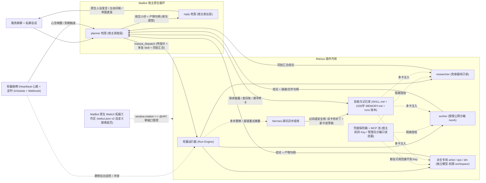

# Maisya 全景骨架与核心处理蓝图（瘦身定稿版）

> **一句话定位**：不改 MaiBot 一行宿主源码，以极致纯粹的插件形态赋予 MaiBot **「有专岗干活、有心跳惦记人、懂实战复盘、全链路透明可见」**的完整 Agent 生命力——不造第二张嘴、不抢聊天节奏、不堆砌工单赘肉。

> [!IMPORTANT]
> **五条设计铁律（剃刀原则）**
> 1. **零工单、零旁路抢麦**：不做审批流、不做工单状态机、不在收消息钩子里另造旁路攒批器；所有发言一律走目标会话原生的 `planner -> reply`。
> 2. **万物皆档案（Profile）**：`planner` 只做调度与收口，`reply` 只按人设开口；开箱只给 `researcher`（免容器只读）和 `worker`（沙箱读写）两个底座，支持克隆派生专用档案（如画图 `artist`、运维 `ops`、带团 `dm`）。
> 3. **有脉搏但极度克制**：保留独立的轻量**心跳（Heartbeat）**赋予活人主动性（想念熟人、借物思人、事后回访），但无事发生即 `HEARTBEAT_OK` 静默跳过，并用代码焊死「睡眠免打扰 + 对方未回绝不连戳 + 熟人边界」。
> 4. **硬底座 + 软技能，不重复造轮子**：密钥隔离统一归口到 **Secret Vault + MCP / 沙箱挂载**（不另造网关）；交付策略、画图写词、心跳习惯全部写成可进化的 Markdown 文件（`SKILL.md` / `HEARTBEAT.md`）。
> 5. **指针化省流 + 零端口玻璃盒**：全程传消息 ID、运行编号与产物短句柄，媒体二进制旁路直通；管理台直接嵌进 MaiBot 原生 WebUI 拓展工作区（`webui.json` v2），默认零额外监听端口。

---

## 一、全景骨架图（5 大精悍内核模块）

---

## 二、角色档案体系（预设双底座 + 可派生专岗）

`Maisya` 对**「白名单服务群 + 管理员及熟人私聊」**生效（`chat_scope="all"`，陌生人私聊静默）：

| 角色档案 | 归属 | 核心职责 | 能力与安全边界 | 谁能触发 |
|---|---|---|---|---|
| **`planner`** | 宿主原生改造 | 理解语境、查历史任务、挑多张调度 Skill、派专岗、设惦记/定时、拍板交付 | **常驻仅 3 个工具 + 2 个延迟工具**；启用会话自动剔除宿主内置黑箱 `subagent*`；零慢工具、零 MCP | 启用会话自然触发 / 心跳唤醒 |
| **`reply`** | 宿主原生保留 | 用 MaiBot 的人设、黑话和表情习惯把结果或问候说出来 | 只读观测；有专岗产出时单次垫入核实小抄（发完即清），日常闲聊零干预 | 由 `planner` 调用 |
| **`researcher`** | 预设只读底座 | 联网查证、翻公开会话、查宿主记忆/人物印象、识图读文档 | **100% 纯只读**（免容器秒开）：搜索/抓网页、会话检索、记忆查询、只读 MCP；零写权限、零命令 | 服务群全员可用 |
| **`worker`** | 预设读写底座 | 写脚本算数据、画图表、解析群文件、生成网页或远程运维 | **100% 容器沙箱隔离**：读写执行仅限 `/work`，受限公网（封死宿主机本机与内网），内置 `here.now` 预览与文件收尾 | 可切换：「全员可用」或「仅管理员」 |
| **派生专岗** （如 `artist` / `ops` / `dm`） | 管理台克隆派生 | 承接定制工作流（如小模型写词调生图 MCP、带私钥配服务器、持模组真相带团） | 存于 `data/profiles/<id>/`（文件改动热生效）；独立绑模型、MCP、只读 `/work/preset/` 资产、开放范围与频控 | 每档案独立配置 |

---

## 三、六条核心处理链路

### 处理 1：消息调度、并发汇合与分级交付

1. **平时闲聊零打扰**：注入给 `planner` 的静态说明块保持字节级恒定，95% 日常水群直接命中缓存走 `reply`，零额外耗时。
2. **全能入参本地装载（`ref_msg_ids`）**：`planner` 调 `maisya_dispatch` 在 `< 100ms` 秒回 `run_id`；底座在本地把引用的**原图、递归展开的合并转发对话 `.md`、以及通过适配器下载的群文件（Excel / PDF / 压缩包）**直接装进专岗 `/work/in/`，模型零手抄搬运。
3. **同轮并发「汇合闸」（Batch Barrier）**：若 `planner` 同轮并行发出多个 `maisya_dispatch`（如三路查资料 + 一路画配图），底座自动等该批次全部收尾后**合并为唯一一次唤醒**交回 `planner`，杜绝碎嘴连发与重复计费。
4. **专岗收尾准备 + 软技能指导交付**：
   - 执行专岗收尾可直接产出文件句柄（图/音视频/普通文档直传）或调 `publish_preview` 推上 `here.now` 拿到 24 小时一次性预览 `siteUrl`（网页、复杂大表、复合报告）；
   - 回流文本强制做防注入标签转义与隔离包裹，出站层硬性剥离非管理员触发的 `@全体成员`；
   - `planner` 参照预设 **`platform-delivery` Skill** 按当前平台（`qq` / `qq_official` / `telegram`）灵活拍板，调用 `reply` 时由底座单次垫入核实结论并旁路挂上图片/文件发出。

---

### 处理 2：轻量人格心跳（Heartbeat）、定时巡检与 Webhook

用**唯一一条干净的后台脉搏循环**同时托起「活人感主动性」与「自动化盯事」：

| 脉搏来源 | 干什么用 | 怎么做到既像活人又绝不烧钱扰民 |
|---|---|---|
| **1. 自主人格心跳（`HEARTBEAT.md`）** | 闲暇时突然想念几天没冒泡的熟人去聊两句；或按自身人设兴趣让 `researcher` 去网上冲浪，撞见对味好东西顺手甩给某人/某群（借物思人） | 按**随机抖动间隔**（如 45～120 分钟随机，消灭整点机器感）在系统空闲时跳动一次，读取短短的 `HEARTBEAT.md` 心跳守则与近期互动摘要；**90% 无自然由头时直接返回 `HEARTBEAT_OK` 原地静默**，不唤醒重会话 |
| **2. 延时惦记与定时巡检（`maisya_schedule`）** | • **事后惦记**：听到朋友说「明天下午考科目二」，`planner` 顺手埋一条明晚的单次提醒去问结果 • **静默盯事**：盯游戏降价、漫展余票或每早巡检服务器 | 到点先看目标会话是否已聊过此事（聊过自动消掉）；盯事类先跑便宜专岗，无变化返回 **`[NO_CHANGE]` 直接静默结束**，只有真出结果才唤醒 `planner -> reply` 通知 |
| **3. 外部事件入口（`Webhook`，可选按需开）** | 监控告警、GitHub 推送主动打进来，先触发专岗查清根因，再由 MaiBot 用人话汇报 | **插件默认零监听端口**；仅在设置里显式开启 Webhook 时，才按需起一个极薄纯 JSON 验签接收口（`POST /webhooks/<id>`，不托管任何网页） |

> [!TIP]
> **代码级焊死的「社交分寸硬闸」（不靠模型自觉）**
> 主动跨会话找人一律通过宿主原生 `chat.open_session` + `maisaka.proactive.trigger`〔源码已核〕走对方会话自己的 `planner -> reply` 开口，并受三条硬规则约束：
> 1. **未回不连戳**：主动发过一次消息后，**对方回复之前硬性锁死不再主动发第二次**，彻底杜绝变成烦人精。
> 2. **熟人边界与隐私隔离**：主动私聊仅限管理员与已建立私聊互动的熟人/白名单，绝不骚扰陌生群友；私聊内容与记忆硬隔离，绝不反向外泄进公开群聊。
> 3. **作息免打扰**：睡眠时段（如 `01:30–08:30`）跳过所有人格心跳与普通推送（仅管理员显式标记紧急的运维告警除外）。

---

### 处理 3：凭据保险箱、MCP 密钥隔离与双道管理员验身

1. **两种零泄密凭据用法（不重造网关，统一归口 Vault + MCP / 沙箱）**
   - **给全群群友玩的带 Key 工作流（如 `artist` 画图 / TTS）→ 走宿主机 MCP**：API Key 存入凭据保险箱并注入宿主机侧运行的生图 MCP 进程；`artist` 专岗绑便宜快模型写好提示词后调 MCP 拿回图片短句柄 `img_09`。**模型与群友全程碰不到明文 Key，图片字节不进模型上下文**。
   - **管理员自己的重度实操（如给服务器和私钥配环境）→ 走沙箱只读挂载**：私聊发私钥时入站层截留存入保险箱换成句柄 `ssh_hk_dev`（原文不过第三方模型 API）；仅**管理员真身触发**时，单次沙箱挂入 `/run/secrets/ssh_hk_dev`（`0400` 只读内存文件，用完即焚），容器输出强制过密钥脱敏闸。
2. **免重配名册 + 双道防串号硬锁**（防宿主攒批 `context.user_id` 串号〔源码已核：[06-宿主接口事实](06-宿主接口事实.md)〕）
   - 自动只读继承宿主 `plugin.permission` 操作员名单与 `local_operator`，开箱认主人；
   - **锁一（请求前门禁）**：本轮新消息无管理员发言时，直接在工具列表中隐藏 `maisya_memory`（写）与仅管理员专岗；
   - **锁二（执行时验真身）**：管理员级操作必填指令原消息 `source_msg_id`，反查可信消息表确认确属管理员本人所发（排除 `relayed_by_plugin` 代投）才放行。

---

### 处理 4：受限公网沙箱与可选持久工作区（`workspace`）

用同一套容器笼子支持「单次快活」与「长线带团/开发」：
1. **单次即焚 vs 持久 `workspace`**：默认新建空白 `/work` 跑完即焚；传入 `workspace="<name>"`（如嘈杂群聊跑团 `coc_hotel_01`，玩家通过原生引用回复/`@` 互动）则挂载本会话专属持久盘，把模组真相本（防剧透省 Token）、绑定真实账号的角色状态表与真随机掷骰脚本稳锁在专岗房内，跨周续团零失忆。
2. **受限公网与资源笼**：`--read-only`、`--cap-drop=ALL`、无 root `1000:1000`、零宿主环境变量；放行外部公网但硬封死宿主机本机、局域网与云元数据网段（`127/8`、`10/8`、`172.16/12`、`192.168/16`、`169.254.169.254`）；严格校验软链接防越界；无容器运行时自动置灰沙箱专岗，绝不裸跑。

---

### 处理 5：多技能协同、Hermes 双轨复盘与双层任务记忆

1. **多张 `SKILL.md` 叠加 + 半自动进化（无自动馆长赘肉）**
   - 支持 `skills: [...]` 多卡组合，按 `roles` 区分调度卡与专岗卡，脱敏后默认跨群共享。
   - **双轨复盘**：聊天明确指正时 `planner` 直接调 `maisya_skill` 修卡；顺畅一步查询零复盘，仅当专岗 `≥ 5` 步、报错重试成功或同轮返工补派 `≥ 2` 次时，后台用 `< 500` token 动作摘要异步提炼。
   - **四道安全闸治理**：**已有卡小补丁过闸自动生效并留版本一键回滚；新建卡一律进草稿箱（`pending`）等管理员点确认**，从源头杜绝垃圾卡泛滥。
2. **双层任务记忆（与宿主闲聊记忆 `A_Memorix` 互补）**
   - **`MEMORY.md`（每会话 2,200 字硬上限）**：记本会话明确规矩与资产索引（如「`hk-dev` 凭据 `ssh_hk_dev`」「当前跑团工作区 `coc_hotel_01`」），仅管理员可写，冻结在静态前缀最末尾保缓存。
   - **`maisya_runs`（本地 SQLite FTS5 `< 5ms`）**：查本会话历史任务结论、链接与短期产物归档包，支持 `from_runs` 在上次产物上接着改；后台有任务在跑时仅在消息流末尾附一行实时状态。

---

### 处理 6：全链路省 Token 账本

1. **专岗独立绑便宜快模型**：`planner` 只花几十 token 翻译群聊语境，扩词、抓取、巡检交给高性价比小模型。
2. **媒体二进制旁路直通**：图片/大文件全程传短句柄 `img_09`，零 Base64 进出上下文。
3. **空白房间销毁脏数据 + 全程 ID 指针**：几万字网页和报错阅后即焚，入参与接力靠 `ref_msg_ids` / `from_runs` 本地挂载。
4. **死守静态前缀保 50%～90% 缓存**：`planner` 工具收敛为 **3 常驻**（`maisya_dispatch`、`maisya_runs`、`maisya_skill`）+ **2 延迟**（`maisya_memory`、`maisya_schedule`），剔除宿主 3 个内置 `subagent*`，零 MCP 负担。
5. **心跳与巡检默认静默**：`HEARTBEAT_OK` 与 `[NO_CHANGE]` 原地收工，不白跑主会话与 `Replyer`；交付小抄单次即焚。

---

## 四、玻璃盒管理台：直接嵌入 MaiBot 原生 WebUI 拓展页（零独立端口）

经核实线上宿主源码（[06-宿主接口事实](06-宿主接口事实.md)），直接采用 MaiBot 原生 **`webui.json`（`schema_version: 2`, `mode: "custom"`, `placement: "workspace"`）**，在 MaiBot 官方后台顶部工作区挂出 `Maisya` 专属空间——**零独立 HTTP 端口、零额外登录密码、自动同步宿主亮/暗主题与字体，且修改 `.html` 支持页面级热刷新、绝不触发跨插件重载**：

- **严格对齐宿主沙箱契约〔源码已核〕**：
  1. **自包含单文件 HTML**：宿主 CSP 锁死 `connect-src 'none'` 且禁一切外链，每页做成内联 CSS/JS 的纯净原生单文件（单页 `< 150 KB`，远低于宿主 `2 MiB` 上限）。
  2. **避开「2 并发硬顶」的单路游标轮询**：宿主对每插件 WebUI 请求硬限同时最多 **2 个在途**（超限返 `429`），单次超时 `10s`、返回上限 `512 KiB`；因此「现场」页采用 **单路串行增量轮询**（`window.maibot.query("live_poll", { since_seq })` 每 1.5～2 秒拉一次），永远只占 1 个槽位，把第 2 个槽位留给用户随时点击「中止专岗 / 查看详情 / 确认操作」，危险操作直接复用宿主原生 `confirmation` 弹窗。

| 工作区页面（`workspace`） | 核心内容 |
|---|---|
| **1. 现场（`live.html`）** | • 实时流向圆点动画（消息 / 心跳 → `planner` → 专岗 → `reply`） • 运行中专岗每步工具实况流与一键中止 + 最近心跳脉搏记录（静默或触达原因） • 任意节点 **上下文方块地图（Context Map）**，按面积看清每块上下文的 token 占比与原文 |
| **2. 档案（`profiles.html`）** | • `planner` / `reply` / `researcher` / `worker` 及自定义派生专岗（`artist`、`ops`、`dm`）卡片管理 • 在线编辑 `HEARTBEAT.md` 心跳守则、各专岗 `AGENTS.md` / `NOTES.md` / `/work/preset/` 预设文件、各会话 2,200 字 `MEMORY.md` 与持久 `workspaces` |
| **3. 技能与工具（`skills.html`）** | • 技能库（按角色筛选）、待确认草稿箱（`pending`）、自动补丁 Diff 与一键回滚 • 内置工具开关、**MCP 服务池配置（支持注入保险箱密钥）**、定时任务（`schedule`）与可选 `Webhook` 列表 |
| **4. 设置（`settings.html`）** | • 服务群白名单、熟人主动触达边界、睡眠免打扰时段与心跳随机间隔 • 继承宿主管理员与增补协管、模型与**凭据保险箱（Secret Vault，只进不出）**、沙箱健康自检灯 |

---

## 五、与 MaiBot 宿主的精确挂载表（零改宿主源码）

| 宿主接点 | `Maisya` 用途 | 安全与性能要点 |
|---|---|---|
| `chat.receive.after_process` | 记录真实发言人映射、重置该用户「未回不连戳」锁；管理员私聊发密钥时截留入保险箱 | `< 5ms` 极短有界处理，永远返回 `continue`，零旁路抢麦 |
| `maisaka.planner.before_request` | 启用会话剔除内置 `subagent*`、挂载字节恒定说明块与冻结 `MEMORY.md`；无管理员发言时藏起管理员写工具 | 锁死 Prompt Cache；陌生人私聊与非服务群完全静默 |
| `maisaka.planner.after_response` | Observe 模式记录决策轨迹，驱动管理台「现场」流向图与上下文地图 | 纯旁路只读 |
| `@Tool`（`chat_scope="all"`） | 常驻：`maisya_dispatch`、`maisya_runs`、`maisya_skill`；延迟：`maisya_memory`、`maisya_schedule` | 管理员操作强制按 `source_msg_id` 核验真实发送人 |
| `webui.json`（v2）+ `@API` | 挂载 4 个 `mode="custom"` 顶部工作区页面，通过宿主 `window.maibot` 桥接读写本地快照 | 复用宿主登录 Cookie、零额外端口；遵守 `inflight <= 2` 与 `10s` 超时红线 |
| `chat.open_session` + `maisaka.proactive.trigger` | 专岗批次汇合完成后唤醒收口；心跳念头、到期惦记或 Webhook 唤醒目标群/熟人私聊的 `planner` | 严格过「睡眠免打扰 + 未回不连戳 + 熟人边界」三道硬锁 |
| `maisaka.replyer.before_request` + `send.hybrid` | 交付当次单次垫入核实结论（`extra_prompt`），图片/文件句柄旁路直通挂段发出（`guided_reply`） | 发完当次即清，后续闲聊零残留 |
