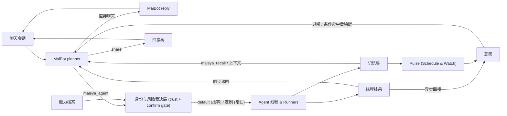

# Maisya 架构蓝图

> **一句话定位**：`Maisya v0.3` 为 MaiBot 提供极简高权、零强制前置配置即可开箱使用的可调度 Agent 能力。MaiBot 继续用自己的 `planner` 理解语境和做决定，用原生表达能力开口；Maisya 负责让它能够开启双轨 Agent 线程、按需演进定制能力档案、安全落盘与执行工作区命令、积累经历、记住方法，并在合适的时候或条件触发时重新想起某件事。

## 一、设计中心

Maisya 用四个核心概念组合出全部能力：

| 概念 | 回答的问题 | 典型例子 |
|---|---|---|
| **能力档案（Profile）** | MaiBot 可以调用哪种 Agent 能力？ | 内建三位精选角色：**`default`**（全能默认助手）、**`scout`**（查证助手）与 **`digest`**（资讯简报），以及按需定制的新角色 |
| **Agent 线程（Thread）** | 这段 Agent 活动如何持续、接收消息、保存现场？ | `default` / `scout` 按事轻量线程、持久工作区（`digest` / 定制档案）、热转向与 `idle` 随时重开 |
| **意图（Intent）** | MaiBot 为什么要在之后重新想起某件事？ | 线程结果回接、事后惦记、冲浪偶遇、久违想念、定点工作流、单一心跳巡检与条件盯梢（Watch） |
| **记忆层（Memory Layers）** | 活动之后留下什么？ | 自身近况 `JOURNAL.md`、会话备忘 `MEMORY.md`、**角色独立长期记忆 `profiles/<id>/MEMORY.md`**、技能与经验笔记 `NOTES.md` |

它们之间只有一条主循环：MaiBot 调用能力开启线程；线程经身份与风险裁决层路由至宿主机或隔离容器执行，并产出结果、经历和方法；结果或念头形成意图（含定点调度与条件盯梢）；意图过闸后在合适时机唤醒 MaiBot。



其余能力都从这条循环组合出来：热转向是给线程发新消息；续聊、热改配置不断档与审批放行都是继续同一个线程；跑团和长期专题是绑定持久主线的工作区线程；管理台引导也是线程消息；事后惦记、偶遇分享与条件盯梢都是意图。

## 二、MaiBot 与 Maisya 的分工

| 层次 | 负责 | 不承担 |
|---|---|---|
| **MaiBot `planner`** | 理解语境、直接聊天、调用宿主工具和其他插件、决定是否调度 Maisya、决定如何回应 | 长时间执行、环境隔离、MCP 细节 |
| **MaiBot 原生表达** | 用 MaiBot 的人设、语气和本群表达习惯开口 | 保存线程过程 |
| **Maisya** | 能力档案、双轨 Agent 线程、双级执行器与风险确认、结果回接、意图与条件盯梢、记忆沉淀、权限与凭据边界、玻璃盒观察 | 抢占聊天节奏、决定日常是否回复 |

日常聊天、接梗、常识和情绪交流由 `planner` 直接调用 `reply`。只有当 MaiBot 需要查证、创作、计算、操作环境、维持一段持续活动或调用受控凭据时，才开启 Agent 线程。

## 三、能力档案（Profile）

能力档案描述一种可被 MaiBot 调用的 Agent 能力，采用 Hermes 式渐进结构：

```text
<宿主根>/data/maisya/abilities/profiles/<profile_id>/
├── PROFILE.md     # 能力说明（建议 <= 150 行，新建留空时自动生成初稿并可随时手改/回滚）
├── profile.toml   # 模型、5 大工具集、技能、连接器、执行模式、会话模式与作用域
├── NOTES.md       # 从实际线程中提炼的短笔记，可回滚
└── preset/        # 可选：启动线程时放入工作区的预设资产（如只读固定脚本 preset/scripts/*.py）
```

极简 `profile.toml` 核心字段：

```toml
title = "全能默认助手"
description = "按需调用会话检索、联网查证、工作区产物、脚本运行与条件自唤醒"
enabled = true
base = "default"                       # 派生起点
session_mode = "persistent"            # persistent（定制档案默认常驻主线）| ephemeral（default 默认按事建线，兼容 task）
execution_mode = "host"                # host（默认；管理员直通工作区）| sandbox（显式要求容器隔离）
permission_mode = "ask_risky"          # 留空继承全局 | ask_risky | autonomous | always_ask
access = "everyone"                    # everyone | admins | listed
allow_users = []                       # 例如 ["qq:10001"]，按真实发言人核验并保留 OpenID 大小写
allow_chats = []                       # 统一使用 <platform>:<group|private>:<id>（如 "qq:group:100246809"）
shared_secrets = true                  # 管理员触发时允许注入受托凭据；非管理员轮次恒硬隔离
secrets = []                           # 只写保险箱句柄名
sandbox_targets = []                   # 可选：仅 admins + restricted 网络时的受控公网 host:port 白名单
model_name = ""                        # 第 1 位主选模型（留空跟随全局 default_model 或宿主 task 槽位）
fallback_models = []                   # 第 2..N 位按顺序回退模型
toolsets = ["context", "web", "workspace", "exec", "schedule"]
skills = []
connectors = []                        # 统一声明启用的 MCP / 跨插件 @API（兼容 mcp / apis 字段）
fish_seed = "auto"
```

### 3.1 内建三位角色（`default` / `scout` / `digest`）与 5 大工具集

- **`default`（全能默认助手）**：[`presets/profiles/default/`](../presets/profiles/default/profile.toml) 默认启用全部 5 大工具集并绑定 `research-report`、`ongoing-workspace`（兼吸收图文对比长卡与工作区持续产出能力；向后将历史 `maker` 别名映射至 `default`）。
- **`scout`（查证助手）**：专职快速核实信息与溯源（绑定 `source-checking` 技能）。
- **`digest`（资讯简报）**：专职定时收集热点、去重过滤并产出阅读体验友好的简报卡片（绑定 `news-digest` 技能）。
- **独立角色长期记忆**：每个角色目录拥有独立的 `profiles/<id>/MEMORY.md`（与经验笔记 `NOTES.md`、会话备忘互不混淆），支持管理台独立页签与管理员对话编辑。
- **角色自动赋予外部连接权限**：当使用 `toolsets` 模式的档案勾选外部 MCP 或跨插件 `@API` 时，`Profiles` 运行时自动附加 `mcp_call` / `plugin_api`。
- **5 大工具集（`TOOLSETS`）精确映射**：

| 工具集标识 | 面向用户的定位 | 装配的底层工具 |
|---|---|---|
| `context` | 会话与记忆感知 | `chat_read`, `message_read`, `memory_read`, `person_read`, `recall_read`, `image_read`, `thread_read`, `ask_user` |
| `web` | 联网搜索与抓取 | `web_search`, `web_fetch` |
| `workspace` | 工作区与产物制作 | `workspace_file`, `html_render`, `render_report`, `result_attach`（挂载 `news-digest` 或旧档时暴露 `digest_feed`） |
| `exec` | 代码与终端执行 | `exec_command`（兼容旧别名 `sandbox_exec`） |
| `schedule` | 定时与条件延续 | `thread_later` |

- **`PROFILE.md` 留空自动生成与 `.zip` 移植**：新建/更新自定义档案且 `PROFILE.md` 正文留空时，系统按 `title`、`description` 与所选工具集生成 `<= 150` 行结构化说明初稿并落盘（模型不可用时自动使用干净结构化模板兜底）；单档案通过极简 `.zip` 打包导出/导入（自动剥离本机 `allow_chats` / `allow_users` 与执行秘密，导出前强制执行密钥扫描阻断泄密）。

### 3.2 两级执行器与真实身份裁决矩阵

Maisya 采用统一协议 `WorkspaceRunner`（[`maisya/runner.py`](../maisya/runner.py)）与可选隔离层 `DockerRunner`（[`maisya/sandbox.py`](../maisya/sandbox.py)），不再强迫用户先装 Docker + gVisor 才能跑工作区命令：

| 执行器 | 适用场景与核心机制 | 安全与脱敏边界 |
|---|---|---|
| **`HostWorkspaceRunner`（内置免容器）** | 已核验管理员触发且未显式要求 `sandbox` 时默认直通执行 Python / Bash / CLI | 固定工作目录为当前线程副本 `project/`；调用 `minimal_subprocess_env()` 剥离宿主环境并设 `PYTHONNOUSERSITE=1`；独立进程组超时强杀（默认 `60s`，上限 `180s`）；`secrets` 仅以 `0o400` 临时文件写入 `MAISYA_SECRETS_DIR` 并在 `finally` 立即销毁；输出经 `vault.redact()` + 正则脱敏 |
| **`DockerRunner`（可选降门槛隔离）** | `[sandbox] enabled = true` 时可用，非管理员执行代码强制路由至此，或管理员 `execution_mode = "sandbox"` 时显式隔离运行 | 启动时探测 Docker 运行时，存在 `runsc` 自动附加，否则使用标准无特权容器（`--cap-drop ALL --security-opt no-new-privileges --pids-limit 128`）；支持常规镜像标签（默认 `maisya-sandbox:latest`，除非显式开启 `privileged_sandbox_mode=true`）；非管理员轮次禁止注入凭据与宿主挂载 |

- **非管理员且未启用 Docker 时**：`Maker._run_exec_tool()` 硬拦截任意 Shell 与自由代码执行，仅允许运行 `context` / `web` / `workspace` 工具以及档案 `preset/scripts/` 中由管理员预置的只读固定 `.py` 脚本（无 Shell 参数数组直调，零凭据）。
- **风险分级确认闸（`ask_risky` / `autonomous` / `always_ask`）**：`assess_execution_risk()` 与 `evaluate_permission_gate()` 对写工作区外路径、破坏性命令（如 `rm -rf`、`git reset --hard`、`systemctl` 等）、外部写请求、敏感绝对路径或首次向外部注入凭据执行拦截；`ask_risky`（默认）或 `always_ask` 命中风险时将待确认详情存入 `pending_approvals` 并将线程挂起为 `waiting`，等待管理员真身确认后经 `maisya_agent(action="approve", grant_tier="once|session|always|deny", source_msg_id=...)` 放行并按需持久化至 `permission_grants`（详见 [M3 执行方案](03-M3执行方案.md) 中的隔离边界说明）。

## 四、Agent 线程（Thread）

Agent 线程是某个能力档案的一段持续上下文。它保存模型消息、工具轨迹、状态、最新结果、审批状态，以及可选的工作区。

### 4.1 线程归属与双轨主线路由

| 归属 | 用途 | 可检索范围 |
|---|---|---|
| **会话线程（`owner="chat"`）** | 某个群或私聊中的查找、创作、跑团、长期项目 | 当前聊天会话 |
| **自身线程（`owner="self"`）** | MaiBot 自己的冲浪、旅行和持续兴趣 | 所有启用会话；分享前经过隐私脱敏 |

线程创建与续接按 `Profile.session_mode` 走双轨策略：

- **按事轻量线程（`ephemeral`，`default` 档案默认，兼容别名 `task`）**：每次 `start` 新建轻量任务线程；`<maisya_threads>` 展示最近活动线程供直接 `send`，更早历史通过 `maisya_recall` 查得 `thread_id` 后原地 `send` 或 `reopen` 续接。
- **同会话常驻主线（`persistent`，定制档案默认）**：不传 `fresh=true` 调用 `maisya_agent(action="start" | "send", profile="<custom_id>")` 时，引擎按 `(owner, chat_id, profile)` 在 `primary_threads` 自动匹配或创建绑定主线程与默认工作区；`<maisya_profiles>` 注入直接附带 `active_thread_id` 与近况摘要；传入 `fresh=true` 时仅将旧主线标记为 `archived` 并原地另起干净新主线，旧历史与产物完整保留可随时 `reopen` 捞回。
- **配置热改不断档**：移除旧版快照对比报错；每次恢复或续接通过动态解析最新 `Profile`，当前安全边界由本轮真实触发身份实时裁决。

### 4.2 线程状态

| 状态 | 含义 | 下一步 |
|---|---|---|
| `active` | 正在运行 | 可追加 `send` / `steer` 或 `stop` |
| `waiting` | 存在 `ask_user` 问题或 `pending_approvals` 高风险确认 | 回答时用 `send`，审批时用 `approve` |
| `idle` | 当前一轮完成或被 `stop` 中断（含已清理的悬空工具调用） | 可随时通过 `send` 或 `reopen` 继续使用上下文与工作区 |
| `archived` / 历史 `done` / `closed` | 已归档主线或历史完成线程 | 保留结果与工作区，可被 `maisya_recall` 检索、通过 `reopen` / `send` 原地恢复或 `from_threads` 引用 |

线程按自适应模型 Token 窗口保留上下文（未识别模型默认 `262,144` / `256K` tokens，小窗口家族自动向下封顶），在 `55%` 水位先做零模型开销的 `context_prune` 折叠，在 `75%` 水位或厂商溢出报错时先归档全文至 `thread_events(context_archive)` 并生成滚动结构化交班单。并发调度保持交互与后台双车道，后台任务在满槽时 `defer_if_full=True` 持久化排队并由 `kick_queued` 拉起。

### 4.3 统一工具：`maisya_agent`

```json
{
  "action": "start | send | stop | reopen | list | approve | share",
  "profile": "default",
  "fresh": false,
  "grant_tier": "once | session | always | deny",
  "thread_id": "th_...",
  "message": "要做什么、补充什么、审批说明或分享表达意图",
  "source_msg_id": "用户触发、审批确认或需要管理员权限时的真实消息 ID",
  "ref_msg_ids": ["原图、合并转发、文件或旧消息"],
  "from_threads": ["th_..."],
  "workspace": "coc_hotel_01",
  "owner": "chat",
  "target_chat": "qq:group:100246809",
  "deliver_to": "auto | target | current | none",
  "wait_seconds": 20
}
```

| 动作 | 用途 |
|---|---|
| `start` | 启动线程（`default` 新建按事线程；`persistent` 定制档案自动续接常驻主线或 `fresh=true` 归档重开） |
| `send` | 给已有线程补充要求、转向（`steer=true`）、回答 `ask_user` 或继续修改 |
| `stop` | 取消当前运行中的任务、修补未闭合的工具调用并将状态置回 `idle`（不锁死） |
| `reopen` | 将 `idle` / `archived` / 历史遗留 `done` / `closed` 线程唤醒为可续聊 `idle` 态并可选立即执行新要求 |
| `list` | 按会话、档案或关键词检索活跃与历史线程索引 |
| `approve` | 核验真实管理员 `source_msg_id` 后对 `waiting` 挂起的高风险操作执行 `once` / `session` / `always` / `deny` 裁决并继续执行 |
| `share` | 把线程结果中的准确链接、媒体、文件或旧消息锚点交给回接桥，由 MaiBot 原生表达一次发出 |

### 4.4 等待窗口、连续性与工作区

- `start` / `send` 默认等待 `20` 秒（范围 `0..30` 秒）；并行派出多线程传 `wait_seconds=0`，完成后经回接组汇合唤醒 `planner`。
- 命名工作区在同一时间仅由一个活跃线程串行提交写入，通过 `Workspaces` 临时拷贝校验后原子替换 `in/`、`project/`、`out/`；`from_threads` 将上游结论与 `out/*` 产物安全引入下游只读 `in/`。
- 纯文字结果直接可用；附件仅检查路径存在、位于允许目录与非 0 字节。

## 五、回接桥（Bridge）

回接桥把线程结果交还给 MaiBot，解决宿主 `Replyer` 看不到内部工具轨迹、插件代发需标记自身身份、以及 `reply` 拆句易损坏准确链接/文件的问题：

- **同步结果**：等待窗口内完成时暂存核实事实；纯文字由 `planner` 调原生 `reply` 并经 `maisaka.replyer.before_request` 单次垫入；含准确链接、图片或文件时由 `planner` 调 `maisya_agent(action="share")`。
- **异步结果与汇总**：后台线程完成或挂起确认时生成 `return` 意图，多路并发在最后一次调用后 `1s` 合并窗口 / `10s` 汇合期限内最多唤醒一次 `planner`。群聊自触发后滚动超过 5 条新消息时会附带引用锚点提示。
- **`share`**：调用 `maisaka.reply.generate`（附带清洗后的 `<planner_intent>`）生成自然口吻，经 `send.hybrid` 一次发出并标为 `guided_reply`；跨容器场景自动兜底走 NapCat `base64://` 群文件上传，发出后提示本轮不再重复调用 `reply`。

## 六、意图、Pulse 与条件盯梢（Watch）

所有异步唤醒统一写入 `intents`（已移除旧版 Webhook 通道与 `incoming_events` 表），由 `Pulse` 统一调度：

```json
{
  "kind": "return | proactive | silent",
  "mode": "once | recurring | watch",
  "source": "thread | afterglow | serendipity | longing | later | workflow | watch",
  "target": "chat:<chat_id> | self",
  "due_at": "2026-11-16T20:00:00+08:00",
  "condition": "watch 模式下的汇报触发条件",
  "reason": "为什么想起这件事或盯梢摘要",
  "thread_id": "th_..."
}
```

| 调度/意图机制 | 规则与行为 |
|---|---|
| **`return`** | 回接用户请求的结果、提问或挂起审批提示；绕过主动搭话限制（含管理员私聊 `admin_direct` 直达回传） |
| **`proactive`** | 无事搭话、事后惦记、冲浪偶遇、久违想念；过全部社交分寸闸 |
| **`silent`** | 推进自身线程或静默后台任务；不唤醒聊天会话，只更新工作区与 `JOURNAL.md` |
| **`mode="watch"`（条件盯梢）** | 后台到期时注入 `<watch_contract>` 与近 3 次 `<previous_runs>` 静默巡检；未满足条件仅输出 `[WATCH:NO_CHANGE]`，记录 `last_checked_at` 并自动重排下轮，**不唤醒聊天 `planner`、不发消息、不扣减每日主动额度**；条件命中才生成发现结论与回接意图 |

- **社交分寸闸**：包含睡眠免打扰（`sleep_window`）、按会话隔离的「未回不连戳」（群聊仅在真人轮次促成有效响应后解锁，私聊收到对方消息解锁）、私聊白名单边界（非管理员私聊必须明确列入 `enabled_chats`；**已核验管理员私聊在插件启用后直接全能力直通**）、熟人边界（`acquaintance_users`）、默认关闭的 `longing_quiet_hours=0`、会话主动度（`quiet` / `care` / `lively`）与分舞台 `daily_proactive_limit`（`failed`/`cancelled` 不扣额）。

## 七、记忆层

| 层 | 存放内容 | 写入方式 | 使用方式 |
|---|---|---|---|
| **自身经历** | `JOURNAL.md` 近 7 天主观近况（同日合并），自身线程的经历与发现 | 自身线程、Pulse、管理员编辑 | 当前状态短摘录进入上下文；完整经历按需检索 |
| **会话备忘** | 每个会话的 `MEMORY.md`：本会话长期办事约定、偏好、资产索引（长期聊天与人际印象仍归宿主 `A_Memorix`） | 管理员通过 `maisya_shape` 或管理台修改 | 每会话最多 `2,200` 字，进入该会话 `planner` 上下文尾部 |
| **方法** | 全局 `SKILL.md`、档案 `PROFILE.md` 与 `NOTES.md` | 管理员修改（支持留空自动生成）或线程轻量自动提炼 | 加载到对应档案线程，过隐私与密钥检查 |
| **活动现场** | 线程消息、工具轨迹、审批记录、结果、工作区 | 线程运行时写入 | 玻璃盒观察、继续线程、检索旧结果 |

`maisya_recall` 基于 SQLite FTS5 检索线程摘要、结果、自身经历、会话备忘与近况，坚持 `Private <-> Group` 单向隐私隔离墙；管理员可在任意已核验会话通过 `target_chat`（含 `"all"`）跨会话回溯。

## 八、工具接口汇总

| 工具 | 可见性 | 用途 | 权限 |
|---|---|---|---|
| `maisya_agent` | 可见 | `start` / `send` / `stop` / `reopen` / `list` / `approve` / `share` | 普通档案按 `access` 判断；受限档案、`approve`、`target_chat` 跨群须真实 `source_msg_id` 管理员核验 |
| `maisya_recall` | 可见 | 检索线程、经历、会话备忘与近期手账 | 按会话与隐私边界过滤；跨会话指定须管理员核验 |
| `maisya_later` | 可见 | 安排 `once` / `recurring`（支持 `daily_at` / `every_seconds >= 300`）/ `watch`（条件盯梢）、`list` 与 `cancel` | 闲聊惦记受每日额度约束；跨群/定点/`watch` 及 `scheduled_admin` 计划受管理员保护 |
| `maisya_shape` | 延迟（严禁设 `visibility`） | 管理员配置入口，收敛为 `overview` / `settings` / `profile` / `file` 4 类正交动作（含局部 `patch` 与版本回滚） | 请求前隐藏，管理员轮次引导先调 `tool_search` 展开，执行时必须核验 `source_msg_id` 并防自锁死 |

启用会话仅剔除宿主内置 `subagent*`，保留全部宿主原生工具与其他插件 `@Tool`。

## 九、权限与信任

1. **双源合并管理员**：运行时有效管理员为 `宿主 plugin.permission（只读继承） ∪ 插件 Settings.admins（支持引导/设置页/对话动态增删，防清空与防删己自锁死）`，完整保留 `user_id` 原始大小写。
2. **管理员私聊免白名单直通**：`plugin.enabled == true` 后，已核验管理员私聊无需将私聊流加入 `enabled_chats` 即可使用全部工具与跨群管理；未启用群聊与非管理员私聊严格维持零注入、零落盘。
3. **来源核验**：`chat.receive.after_process` 记录可信来源映射（含是否插件代投），攒批后 `context.user_id` 不授予权限；显式传错或伪造 `source_msg_id` 直接拒绝。
4. **隔离与脱敏**：外部文本使用隔离标签并转义控制标记；非管理员出站移除全体提及；保险箱 `vault_meta.json` 仅向模型暴露非敏感句柄目录，明文永不进日志或上下文。

## 十、五页双主题玻璃盒管理台

管理台通过宿主 `webui.json` v2 注册单一自包含页面入口 [`webui/now.html`](../webui/now.html)，内置「千禧机械（`millennium`，默认） / 现代极简（`modern`，兼容旧值 `maiwork`） / 自动（`auto`）」主题体系与首次安装 5 步全屏启动引导（`hello -> admins -> chats -> runtime -> done`），严格遵守 `connect-src 'none'`、零 ``、零 `<iframe>`、零 `localStorage` 与峰值并发 `<= 2`（详细设计见 [04-管理台与接入](04-管理台与接入.md)）：

| 页面 | 内容与分工 |
|---|---|
| **现场（`now`）** | 左栏展示「预定与盯梢（`schedule` / `watch`）」与「活动时间线」（临时发起线程下拉框选择角色、会话与工作区）；右栏垂直步骤时间线 + 上下文 Token 方块图联动，支持运行中转向/`stop`/审批 |
| **产物（`library`）** | 统一产物画廊与预览（网页报告 / 图卡 / 文档 / 代码 / 结论），支持按类型与来源会话快速检索 |
| **能力（`abilities`）** | 三子栏：`角色`（3 位内建角色 + 定制档案、小鱼外观、模型回退链、`profiles/<id>/MEMORY.md` & `NOTES.md`、三层 `.maisya.zip` 脱敏打包预览/导出与 `https` 直链导入）、`技能`（任务后自动复盘新技能草稿确认、手动提炼与附属文件编辑）、`外部连接`（MCP `mcpServers` JSON 粘贴、stdio / HTTP、直填加密密码、工具测试发现与宿主 `@API` 一键登记） |
| **手账（`memory`）** | 顶部状态条展示今日主动额度、免打扰时段与未回锁；集中编辑并回滚会话 `MEMORY.md`、近 7 天 `JOURNAL.md`、`HEARTBEAT.md` 与一键撤回自动经验回执 |
| **设置（`settings`）** | 会话开关（白名单增删）、权限与双源管理员、可选密码保险箱（别名+日期索引，不回显秘密）、直观的心跳/免打扰/主题/Docker 开关（精细参数留白由用户直接与 MaiBot 对话调整） |

## 十一、宿主挂载与运行期数据

### 11.1 宿主挂载

| 宿主接点 | Maisya 用途 |
|---|---|
| `chat.receive.after_process` | 记录可信来源映射、`session_routes` 与解锁私聊未回锁，识别 `/vault` 命令；永远返回 `continue` |
| `maisaka.planner.before_request` | 剔除 `subagent*`，按身份裁剪工具与档案，追加可用档案（含常驻 `active_thread_id`）、记忆与线程索引 |
| `maisaka.planner.after_response` | 关联回接组并记录人类群参与解锁 |
| `maisaka.replyer.before_request` | 纯文字结果单次垫入核实摘要，或因 `share` 已发送抑制重复回复 |
| `send_service.before_send` | 出站凭据与私密路径脱敏，非管理员剥离全体提及 |
| `@Tool` | 注册 `maisya_agent`、`maisya_recall`、`maisya_later`、`maisya_shape` |
| `chat.open_session` + `maisaka.proactive.trigger` | 唤醒目标会话处理回接、定时或条件命中盯梢 |
| `maisaka.reply.generate` + `send.hybrid` | 执行 `share` 原生表达与准确载荷发送 |
| `webui.json` + `@API` | 提供单入口四页玻璃盒工作台与 6 个静态 `@API`（`maisya_now`、`maisya_event`、`maisya_note`、`maisya_stop`、`maisya_manage_read`、`maisya_manage_write`） |

### 11.2 运行期数据（均位于 `<宿主根>/data/maisya/`）

```text
<宿主根>/data/maisya/
├── maisya.db                         # 可信消息、线程、待审批、授权记忆、意图/盯梢、FTS5 与社交状态
├── settings.json                     # 当前生效运行时配置（与 config.toml、settings.base.json 三路合并）
├── settings.base.json / settings_history.json
├── onboarding.json                   # 5 步冷启动引导状态与脱敏模型探测结果（0600）
├── host_models.json                  # 宿主可用模型脱敏名录（不含 api_key/base_url）
├── vault/                            # 加密凭据文件 + vault_meta.json 元数据目录（0600）
├── abilities/
│   ├── profiles/<profile_id>/        # PROFILE.md、profile.toml、NOTES.md、preset/
│   ├── skills/<skill_id>/SKILL.md    # 全局方法与伴随资源
│   └── services.json                 # 管理员登记的 servers / apis / web / inputs 连接器
├── memory/
│   ├── self/                         # HEARTBEAT.md、JOURNAL.md
│   └── chats/<会话哈希>/MEMORY.md    # 每会话独立备忘（最多 2,200 字）
└── workspaces/
    ├── ws_<内部编号>/                # SQLite 绑定的命名/线程工作区检查点
    └── attachments/                  # 不可变结果附件
```

全部运行期资产置于插件目录之外，常规升级保留可读；在 `v0.3` 重大收敛重构后，亦支持在用户当次授权与 `/root/backups/` 备份前提下执行线上清零整洁替换。
