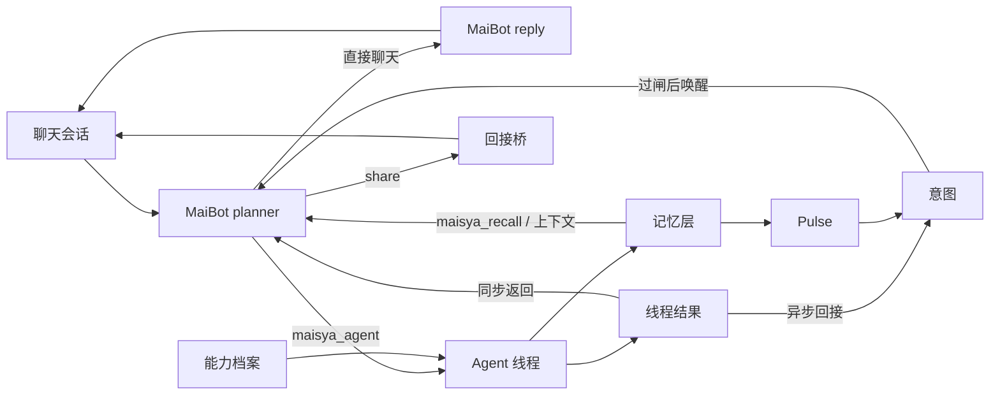

# Maisya 架构蓝图

> **一句话定位**：Maisya 为 MaiBot 提供可调度的 Agent 能力。MaiBot 继续用自己的 `planner` 理解语境和做决定，用原生表达能力开口；Maisya 负责让它能够开启 Agent 线程、积累经历、记住方法，并在合适的时候重新想起某件事。

## 一、设计中心

Maisya 用四个核心概念组合出全部能力：

| 概念 | 回答的问题 | 典型例子 |
|---|---|---|
| **能力档案（Profile）** | MaiBot 可以调用哪种 Agent 能力？ | `scout` 只读探索、`maker` 沙箱创作与计算、派生的 `artist`、`ops`、`dm`、`traveler` |
| **Agent 线程（Thread）** | 这段 Agent 活动如何持续、接收消息、保存现场？ | 查一个问题、画一组图、维护一场跑团、推进一次虚拟旅行 |
| **意图（Intent）** | MaiBot 为什么要在之后重新想起某件事？ | 线程结果回来、事后惦记、冲浪遇到合适的内容、久违想念、定时、外部事件 |
| **记忆层（Memory Layers）** | 活动之后留下什么？ | MaiBot 自身经历、会话关系、可复用方法、活动现场 |

它们之间只有一条主循环：MaiBot 调用能力开启线程；线程产生结果、经历和方法；结果或念头形成意图；意图在合适的时候唤醒 MaiBot。



其余能力都从这条循环组合出来：热转向是给线程发新消息；续聊是继续同一个线程；跑团和旅行是绑定工作区的长期线程；管理台引导也是线程消息；事后惦记、偶遇分享和外部事件都是意图。

## 二、MaiBot 与 Maisya 的分工

| 层次 | 负责 | 不承担 |
|---|---|---|
| **MaiBot `planner`** | 理解语境、直接聊天、调用宿主工具和其他插件、决定是否调度 Maisya、决定如何回应 | 长时间执行、沙箱操作、MCP 细节 |
| **MaiBot 原生表达** | 用 MaiBot 的人设、语气和本群表达习惯开口 | 保存线程过程 |
| **Maisya** | 能力档案、Agent 线程、结果回接、意图唤醒、记忆沉淀、权限与凭据边界、玻璃盒观察 | 抢占聊天节奏、决定日常是否回复 |

日常聊天、接梗、常识和情绪交流由 `planner` 直接调用 `reply`。只有当 MaiBot 需要查证、创作、计算、操作环境、维持一段持续活动或调用受控凭据时，才开启 Agent 线程。

## 三、能力档案（Profile）

能力档案描述一种可被 MaiBot 调用的 Agent 能力。它由一份说明文件和一份结构化配置组成：

```text
<宿主根>/data/maisya/abilities/profiles/<profile_id>/
├── PROFILE.md     # 能力说明、工作方式、输出习惯
├── profile.toml   # 模型、工具、技能、执行环境、可用范围、凭据句柄
├── NOTES.md       # 从实际线程中提炼的短笔记，可回滚
└── preset/        # 可选：启动线程时放入工作区的预设资产
```

`profile.toml` 的核心字段：

```toml
title = "探索者"
enabled = true                 # 可选：角色启用开关（预设 digest 默认为 false）
model_name = "primary-reader"  # 可选：第 1 位主选模型名（覆盖宿主槽位默认分配）
fallback_models = ["backup-reader"] # 第 2..N 位按顺序回退的备选模型列表
task = "utils"                 # utils | planner | replyer | fast_model | vlm | 自定义槽位（当未指定 model_name 时回落使用）
max_tokens = 4096              # 可选：覆盖模型生成预算
temperature = 0.3              # 可选：覆盖采样温度
max_steps = 24                 # 可选：覆盖该档案每轮工具步数预算
web_provider = ""              # 可选：按档案固定联网来源（如 plugin:ID / web:别名 / mcp:名 / plugin_api:名）
environment = "readonly"       # readonly（无容器工作区可用 workspace_file/html_render/result_attach）| sandbox
tools = ["web_search", "web_fetch", "chat_read", "memory_read", "person_read", "recall_read", "image_read"]
skills = ["source-checking"]
mcp = []
apis = []
secrets = []                   # 只写保险箱句柄名（限 admins 档案，按管理员验身挂载）
sandbox_targets = []           # 可选：仅 admins + network="restricted" 的受控公网 host:port 白名单
access = "everyone"            # everyone | admins | listed
allow_users = []               # 例如 ["qq:123456789"]，按真实发言人核验
allow_chats = []               # 统一使用 <platform>:<group|private>:<id>（如 "qq:group:100246809"）；同时配置用户和会话时取交集
```

### 3.1 开箱档案

| 角色 | 执行环境 | 用途 |
|---|---|---|
| **`scout`** | `readonly` | 搜索、读网页、识图、读文档、查公开会话与宿主记忆、调用受权只读插件 `@API` |
| **`maker`** | `sandbox` | 联网查找、写脚本、处理文件、计算、画图、生成网页、维护持久工作区 |
| **`digest`** | `readonly` | 默认停用（`enabled = false`）；开启后结合 `news-digest` 技能与 `digest_feed` 工具执行 RSS 试订/退订、五维打分硬筛与简报卡生成 |

派生档案从这两个底座克隆，再改模型、说明、工具、技能、执行环境和可用范围。例如：

- `artist`：使用便宜快模型写提示词，通过宿主机侧生图 MCP 生成图片。
- `ops`：仅管理员可用，在沙箱中挂载指定 SSH 凭据进行远程运维。
- `dm`：绑定跑团工作区，保存模组真相、角色状态和随机检定脚本。
- `traveler`：以 MaiBot 自身为主体，持续推进虚拟旅行并记录经历。

### 3.2 执行环境

M3 的执行环境、工作区和凭据细化方案见 [M3 执行方案](03-M3执行方案.md)。普通 `maker` 默认采用受控公网出站，严格断网是档案可选策略；真实 gVisor（`runsc`）与网络/资源边界已通过独立环境验收，未开启沙箱时自动降级为无容器轻量工作区模式（`light_workspace`）。

| 环境 | 能力 | 边界 |
|---|---|---|
| **`readonly`** | 宿主进程内工具、只读 MCP / 插件 `@API`；配置工作区工具（`workspace_file` / `html_render` / `result_attach`）时无容器即可使用持久工作区与宿主 `render.html2png` 无网渲染出图 | 默认无 `sandbox_exec` 任意命令执行；管理员可写 MCP / 跨插件 `@API` 须 `access="admins"` 且当前管理员授权 |
| **`sandbox`** | 容器内 `/work` 读写执行、受控公网访问、依赖安装、API 调用、文件处理、预览发布；`admins` 档案可配合 `secrets` 与 `sandbox_targets` | 只读根文件系统、非 root、放弃全部 capabilities、无宿主环境变量、网络层封锁宿主/内网/元数据与其他容器，不开放入站；未开启容器沙箱时，不含私有凭据/受限出站/固定模板的工作区角色（如默认 `maker`）自动降级为无容器轻量工作区模式（`light_workspace`：保留 `workspace_file`/`html_render`/`result_attach` 等，隐去并拦截 `sandbox_exec`），含容器专属隔离需求的角色仍禁用执行 |

群友共享的带 Key 能力由宿主机只读 MCP / 只读跨插件 `@API` 持有凭据；模型和群友只能看到结果句柄。管理员私有凭据与可写/自定义出站能力仅在管理员真实发言、控制台或管理员定时任务触发时挂载 `/run/secrets/<handle>`（权限 `0400`）或开放受控出站，线程结束即销毁。

### 3.3 能力配方模板分享（Recipe Template）

角色与关联技能、推荐例行任务以「能力配方（Recipe）而非完整克隆」的形式分享与升级：

- **可移植资产**：包含 `PROFILE.md`、自动剥离 `allow_chats`/`allow_users` 的 `profile.toml`、可选打包的已绑定技能集（`preset/skills/<id>/**` 含伴随文件）、可选 `NOTES.md` 与 `preset/` 初始工作区模板，以及自动剥离会话 ID 的推荐例行任务与依赖清单（`recipe.json` + 人类可读 `RECIPE.md`，含各凭据句柄用途说明）；不打包聊天机器人核心人设、保险箱密钥明文、聊天记录、`MEMORY.md` 或运行中工作区。
- **双通道获取与体检对齐**：导出前支持勾选资产并执行敏感信息/隐私体检（阻断保险箱凭据明文与硬编码密钥，提示内网 IP、长数字群号/账号、邮箱与本机路径）；导入支持本地 `.zip`/`.tar.gz`/Base64 包文本以及粘贴公开链接（如 GitHub 仓库/Tree/Blob/Release/Gist，由后端防 SSRF 安全拉取），先生成非破坏性预览并对照宿主 `discovery`/保险箱/服务/沙箱标出就绪或缺件项。
- **平滑升级与回滚**：本地已存在同名角色时，支持选择「平滑升级」（更新说明、技能与配方定义并写入版本历史可一键回滚，同时保留本机 `allow_chats`/`allow_users`、`enabled`、`bound` 与既有运行工作区）或「另存为新副本」，并支持按需挂载推荐例行工作流。

## 四、Agent 线程（Thread）

Agent 线程是某个能力档案的一段持续上下文。它保存模型消息、工具轨迹、状态、最新结果，以及可选的工作区。

### 4.1 线程归属

| 归属 | 用途 | 可检索范围 |
|---|---|---|
| **会话线程（`owner="chat"`）** | 某个群或私聊中的查找、创作、跑团、长期项目 | 当前聊天会话 |
| **自身线程（`owner="self"`）** | MaiBot 自己的冲浪、旅行和持续兴趣 | 所有启用会话；分享前经过隐私脱敏 |

### 4.2 线程状态

| 状态 | 含义 | 下一步 |
|---|---|---|
| `active` | 正在运行 | 可以接收新消息，或等待结果 |
| `waiting` | 线程有一个必须由人回答的问题 | 通过 `send` 回答 |
| `idle` | 当前一轮已经得到结果，上下文和工作区仍可继续使用 | 通过 `send` 继续 |
| `closed` | 线程已停止 | 保留结果、历史和工作区，可被检索或作为新线程的参考 |

线程按上下文预算保留消息，闲置时间不会使前情丢失。超过预算时，完整原文归档到本线程事件，保留当前要求、可容纳的原始目标与近期完整步骤，并附上多轮压缩结构化导航索引（`archive_events` 与上限 `2,400` 字符的 `archived_runs` 目录，记录各轮 `goals`、`tools` 与 `highlights`）。工具调用和对应结果作为一组保留。线程内 `thread_read` 按关键词定位原始事实、理由和出处，支持按事件编号分页继续读；导航不充当事实摘要。各轮输入与结论持续进入检索索引，最新结果不会覆盖旧结论。

并发调度上，线程引擎区分为实时交互车道与后台车道（`background_tasks`，通过 `_background_limit()` 为用户交互预留槽位）：后台工作流与外部事件使用 `defer_if_full=True` 先落盘入队，待并发空出后由 `kick_queued` 或唤醒周期拉起，并在 `recover()` 时保留未完成排队线程状态；引擎内偶遇提取回调同时兼容同步与异步实现。

### 4.3 统一工具：`maisya_agent`

```json
{
  "action": "start | send | stop | share",
  "profile": "scout",
  "thread_id": "th_...",
  "message": "要做什么、补充什么，或希望如何表达结果",
  "source_msg_id": "根据用户消息调用时的真实来源；自主普通只读调用可省略",
  "ref_msg_ids": ["原图、合并转发、文件或旧消息"],
  "from_threads": ["th_..."],
  "workspace": "coc_hotel_01",
  "owner": "chat",
  "wait_seconds": 20
}
```

| 动作 | 用途 |
|---|---|
| `start` | 用指定能力档案开启线程，并装入引用消息、旧线程结果和工作区 |
| `send` | 给已有线程补充要求、转向、回答问题、继续修改 |
| `stop` | 停止线程当前运行；保留已产生的结果、摘要和工作区 |
| `share` | 把线程结果中的准确链接、媒体、文件或旧消息锚点交给回接桥，由 MaiBot 原生表达一次发出 |

MaiBot 可在没有新用户消息时开启、继续或停止普通只读线程。管理员能力与受限线程必须带真实 `source_msg_id` 验权；显式提供的来源核验失败时直接拒绝，不降为自主调用。自主线程也遵守当前会话隔离，不会把群聊内容自动提升为跨会话自身经历。

返回结构保持一致：

```json
{
  "thread_id": "th_...",
  "state": "active | waiting | idle | closed",
  "result": {
    "text": "已经核实的结论",
    "question": "仅 waiting 时出现",
    "attachments": [{"handle": "att_...", "kind": "image", "name": "cover.png"}],
    "links": [{"url": "https://...", "title": "预览页"}],
    "error": "运行失败时的事实说明"
  }
}
```

### 4.4 等待窗口

`start` 和 `send` 默认等待 `20` 秒，可配置为 `0～30` 秒：

- 线程在窗口内得到结果，结果直接返回当前 `planner`。
- 线程仍在运行，工具返回 `active`，线程继续运行；结果回来时形成回接意图。
- 同一轮需要开启多个线程时，`planner` 传 `wait_seconds=0`，让它们并行运行。

等待窗口的上限低于宿主插件工具默认 `60` 秒 RPC 超时，为工具返回和宿主处理留出余量。

### 4.5 线程内的连续性

- **转向**：用 `send` 给同一线程追加新要求。未绑定命名工作区时，在模型返回和每个工具执行前检查新方向；命名工作区普通补充逐条排队。`send(steer=true)` 显式中断当前活动并替代尚未执行的旧方向，保留已完成步骤与检查点。
- **回答问题**：线程进入 `waiting` 后，`planner` 用自然语言转述问题；对方回答后，`planner` 调用 `send`。
- **继续修改**：直接给原线程 `send`；线程已关闭时，新线程通过 `from_threads` 引用旧结果和工作区。
- **管理台引导**：管理员在玻璃盒中给线程 `send` 一条消息（可选勾选立即转向 `steer`），与聊天中的补充使用同一入口。
- **群聊归属保护**：群聊内非管理员仅可停止（`stop`）、强制转向（`steer`）或续接（`send`）由自己发起的个人委托线程（无共享命名工作区）；绑定共享命名工作区的协作线程仍允许同群有权限成员正常参与补充。
- **模型故障**：限流、额度或网关错误发生时，线程保留已完成步骤和工作区，在同一线程内切换到 `fallback_models`。

### 4.6 工作区

工作区是线程的活动现场：

- 未命名工作区随线程创建，线程关闭后按保留策略清理。
- 命名工作区属于某个会话或 MaiBot 自身，例如 `trip_kamakura`、`coc_hotel_01`。
- 同一个命名工作区同一时间绑定一个线程。多人同时补充时，消息进入该线程的输入队列，按顺序处理，避免同时写坏存档。
- 引用的原图、合并转发、群文件和旧线程产物放入 `/work/in/`（通过 `from_threads` 接力时，自动将上游线程脱敏后的文字结论与链接写入 `in/previous-<tid>-result.md`、已声明附件写入 `in/previous-<tid>-<idx>-<name>`，并将上游工作区已提交的 `out/*` 成品同步导入 `in/previous-<tid>-out/*`）；线程主动声明的附件只能来自 `/work/out/` 或宿主机 MCP 返回的结果句柄。

### 4.7 结果检查

纯文字结果直接可用。线程声明附件时，Maisya 只检查三件事：路径存在、位于允许目录、文件非 0 字节。检查失败时让线程修正一次；仍失败则返回错误说明。

## 五、回接桥（Bridge）

回接桥把线程结果交还给 MaiBot，并解决宿主中三个具体限制：

1. 宿主 `Replyer` 看不到工具结果和内部上下文，需要单次垫入核实结果。
2. 插件代机器人发送消息时必须标记为 MaiBot 自己发出的消息，否则后续上下文会把它误认为他人发言。
3. 原生 `reply` 依赖当前历史窗口，并可能经过拆句或错字模拟；准确链接、媒体、文件和较早消息锚点需要单独处理。

### 5.1 同步结果

线程在等待窗口内完成时：

1. `maisya_agent` 把结果返回给当前 `planner`。
2. 回接桥按会话、线程与当前输入版本暂存一份核实事实。
3. `planner` 选择出口：
   - 纯文字结果：调用原生 `reply`；`maisaka.replyer.before_request` 单次垫入核实摘要，使用后清除。
   - 含链接、媒体、文件或较早消息锚点：调用 `maisya_agent(action="share")`。

单次补入以一次原生回复生成为单位：宿主重试时通过不透明标记重新取得本次事实，保留其他插件原有参数；线程一旦停止或转向，重试不再带入旧事实。下一次独立回复重新选择材料。

### 5.2 异步结果

线程在后台得到结果或进入 `waiting` 时，回接桥创建一个 `return` 意图。Pulse 唤醒原会话的 `planner`，并提供：

- 线程编号、能力档案和触发消息。
- 简短结果、问题或错误说明。
- 可用的附件和链接句柄。
- 推荐出口：纯文字可用 `reply`，准确载荷使用 `share`。

同一轮从同一触发消息开启的多个线程会组成一个回接组。宿主顺序执行工具期间先等待组员登记；最后一次工具调用返回后留 `1` 秒合并窗口，组内线程全部结束或达到 `10` 秒汇合期限后，回接桥最多唤醒一次 `planner`。

结果事件与回接意图在同一 SQLite 事务中保存，意图引用原事件。唤醒前检查线程输入版本、停止状态、会话启用状态和结果是否已被处理。重载后继续处理尚未认领的有效意图；RPC 接收状态不明时保留记录与结果索引，避免盲目重复唤醒。

目标会话不可唤醒、处于静默状态，或者 MaiBot 本轮选择不开口时，结果保留在线程中，并在接下来一段时间内出现在 `planner` 的线程索引里。之后有人追问，MaiBot 可以直接接上。

回接桥读取后备载荷并随 `<maisya_return>` 一并附带 `chat_type` 与 `messages_since_trigger`；当群聊自触发消息起已滚过不少于 `5` 条非插件代投新消息且具备 `source_msg_id` 时，唤醒提示会显式提醒结合 `source_msg_id` 引用锚定原提问或顺应翻篇静默收尾。

当前已实现用户来源线程的自动回接。MaiBot 自主活动的后台结果进入线程索引，自动触达随完整 Pulse 的主动性与社交分寸闸接入。

### 5.3 `share`

`share` 是含准确载荷的结果出口：

1. 回接桥读取线程结果、附件、链接和原始消息锚点。
2. 回接桥调用宿主 `maisaka.reply.generate`（同时将 `planner` 传入的 `message` 清洗后作为 `<planner_intent>` 本轮对话表达意图一并传入），用 MaiBot 的人设、语气和本群表达习惯顺着当前话头生成一两句话。
3. 回接桥把生成文字、准确链接、媒体和引用锚点组成一条消息，通过 `send.hybrid` 发送，并标记 `sync_to_maisaka_history=True`、`maisaka_source_kind="guided_reply"`。
4. 平台必须单独上传群文件时，文字消息和文件上传分别发送，文件上传不重复正文。

`share` 发送后返回本轮应结束的提示，`planner` 不再为同一结果调用 `reply`。

## 六、意图与 Pulse

意图是 MaiBot 之后重新想起某件事的理由。所有异步唤醒都先写成意图，再由 Pulse 统一处理。

```json
{
  "kind": "return | proactive | silent",
  "source": "thread | afterglow | serendipity | longing | later | webhook",
  "target": "chat:<chat_id> | self",
  "due_at": "2026-11-12T20:00:00+08:00",
  "reason": "为什么想起这件事",
  "thread_id": "th_...",
  "evidence": ["相关线程、经历或记忆"]
}
```

| 类型 | 用途 | 规则 |
|---|---|---|
| `return` | 回接用户请求的线程结果或问题 | 绕过主动搭话限制，遵守会话静默和平台可用性 |
| `proactive` | 无事搭话、偶遇分享、事后惦记、久违想念 | 过全部社交分寸闸 |
| `silent` | 推进自身线程或长期活动的下一步 | 不唤醒聊天会话，只更新线程、工作区、经历和 `JOURNAL.md` |

### 6.1 意图来源

- **线程**：后台结果、需要回答的问题、长期活动安排的下一次唤醒。
- **对话余韵**：近期聊天中仍有余温的话题，或刚完成的一段重要活动。
- **冲浪偶遇**：自身 `scout` 线程先发现值得分享的新内容，再判断它与哪个会话或熟人有关。
- **久违想念**：熟人或活跃群长时间安静后的自然冒泡。
- **定时**：`planner` 通过 `maisya_later` 安排的提醒或回访。
- **外部事件**：显式开启的 Webhook 先预验参数、能力自主权限与当日额度，再按 Inbox-first 原则原子写入 `agent_threads` 与 `intents`（并发满槽时走 `defer_if_full=True` 持久排队，并在 `silent` 通道通过 `already_started` + `kick_queued` 接力）。

### 6.2 Pulse

Pulse 是唯一的后台调度循环：

1. 读取到期意图和候选来源；无到期且处于心跳冷却期时保持零空闲磁盘/SQLite I/O（`_heartbeat` 通过 `stat().st_mtime_ns` 缓存 `HEARTBEAT.md`、`_heartbeat_next_at` 门控并由 `on_config_update` 热更新即时失效，后台 `_longing` 按 `30s` 节流）。
2. 先用规则做轻量筛选，只有需要判断内容时才调用小模型；心跳执行前附带 `<recent_journal>` 去重提示。
3. 对 `proactive` 意图执行社交分寸闸；定时与周期工作流采用非阻塞派发（`wait_seconds=0` + `delay=2` 短轮询），无论单次成功或 `failed`（`profile_disabled` / `rejected` 等非 `deferred`）均按安全下限 `max(now + 60, due_at)` 自动重排下一次唤醒；无命名工作区周期任务保留最近 3 次 `recent_runs` 并注入 `<previous_runs>` 以便无变化时静默 `stop`。
4. 每轮最多唤醒一个主动搭话会话；`return` 和 `silent` 按各自队列处理。
5. `serendipity` 冲浪偶遇结合会话 `MEMORY.md`、最近线程语料（`agent_threads` / `thread_search`）与可选近期话题回调检索匹配目标会话（私聊支持 `care`/`lively`，群聊仅限 `lively`）。
6. 对聊天会话调用 `chat.open_session` 和 `maisaka.proactive.trigger`，由目标会话 `planner` 决定直接回复、调用工具、开启线程或保持安静。

### 6.3 社交分寸闸

- **睡眠免打扰**：配置时段内跳过 `proactive` 意图。
- **未回不连戳**：按 `chat_id` 隔离。Pulse 主动搭话后锁住该会话；群聊不再因路人普通闲聊解锁（`engaged=False`），仅在真实人类轮次促成有效响应（`reply`、`maisya_agent` 或人类触发 `share` 发送成功）时解锁该群，私聊收到对方消息即解锁。
- **私聊严格白名单与熟人边界**：所有非管理员私聊必须先显式列入 `enabled_chats` 才可启用服务；`acquaintance_users`（精确保留 `user_id` 大小写、仅平台小写）只用于熟人主动边界判定，绝不绕过私聊白名单。
- **久违想念默认关闭**：`longing_quiet_hours` 默认为 `0`（关闭），仅接受 `0` 或 `12..720` 小时显式开启。
- **主动度**：每个会话可设为 `quiet`、`care` 或 `lively`，决定可接受的主动意图来源和频率（私聊 `care` 允许接收偶遇，群聊仅 `lively` 接收偶遇）。
- **分舞台每日额度**：`daily_proactive_limit` 按 `group` 与 `private` 双舞台独立分桶计数，且 `failed` / `cancelled` 状态不消耗当日额度；长期工作流按调度排班推进。

### 6.4 自身活动

虚拟旅行、持续冲浪和兴趣研究都是自身线程：

- 线程绑定 `self` 工作区，例如 `self/trips/kamakura`。
- 每一站完成后，线程可以创建下一次 `silent` 意图。
- 途中值得分享的内容可以生成 `proactive` 意图，交给相关会话的 `planner` 判断是否提起。
- 经历进入自身线程索引，任意启用会话问起时可通过 `maisya_recall` 检索。

## 七、记忆层

记忆按“是谁的、能用在哪里”分层：

| 层 | 存放内容 | 写入方式 | 使用方式 |
|---|---|---|---|
| **自身经历** | `JOURNAL.md` 近 7 天主观近况（同日多条自动合并至单一 `## YYYY-MM-DD` 区块，超限先裁最旧日期内最早条目），自身线程的经历与发现 | 自身线程、Pulse、管理员编辑 | 当前状态短摘录进入上下文；完整经历按需检索 |
| **会话备忘** | 每个会话的 `MEMORY.md`：本会话长期置顶的协作约定、版式偏好、资产索引（群友日常印象与长期聊天记忆由宿主 `A_Memorix` 负责） | 管理员通过 `maisya_shape` 或管理台修改 | 每会话最多 `2,200` 字，进入该会话 `planner` 上下文尾部 |
| **方法** | 全局 `SKILL.md`、能力档案说明与 `NOTES.md` | 管理员明确修改；线程自动提炼短笔记 | 加载到相关能力档案的线程 |
| **活动现场** | 线程消息、工具轨迹、结果、摘要、工作区 | 线程运行时写入 | 玻璃盒观察、继续线程、检索旧结果 |

宿主 `A_Memorix` 继续负责 MaiBot 的长期聊天记忆。Maisya 负责 Agent 活动产生的经历、方法和现场。

### 7.1 检索：`maisya_recall`

```json
{
  "query": "镰仓旅行 / 上次那张海报 / th_...",
  "scope": "chat | self | available",
  "kind": "threads | experiences | memory | journal | all",
  "target_chat": "qq:group:100246809 | all",
  "limit": 5
}
```

`maisya_recall` 使用 SQLite FTS5 检索线程摘要、结果、自身经历、会话记忆和 `JOURNAL.md`。Private <-> Group 实行单向隐私隔离墙：群聊中禁止通过 `maisya_recall(target_chat="all")` 检索私聊线程与私聊 `MEMORY.md`，且禁止通过 `from_threads` 将私聊线程结果注入群聊线程（管理员 `deliver_to="current"` 私聊预览除外）；同时允许同一已验身用户在其已启用私聊中检索自己发起的已启用 `everyone`/无凭据/无模板群聊线程结果，但不暴露他人线程与群 `MEMORY.md`。自身经历可跨会话检索；管理员可在任意会话通过 `target_chat`（支持 `<platform>:<group|private>:<id>`、群名或 `"all"` 全部会话）跨会话查阅。

### 7.2 学习

- **明确指正**：管理员指出做法、偏好或规则时，`planner` 调用 `maisya_shape` 直接修改对应能力档案、技能或会话记忆，并保留版本历史。
- **线程笔记**：同一工具失败后成功，或上次完成后连续两次显式转向并最终完成工具执行时，后台用不超过 `500` token 提炼通用方法笔记，写入对应档案的 `NOTES.md`。输入只含内置工具名、成败状态和显式转向次数，不提供原始参数、输出或会话正文；一次活动只提炼一次。管理员明确指正直接用 `maisya_shape` 修改。
- **隔离检查**：写入前检查已登记秘密、常见密钥格式、邮箱、数字标识、IP、主目录路径、明确会话用语，以及原会话已知记忆片段、发言人和工作区标识。匹配这些内容时拒绝写入全局方法，具体群信息写入对应会话的 `MEMORY.md`。

## 八、工具接口

| 工具 | 可见性 | 用途 | 权限 |
|---|---|---|---|
| `maisya_agent` | 可见 | 开启、继续、停止、分享 Agent 线程（支持 `target_chat` 跨会话启动及 `deliver_to="auto\|target\|current\|none"` 投递路由） | 按能力档案的 `access` 判断；受限与跨会话动作验证真实发言人 |
| `maisya_recall` | 可见 | 检索线程、经历、会话记忆和近况（支持管理员 `target_chat` / `"all"` 跨全部会话检索） | 按会话与自身范围过滤；跨会话指定须管理员核验 |
| `maisya_later` | 可见 | 按自然语言安排之后的提醒、主动回访或周期运行角色工作流（`every_seconds >= 300`，支持 `daily_at` HH:MM 不漂移定点、`replace` 去重与跨群 `target_chat`） | 普通闲聊惦记受每日额度约束；受限工作流与 `scheduled_admin` 计划按 `source_msg_id` 验证并受管理员保护 |
| `maisya_shape` | 延迟（严禁设 `visibility`），管理员轮次引导经 `tool_search` 展开 | 一站式读取 `overview` 及读/局部 `patch`/全写/历史/回滚设置、角色、技能、`MEMORY.md`、`digest_sources`、心跳、外联服务、Webhook 与配方导入 | 请求前隐藏，执行时按 `source_msg_id` 验证（含未启用私聊有界 300s 内存缓存引导；抗自锁死禁止从对话关掉插件总开关） |

启用会话只剔除宿主内置 `subagent`、`subagent_status`、`subagent_stop`。宿主原生工具与其他插件 `@Tool` 全部保留，MaiBot 可以把线程结果继续交给其他插件使用。

## 九、权限与信任

1. `chat.receive.after_process` 记录可信消息映射：原始消息 ID、短别名、会话、平台、真实发言人和是否为插件代投。
2. `maisaka.planner.before_request` 根据本轮真实发言人隐藏管理员工具和受限能力档案。
3. 受限动作执行时必须带 `source_msg_id`，Maisya 反查可信消息映射后再放行。
4. 线程输入中的外部内容使用隔离标签包裹；线程结果回到 `planner` 前转义控制标签。
5. 非管理员触发的出站内容移除 `@全体成员`。
6. 凭据保险箱只支持录入、替换、删除和绑定句柄，不提供明文读取接口。

## 十、玻璃盒管理台

管理台嵌入 MaiBot 原生 WebUI 顶部工作区，使用 `webui.json` v2 自定义页面和静态 `@API`，复用宿主登录，并提供双主题体系：默认以配合 MaiBot 宿主的「千禧机械风（`millennium`）」启动，同时支持顶栏一键切换与持久化的「清朗手账风（`maiwork`）」及「自动跟随宿主（`auto`）」。全页零口号、帮助说明收纳进 `?` 气泡弹窗，设置明确区分「一般设置」与「高级设置」。

| 页面 | 内容 |
|---|---|
| **现场** | 顶部 `01→04 FLOW` 拓扑突出 `02 主脑调度 · PLANNER`（`MaiBot Planner` 原生编排、`Pulse` 作为节律子带退居其下）、状态与遥测条、上下文构成方块图与深色 `TREND` 示波器、线程步骤流与活动现场、底部折叠唤醒抽屉 |
| **产物** | 参考统一「资料空间」形态：左侧按资料分类（全部/页面卡片/图像海报/文档代码/结论出处/持续工作区）与最近 5 项、来源会话筛选，右侧支持列表/4 列网格切换、预览、源码检视与持续工作区浏览 |
| **能力** | 双列 `SKILL.md` 画廊与压缩包导入导出/伴随文件预览、角色名册与启停开关、按优先级排序的角色多模型 `model_name` + `fallback_models` 分配、定制小鱼头像、`NOTES.md`、`1 + 2` 能力配方导入导出、宿主发现与执行环境 |
| **手账** | `JOURNAL.md`、自身经历、各会话 `MEMORY.md` 备忘（按 `<platform>:<group|private>:<id>` 别名对齐）、`HEARTBEAT.md` 探索节奏、`A_Memorix` 边界、直达意图队列与自动笔记回执 |
| **设置** | 一般设置 vs 高级设置分级：条目增删式消息流白名单（`<platform>:<group|private>:<id>`）、熟人边界、主动度、时段选择睡眠免打扰、预设快捷定时、联网来源（`host_models.json` 脱敏清单与自定义源）、凭据保险箱、动态模板、Webhook 与沙箱自检 |

“现场”使用单路游标串行轮询，第二个并发槽留给用户操作。源码位于 `webui/*.in`、`webui/fragments/*.html`、`webui/millennium.css` 与 `webui/fish.js`，编译为自包含单文件 HTML（零 ``、零 `<iframe>`、零 `transition: all`、零 `localStorage`），严格遵守宿主 CSP。

## 十一、宿主挂载

| 宿主接点 | Maisya 用途 |
|---|---|
| `chat.receive.after_process` | 记录可信消息映射，解锁该会话的未回不连戳状态，处理显式 `/vault` 命令；普通消息返回 `continue` |
| `maisaka.planner.before_request` | 剔除宿主内置 `subagent*`，隐藏无权工具，在上下文尾部追加会话记忆、近况摘录和线程索引 |
| `maisaka.planner.after_response` | 记录 `planner` 工具选择和回合轨迹，形成回接组与玻璃盒事件 |
| `maisaka.replyer.before_request` | 纯文字结果单次垫入核实摘要；当同轮精确载荷已由 `share` 投递时自动抑制重复回复 |
| `send_service.before_send` | 出站凭据与路径脱敏，非管理员触发消息自动剥离 `@全体成员` |
| `@Tool` | 注册 `maisya_agent`、`maisya_recall`、`maisya_later`、`maisya_shape` |
| `chat.open_session` + `maisaka.proactive.trigger` | 唤醒目标会话处理回接或主动意图 |
| `maisaka.reply.generate` + `send.hybrid` | 执行 `share`，用 MaiBot 原生表达生成文字，并发送准确载荷 |
| `webui.json` + `@API` | 提供五个玻璃盒页面 |

## 十二、运行期数据

```text
<宿主根>/data/maisya/
├── maisya.db                         # 可信消息、线程、事件、意图、检索索引、社交状态
├── vault/                            # 加密凭据，0600
├── abilities/
│   ├── profiles/<profile_id>/         # PROFILE.md、profile.toml、NOTES.md、preset/
│   ├── skills/<skill_id>/SKILL.md      # 全局方法与历史版本
│   └── services.json                  # 管理员登记的 MCP 与私有执行模板
├── memory/
│   ├── self/
│   │   ├── HEARTBEAT.md               # MaiBot 主动性的气质与节奏
│   │   └── JOURNAL.md                 # 近 7 天主观近况，最多 1,500 字
│   └── chats/<会话哈希>/MEMORY.md     # SHA-256 前 32 位；会话备忘（办事约定），最多 2,200 字
└── workspaces/
    ├── ws_<内部编号>/                 # SQLite 绑定会话/自身、工作区名与线程
    │   ├── current.json               # 最近提交的检查点指针
    │   └── v_<版本编号>/              # project/in/out 的普通文件
    ├── runtime/                       # tmpfs 活动副本，缓存不持久化
    └── attachments/                   # 不可变结果附件
```

全部运行期资产都放在插件目录外，插件更新或重装时保留。

## 十三、成本与稳定性

- `planner` 工具定义和静态说明保持稳定；动态内容追加在上下文尾部。
- 媒体和文件只传句柄，二进制内容不进入模型上下文。
- 长网页、命令输出和中间文件留在线程现场；返回 `planner` 的只有结果摘要和必要句柄。
- 能力档案可以绑定便宜快模型；高价模型只用于需要更强判断的档案。
- Pulse 的候选筛选优先使用规则；没有合适意图时直接结束，不调用 `planner`。
