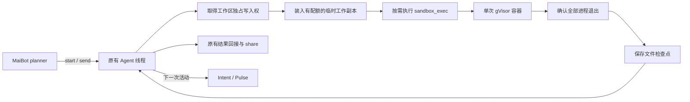

# M3 执行方案

状态：用户已确认方案并授权实现；执行代码、本地回归与宿主 SDK 隔离契约已完成，真实运行时验收待单独授权。2026-11-12。下列资源值已写入默认配置，OS 效果以独立容器环境验收为准。

## 1. 选型结论

采用 **Docker + gVisor（runsc，systrap 平台）** 作为 `sandbox` 环境。模型调用、线程上下文和权限判断留在 Maisya；只有脚本与文件处理进入沙箱。

**工作区持久，执行容器一次一建。** 一次 `sandbox_exec` 对应一个容器；命令退出后确认其全部进程退出，保存文件检查点并销毁容器。同一线程靠文件和消息续接，模型思考和线程闲置期间没有常驻容器。

普通 `maker` 默认受控公网出站：脚本可安装依赖、读取公开数据和调用公网 API；网络边界阻止访问宿主、内网、云元数据和其他容器，不开放入站服务。搜索、读网页和 MCP 仍可作为线程工具直接使用，脚本无需通过这些工具才能联网。严格断网是档案可选策略。容器运行时、镜像、挂载和网络/资源策略由管理员配置及固定代码决定，模型不能提供 Docker 参数或放宽网络规则。

这扩展现有 Profile 与 Thread：`maker` 是能力档案，工作区是线程现场，下一步活动继续使用 Intent/Pulse。沙箱隔离、工作区文件检查与 MCP 连接需要执行边界代码，不能只靠提示词或线程消息实现；它们不增加 planner 可见工具或新的活动状态机。

## 2. 已核事实与取舍

2026-11-12 通过 SSH 只读检查当前服务器，未安装软件、启动容器或修改服务：

| 项目 | 当前事实 | 对方案的影响 |
|---|---|---|
| 系统 | Debian 13，Linux 6.12，x86_64，systemd，cgroup v2 | 可实施 Linux 容器隔离与宿主资源限制 |
| Docker | 29.9.3，可访问；当前默认 runc，未注册 runsc | `maker` 上线前须单独准备并验证 gVisor |
| 防护基础 | Docker 报告 AppArmor 与 seccomp 已启用 | 保留现有防护，不关闭全局安全配置 |
| KVM | `/dev/kvm` 存在 | 尚不能据此认定嵌套虚拟化或 microVM 已可用 |
| 内存快照 | 4 核，约 7.8 GiB 总内存，首次检查约 2.4 GiB 可用 | 初始执行并发设为 1，后续按实际执行开销评估 |
| 数据盘复核 | 根分区约 88.4 GiB，可用约 44.7 GiB；MaiBot 数据目录与 Docker 数据目录均使用该分区 | 当前有空间准备基础镜像与初始工作区；按实际大小及配额控制增长 |
| 临时目录复核 | `/tmp` 是独立 tmpfs，总容量约 3.9 GiB，复核时可用约 3.4 GiB | 属于临时内存文件系统，不能用它推断整机磁盘空间 |

本表不记录连接地址、账号或密钥。可用资源是检查当时的快照。

| 候选 | 取舍 |
|---|---|
| MaiWork 的 systemd 隔离 | 已读本地实现，可借鉴有界输出与目录安全经验；它仍使用宿主文件系统和内核，本项目不直接搬入其执行体系 |
| 普通 Docker/runc | 集成最少，但脚本仍直接使用宿主 Linux 内核接口；不作为开放群聊代码执行的默认边界 |
| **Docker + gVisor** | 沿用容器工具链，增加用户态内核边界；选择此项，兼容性和开销通过实际镜像验收 |
| Firecracker microVM | 需要维护 guest kernel、rootfs、jailer 与 VM 生命周期；当前 M3 不承担这套基础设施 |

gVisor 官方建议虚拟机内优先评估 systrap，KVM 平台还需要验证嵌套虚拟化；Firecracker 的生产隔离依赖 KVM 和 jailer。相关依据见文末。选型不包含启动时自动降级到 runc；runsc 或资源防护不可用时，隐藏 `maker` 并返回具体环境状态，`scout` 继续可用。

## 3. 一次调用怎样运行

1. `start`/`send` 核验来源、档案、线程归属及本轮授权；为本轮保存确定的档案与执行策略快照。
2. 原子绑定命名工作区并按输入顺序取得写入权。取得写入权前不占用执行槽或容器。
3. 第一次文件操作时，从最近检查点装入受限工作副本。只用搜索或 MCP 的线程无需创建容器。
4. 每次 `sandbox_exec` 启动一个容器。命令字符串只交给容器内部的 shell；宿主使用固定 argv 调用运行时，不拼宿主 shell 命令。
5. 命令结束或超时后，确认容器内进程已全部停止，再读取工作副本。正常完成时保存检查点；非零退出可保留调试文件，并如实报告退出码。超时、停止或转向中断的命令不自动提交正在修改的文件。
6. 工具结果包含退出码、有界输出、检查点版本和必要文件句柄；模型在同一线程继续。后台子进程不会跨 `sandbox_exec` 存活。
7. 当前活动完成或进入 `waiting` 后释放临时副本与写入权；保留消息、检查点及已声明附件。下一次 `send` 重新装入文件。

停止先标记线程关闭，再终止运行时并等待确认。杀进程失败时继续占住工作区写入权、阻止后续执行，并在现场页显示具体失败；不能先释放目录让新命令继续写。卸载和异常恢复只清理属于本实例的容器与挂载，不重放未确认执行结果的命令或外部写操作。

执行回执按 `(thread_id, revision, tool_call_id)` 持久记录。重复收到同一次工具调用时返回已有回执；已开始但结果不明时保留具体状态，让线程重新检查现场，不能把断线当成“从未执行”。

转向沿用现有消息流：只读工具可等本次结束后重新检查；正在执行的旧脚本中断并退回上个检查点，旧方向尚未开始的调用跳过。已完成并提交的步骤保留。

## 4. 文件与工作区

命名工作区由 `(owner, chat_id, name)` 确定，物理路径使用内部 ID；用户提供的名字不能直接成为宿主路径。数据仍位于 `<宿主根>/data/maisya/`，版本目录由内部存储管理。

同一命名工作区同一时间绑定一个可继续线程。同名并发 `start` 在档案与权限一致时落到已绑定线程的 `send` 队列，并返回该线程 ID；档案冲突时明确报告已有绑定。每个输入有顺序编号，持久文件变更逐个处理；只有显式转向才替代尚未执行的旧方向，普通排队补充不能被“只取最新消息”吞掉。关闭后可由新线程显式续接文件，保留原线程与检查点的引用。不能用 `owner="self"` 把群资料或群工作区自动提升为跨会话经历。

容器只看到当前工作副本：

| 路径 | 用途 | 持久性 |
|---|---|---|
| `/work/in` | 从当前会话核验并导入的引用输入，只读 | 文件句柄及来源记录保留 |
| `/work/project` | 脚本、活动状态、网页源码和可继续文件 | 正常命令结束后提交检查点 |
| `/work/out` | 线程准备声明的图片、文件等附件 | 声明后复制为不可变附件 |
| `/tmp`、`/work/cache` | 编译、缓存与一次性中间数据 | 不提交到检查点 |
| `/run/secrets/<handle>` | 指定受限执行模板的凭据 | 单次调用结束即移除 |

持久工作区目录不直接挂给脚本。使用宿主创建的独立 tmpfs 工作副本，设置字节与 inode 硬上限，再把指定子目录挂入容器。这样磁盘写满防护不依赖后台 `du` 轮询，也不依赖当前 Docker 存储驱动是否支持项目配额。宿主创建的 tmpfs 页另计全局内存预算，不能假设 Docker 的内存限制涵盖全部文件页。

保存检查点时容器已停止。文件导入、复制与附件打开使用目录描述符约束的路径访问（Linux 优先 `openat2` 的 beneath/no-symlink 约束），拒绝路径穿越、符号链接、硬链接和设备/FIFO/socket 等特殊文件；不在宿主跟随输出中的链接。按实际读取字节和文件数计额，再以新版本目录和原子指针替换提交。失败时保留上个检查点。

`from_threads` 只接受有权读取的原线程结果和不可变附件；写入新工作区前复制，不把另一个会话的目录挂进来。ZIP 导入同样拒绝穿越、链接、异常解压大小与文件数。

## 5. 执行约束与资源预算

默认运行时固定为经过验证的 runsc，非 root UID/GID，只读根文件系统，`cap-drop=ALL`、`no-new-privileges`，保留适配该运行时的 seccomp/AppArmor。禁止特权模式、宿主 PID/IPC/network、设备透传、Docker socket，以及宿主配置、数据库、插件目录和环境变量挂载。

| 项目 | 拟定起始值 | 执行方式 |
|---|---|---|
| 全局脚本执行并发 | 1 | 只有实际运行脚本时占槽；队列有界，等待可取消 |
| 单次执行 | 1 vCPU，512 MiB 内存，禁止额外 swap | 宿主 cgroup，包含运行时开销；隔离测试检查实际生效 |
| 进程数 | 128 | 宿主限制加沙箱内进程限制，验证 fork 后确实被拦截 |
| 单命令时限 | 默认 60 秒，管理员上限 180 秒 | 包含网络等待，同时受本轮 Agent 总时限约束；到期杀整个容器 |
| 工作副本 | 256 MiB，8,192 个 inode | 宿主独立 tmpfs 硬限制 |
| 临时文件 | `/tmp` 64 MiB | 独立有界临时区 |
| 持久检查点 | 单工作区 128 MiB；全部工作区、附件与暂存提交合计先设 1 GiB | 提交前原子预留容量，计入复制期间的临时占用 |
| 输出 | stdout/stderr 合计超过 2 MiB 终止；交给模型最多 12 KiB | 流式读取与有界保存，Docker 使用 `log-driver=none`，避免另写无限日志 |

这些值按当前机器负载起步。准备镜像前，Docker 数据盘和工作区盘须按镜像解压大小、临时提交与保留空间做容量核算；工作区盘保留至少 2 GiB 空闲，内存为执行器及工作副本预留后仍为宿主保留至少 1 GiB。复核确认两类数据共用根分区，当前可用约 44.7 GiB，初始镜像与工作区没有此前误判的磁盘空间瓶颈。工作副本 tmpfs 的大小仍按内存预算限制。

先维护一个固定 digest 的基础镜像，包含 Python、固定版本的 Node 及常用绘图/文档依赖。实际大小与 Python、Node、绘图、文件处理的兼容性都纳入验收。额外依赖可以直接在受控公网容器内通过 `pip`/`npm` 下载、安装和构建，写入工作副本或有界缓存；安装脚本同样受网络、权限、资源与时限约束。需要跨调用使用的项目依赖计入检查点配额，缓存不持久化；严格断网档案使用镜像预装或预先导入的离线依赖。不在宿主执行包安装，也不让模型构建任意 Dockerfile。较重能力以后由管理员增加受测镜像，档案只引用镜像别名。

## 6. 受控公网出站与 MCP

### 6.1 三种档案网络策略

| 策略 | 用途 | 可达范围 |
|---|---|---|
| `public`（普通 maker 默认） | 依赖安装、公开数据、HTTP API 与常见 SDK | 公网 TCP 出站；DNS 仅经配置的解析器；不允许任意 UDP、入站或内网访问 |
| `none` | 严格离线计算或处理敏感输入 | 无外部网络，使用 `network=none` |
| `restricted` | 带私有凭据的固定执行模板 | 仅管理员预先绑定的目标 ID、具体地址和端口；不继承普通 maker 的通用公网访问 |

`public` 支持脚本直接使用 `curl`、`pip`、`npm`、HTTP(S)/WebSocket 客户端等，不强制经过 HTTP 代理或单独的下载工具。普通依赖下载与请求受到执行时限、文件配额和网络连接/流量预算约束，具体网络预算通过第 1 步隔离实测确定。需要额外 UDP 协议时由管理员配置明确目标与端口，模型不能自行放开。

所有策略均保留 gVisor netstack 与独立网络命名空间，不使用 Docker 或 runsc 的 host network。容器自身的 loopback 可供本地测试使用，它不通向宿主 loopback。网页预览仍由发布工具上传静态结果并返回链接，不在宿主发布容器端口。

### 6.2 在实际数据包路径执行策略

使用 Maisya 专用 bridge 和独立的过滤规则，拒绝宿主及其他容器连接；不加入宿主现有默认业务网络。规则由容器外的可信执行器管理，容器不能修改。

- 普通公网策略拒绝私网、回环、link-local、共享地址、组播、保留地址、云元数据，以及宿主所有本地地址和配置的公网/NAT 入口。宿主使用公网地址也不能成为绕过路径。
- 禁止同 bridge 容器互访和跨 bridge 访问；分别覆盖发往宿主的 INPUT 路径与转发的 FORWARD 路径，不能只过滤互联网转发。
- DNS 仅使用配置的解析器，核验 Docker 内置解析器的实际转发路径。域名解析、重定向或 SDK 更换目标后，新连接仍经过目标 IP 策略；直接使用 IP、原始 socket 或清除代理变量也不能绕过。
- 规则同时处理原始目标和 DNAT 后的目标，验证访问宿主公开端口不会转发到受禁服务。默认阻止未明确放行的流量，只允许合法出站连接的返回数据，不发布容器端口。
- IPv4/IPv6 都必须有完整规则。第一版在专用网络关闭 IPv6；通过 IPv6、映射地址和转换路径的隔离测试后才允许管理员启用，不能让 IPv6 成为未过滤旁路。
- 先探测 Docker 当前使用的 firewall backend。iptables 使用 Maisya 自有链接入 `DOCKER-USER`，另加限定本 bridge 的宿主 INPUT 规则；nftables 使用 Maisya 自有 table/base chain，按 hook 与优先级接入。nftables 没有 `DOCKER-USER`，不修改 Docker 自己的表，也不切换服务器现有 backend。
- 启动用户命令前必须确认专用网络、过滤规则和解析器策略已就绪。策略建立失败则不启动执行；运行中发现规则失效时停止对应执行。清理只删除本实例拥有的网络和规则，不清空宿主防火墙。

这份规则控制可达目标，不依赖模型遵守“不要访问内网”的文字要求。不能仅设置 `HTTP_PROXY`/`HTTPS_PROXY`，也不能把 Docker 的 bridge 默认行为当作已完成的出站隔离。实际 INPUT、FORWARD、同 bridge 和 DNAT 路径都要由真容器验证。

宿主侧的搜索、网页读取、引用下载和发布工具也必须有独立的连接边界：限制协议、跳转、大小与时长；每次解析和重定向核验目标，拒绝受禁地址并固定已核验的连接 IP，TLS 仍按原主机名验证。容器过滤规则不会自动保护宿主 RPC 的出站连接。当前 `safe_url` 的字符串/字面 IP 检查不能独自承担这一边界。

### 6.3 MCP 与共享凭据

共享带 Key 能力通过宿主机侧的 MCP 进程持有凭据。管理员登记可信服务、固定启动方式、凭据句柄和允许的工具；档案只能引用已登记服务及工具子集。模型与导入的 ZIP 都不能新增 MCP 启动命令。连接按服务版本、凭据绑定与信任范围隔离；有状态的 MCP session 按线程或会话分开，不能让同一连接把群 A 的上下文带给群 B。

MCP 调用由线程运行器发起；只把已授权的工具 schema 加入该线程。文本经过有界处理与脱敏；图片、文件等大结果落成会话内的附件句柄，二进制不进入模型历史。线程停止、配置撤权和服务版本变化均撤销对应调用资格。MCP stdio 进程只收到所需环境和凭据，不继承 MaiBot 全部环境。

## 7. 权限与凭据

执行权限按实际边界划分：

| 能力 | 是否允许 MaiBot 自主调度 | 边界 |
|---|---|---|
| 普通 `scout` | 允许，沿用现有规则 | 只读，无凭据挂载 |
| 普通 `maker` | 本方案建议允许 | 所属隔离工作区读写、受控公网访问；无宿主或私有凭据 |
| 档案指定的共享 MCP 能力 | 按管理员发布的可用范围 | Key 由 MCP 持有；服务、工具及会话范围固定 |
| 管理员私有凭据执行 | 每次实际执行核验真实管理员来源 | 指定凭据、目标与动作；不能由 Pulse 沿用过期消息自动续权 |

普通 `maker` 的自主调用需要调整当前 `environment != readonly` 就要求来源的判断，改为按上述执行权限决定。这个变化作为 M3 的显式设计决策，不随环境字段偷偷放开权限。显式提供的 `source_msg_id` 一律核验，失败即拒绝；档案设为管理员或受限时始终要求真实授权。

私有凭据只从 Vault 按需取出，放在独立 `noswap` tmpfs，文件归执行用户、模式 `0400`，只读挂入本次执行的 `/run/secrets/<handle>`；不进 argv、镜像、工作副本、检查点、环境或事件日志。tmpfs 默认可被换出，必须实际验证 `noswap` 生效后才启用这一能力。

**任意脚本一旦读到凭据，就能把它变形后输出；脱敏不能作为保密边界。** 因此 M3 把通用 `sandbox_exec` 与私有凭据执行分开：前者始终无私钥；后者只运行管理员登记、固定程序与入口的执行模板，接受有 schema 的参数。模板读取秘密并完成限定动作，返回约定结果；模型不能把自写程序或工作区可执行文件送进同一个带秘密的容器。模板自身不使用可由工作区覆盖的模块、插件或启动配置。

需要远程访问的受限模板使用 `restricted` 网络策略，复用同一执行器的连接限制机制，只放行档案预先绑定的目标 ID、地址和端口；解析后的具体地址写入本次策略，参数不能提供任意目标。访问指定内网目标必须由管理员在该受限档案中明确绑定，不能放开整个网段。SSH 校验固定主机密钥，TLS 校验目标身份；私有凭据容器不获得普通 maker 的通用公网访问。此策略无需另建 Unix socket 隧道或宿主代理监听端口。

档案包保留凭据句柄名和能力说明，移除凭据值、运行日志、工作区文件及本机绑定；导入的服务、镜像和私有凭据引用先处于未绑定状态，由管理员显式绑定。运行中的活动使用原快照；下一次活动加载新版本，权限扩大必须重新验权。

## 8. 附件与交付

线程内增加文件读取、写入、`sandbox_exec` 与结果声明工具，保留现有搜索/读取工具和按档案授权的 MCP 工具。planner 仍使用 `maisya_agent` 的 `start / send / stop / share`；只增加 `workspace` 等必要参数。

纯文字结论直接返回。线程显式声明附件时，检查允许目录内的文件存在、为普通非空文件，复制到会话内不可变附件存储，返回 `att_...` 句柄。引用或 `share` 时再核验所属会话与结果版本，旧句柄不指向后来被改写的文件。附件修正最多一次；修正失败时返回可用文字与具体附件错误，不要求额外产物。

群文件输入先核验原会话消息，再通过受控下载取得实体；宿主 `FileComponent` 元数据不等于文件字节。下载与发送群文件的适配器接口需要继续只读核实并补进 `06`，不能把任意本机路径当作群文件句柄。实际平台上传单独验收。

## 9. M3 开发顺序与完成条件

| 顺序 | 实现内容 | 必须看到的验证结果 |
|---|---|---|
| 1 | 执行策略与运行时预检、最小 maker、受控公网执行 | 真 runsc 下计算、生成图片与 HTML；实际下载依赖并调用测试公网 API；宿主、内网、元数据、其他容器不可达；直接 IP、DNS 重绑定、重定向、代理绕过、DNAT 与 IPv6 旁路均被拦截；none 档案完全断网；资源、超时、子进程退出与停止确实生效 |
| 2 | 工作区绑定、消息顺序、检查点和恢复 | 同名并发只续接一个线程；取消等待不占槽；停止后无迟到写入；宿主重载后文件继续可用；穿越/链接/超配额失败 |
| 3 | 输入实体、不可变附件与 share | 一条引用输入完成文件处理；附件句柄限定会话；原文件修改不影响已声明附件；纯文字无需产物 |
| 4 | 共享 MCP 与档案克隆/包导入导出 | 真实 MCP 测试服务被调用；会话不串上下文；撤权生效；导出包仅含句柄；导入不自动执行代码 |
| 5 | 私有凭据模板与 restricted 网络策略 | 真实来源验权、`0400`/`noswap`、模板参数与目标限制、结束后清理；指定目标可达，其他公网和内网目标不可达；测试密钥不进入模型、日志、附件、包或检查点 |
| 6 | Pulse 持续活动接入与完整回归 | 会话与自身线程的 silent 唤醒均产生新的输入版本和实际模型/脚本结果；受限活动到期不自动复用旧授权 |

`_silent` 的会话查找已修正；回归要求实际新增输入版本、模型调用和新消息，旧结果不能满足断言。命名工作区的补充逐条执行；受限档案的 silent 意图进入需要新授权的状态。`JOURNAL.md` 与分层记忆的写入属于 M4，M3 保存活动现场并提供相应引用。

每步先写失败测试，再实现；mock 验证调度与错误分支，真容器验证 OS 边界，两类结果分别记录。修改清单、生命周期、组件时继续跑服务器真实宿主隔离契约；平台真实发消息或文件上传另按当次授权进行。

## 10. 本次决策与部署前置

已确认普通 maker 默认采用 **受控公网出站**，严格断网保留为可选档案策略。已按 gVisor 执行、临时工作副本与持久检查点、共享 MCP、私有凭据固定模板和 restricted 网络策略实现。

此前只读检查时尚未安装 runsc。后续准备运行时、镜像、专用网络和过滤规则须列出具体差异与备份方案，再单独获得线上授权；当前已备好独立 Docker/containerd 的隔离验收脚本，不改已有 daemon 配置。重启现有服务仍由用户操作。

### 实施与验证记录

- `maker.py` 在现有 Thread 内组合执行能力；planner 工具数量保持不变，可用档案由请求前 Hook 提供。`start(profile="maker", workspace="名称")` 续接同名会话工作区，`send` 逐条追加输入。未命名线程也可使用独立工作区。
- `workspaces.py` 使用目录描述符和 `O_NOFOLLOW` 限制路径，拒绝链接与特殊文件；文件检查点采用版本目录和原子指针。停止与提交用数据库事务排除迟到提交；崩溃遗留的未提交版本在下次活动清理。单工作区 128 MiB，总检查点和附件 1 GiB。
- `sandbox.py` 固定 digest、专用 runtime、非 root、只读根目录与 cgroup 参数；受控公网、none、restricted 三种策略由独立桥和 nft 规则执行，兼容既有 iptables 转发策略。每次运行监测规则、限制输出、记录调用回执；取消后确认容器消失才回退文件并释放锁。无法确认时保留工作副本与网络隔离，阻止后续执行；停止失败写入现场错误。容器、挂载与网络登记在 SQLite，启动时按归属清理，不重放命令。
- 输入支持原会话的 base64 文件实体、图片/语音字节和公网下载地址。公网下载在沙箱内执行；仅有 `file_ref` 时，可经管理员登记并授权给该档案的 MCP 文件读取器获取二进制资源。没有读取器绑定则返回具体缺失原因。模型上下文只含输入路径与来源。
- `result_attach` 将主动声明的 `out/` 文件复制为不可变 `att_` 句柄，限定原会话，拒绝空文件、越界路径和已登记凭据；share 通过宿主原生文件/媒体组件编码。
- `services.py` 运行管理员登记的固定 stdio MCP 程序，按会话和线程隔离会话、校验工具白名单与 JSON Schema，凭据只进入进程环境；Linux worker 降权并设置独立 cgroup。管理员私有模板使用空工作目录、只读 `0400` 凭据挂载和固定目标网络。导出/导入档案检查路径、体积与已知秘密；导入的服务绑定需要重新登记。
- 持久检查点保留 project/in/out 的普通文件；cache、node_modules、.venv、__pycache__、.cache 不持久化。同一次活动可复用安装好的依赖，后续活动按需重建。

本地 **139 项非浏览器测试 + 1 项 Chromium 页面测试**、真实宿主 **17 项 SDK 隔离契约**通过。stdio MCP 测试实际创建并调用本地测试服务；容器控制测试使用 Docker CLI 替身。宿主契约使用真实 SDK 与消息组件，模型、联网和发消息使用测试 RPC；宿主文件检查一致，隔离目录已清理。

真实运行时脚本为 `tests_sandbox/run_isolated.py` 与 `tests_sandbox/check_runtime.py`。准备在 `/var/tmp` 唯一目录下载校验后的 runsc 和官方基础镜像，启动独立 Docker/containerd 与 Unix socket；以独立桥、只匹配该桥的临时 nft/iptables 规则测试公网、内网隔离、pip/npm、文件、超时/取消、资源限制与私有模板。变更前备份防火墙到 `/root/backups/`，验收后清理自有资源并检查既有运行时与宿主文件。不会将候选插件放入线上 plugins。

隔离验收已于 2026-11-13 在用户单独授权下执行并通过：`all_runtime_checks_passed` 全绿，覆盖固定 uid 非 root 执行、node/npm 运行时、文件系统与 socket 隔离、公网依赖安装与 API、宿主/peer/169.254 metadata 与内网目标阻断、DNS rebinding 与 IPv6/DNAT 绕过阻断、断网模式、超时/取消/内存限制与文件回滚、restricted 模式的 `0400` 凭据挂载与目标白名单。复核 `production_checks`：宿主源码与原运行时未变、临时 nft 表名已恢复、隔离目录已清理。

同日补充实机验收通过，覆盖第 9 节此前只有本地 mock 的第 2、3、4 行：`workspace_concurrency_reload_traversal_quota_passed`（同名续接同一 `thread_id`/`workspace_id`、持锁时第二个写入者被拒、跨会话工作区隔离、`../` 与 `..\\` 穿越、目录符号链接、`in/` 只写、超配额写入均失败、`commit` 后新 `activity` 读回检查点）；`input_entities_and_immutable_attachments_passed`（base64 文件与图片字节、公网 URL 沙箱内下载三类输入落到 `in/`，`att_` 句柄限定会话、源文件改写后附件仍读原字节、非 `out/` 路径拒绝声明）；`real_stdio_mcp_sessions_and_revocation_passed`（真实 stdio MCP 服务完成 initialize/tools/list/tools/call，同一服务按 `(chat_id, thread_id)` 起独立会话、未登记工具与非法参数被拒、清空 servers 后调用立即失败）；`profile_clone_export_import_passed`（克隆产生新档案、导出包解压后仅含凭据句柄名、导入含 mcp/secrets/template 的档案自动置 `bound=false` 不执行代码）。

本轮实机再定位一个此前 mock 测不出的问题：

- **降权 MCP worker 读不到私有路径的脚本**：`mcp_worker.py` 在 root 下 `setuid(2000000+)` 后 `execvpe` 管理员登记的 `command`；若 `command` 指向宿主 venv 解释器（`/root/.../python`，路径经 0700 目录）或脚本文件 0600，exec/open 均 `Permission denied`，`initialize` 超时 EOF。修正测试侧：`command` 改用公共解释器 `/usr/bin/python3`，测试脚本显式 `chmod 0644` 且目录 0755。这是 MCP 登记的部署约束：**登记的程序与脚本必须对降权 uid 可执行/可读**，不能引用宿主私有 venv、插件目录或 0700 路径下的文件——该约束同时是安全边界（MCP 不应依赖宿主私有内容），已写入本节登记要求。

本次实机定位并修复了两个此前 mock 测不出的问题：

- **daemon umask 继承**：REMOTE 脚本 `os.umask(0o077)` 后 fork 出的 containerd/dockerd 继承 umask 077，把 overlayfs snapshot 根建成 `0700`，容器根 `/` 随之 0700，非 root 进程连 `/` 都进不去，报 `failed to find initial working directory "/work/project": permission denied`。修复：daemon `Popen` 用 `preexec_fn` 恢复 `os.setsid()+os.umask(0o022)`。
- **gVisor 够不到 embedded resolver**：user-defined bridge 下 docker 把 `--dns` 只作 embedded DNS 上游并写 `nameserver 127.0.0.11`，但 gVisor 沙箱够不到宿主侧的 127.0.0.11（gVisor issue #7469），解析超时。修复：`sandbox.execute` 在有网络的执行里 bind-mount 一个手写的只读 `resolv.conf`（`nameserver` 取自 `settings.dns`），并保留 `--dns` 作 embedded 上游。这是 `maisya/sandbox.py` 的生产代码改动，非仅测试侧。

同时把 check 的 DNAT 验证规则改为多行 nft 脚本（单行连写的 `} }` 解析失败），并给 `stage/maisya`、`stage/work` 补 `chmod -R 0755` 使镜像内 `/opt/maisya`、`/work` 对非 root 可达。

## 官方依据

- [gVisor 安全模型](https://gvisor.dev/docs/architecture_guide/security/)：用户态内核边界，资源与网络策略仍由宿主落实。
- [gVisor 平台选择](https://gvisor.dev/docs/user_guide/platforms/)与[应用兼容性](https://gvisor.dev/docs/user_guide/compatibility/)：systrap/KVM 取舍、语言运行时兼容与实际验证要求。
- [Docker 运行时注册](https://docs.docker.com/reference/cli/dockerd/#configure-container-runtimes)、[离线网络](https://docs.docker.com/engine/network/drivers/none/)与[资源限制](https://docs.docker.com/engine/containers/resource_constraints/)：专用 runtime、none 策略和 cgroup 配置。
- [Docker iptables](https://docs.docker.com/engine/network/firewall-iptables/)与[nftables](https://docs.docker.com/engine/network/firewall-nftables/)：过滤规则的接入位置与 backend 差异。
- [gVisor 网络](https://gvisor.dev/docs/user_guide/networking/)与 [gVisor FAQ #7469](https://gvisor.dev/docs/user_guide/faq)：netstack、独立 loopback 与 host networking 的区别；user-defined bridge 下 embedded DNS 127.0.0.11 在沙箱内不可达，需挂可达的 resolv.conf。
- [Docker daemon 安全边界](https://docs.docker.com/engine/security/)：运行时控制 socket 与挂载参数必须由可信代码掌握。
- [Linux tmpfs](https://docs.kernel.org/filesystems/tmpfs.html)与[Docker tmpfs](https://docs.docker.com/engine/storage/tmpfs/)：容量/inode 约束、swap 与 `noswap`。
- [Firecracker 生产宿主要求](https://github.com/firecracker-microvm/firecracker/blob/main/docs/prod-host-setup.md)：KVM、jailer 与宿主维护要求。
