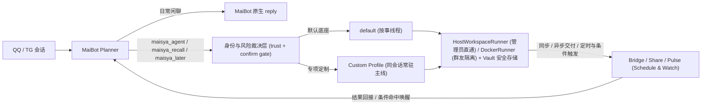

# Maisya v0.3 极简高权收敛与重构计划

> **目标定位**：在不改动 MaiBot 宿主源码、完整保留「MaiBot Planner 唯一调度与原生表达（Bridge / Share / `A_Memorix` 边界）」的前提下，解决当前 `v0.2.0`（核心源码与前端模板合计约 5.38 万行）配置前置繁琐、多角色割裂日常能力、`gVisor` 硬门槛锁死执行权与五页仪表盘过载的问题；收敛为 **「零配置开箱即用 + 全能 `default` 主档案 + Hermes 式渐进定制 `Profile` + 通用双层权限与本机/容器两级执行器 + Muse 式风险询问与透明复盘」**。

---

## 一、设计收敛总览

### 1.1 现状与目标对比

| 维度 | 当前状态（`v0.2.0` 源码已核） | 收敛目标（`v0.3` 规划） |
| :--- | :--- | :--- |
| **冷启动与会话** | 默认 `enabled_chats = []`，管理员自己的私聊也受阻（仅依赖 300s 内存缓存做配置/密钥引导） | **插件启用后，已核验管理员私聊默认全能力直通**；普通群聊与非管理员私聊继续由 `enabled_chats` 白名单精确放行（未启用群保持零注入、零落盘） |
| **首次安装引导** | 新装默认 `plugin.enabled = false` 与 `enabled_chats = []`，首次进入工作台直接落到无引导多页看板，难以判断模型/搜索/执行器是否就绪或有哪些会话可用 | **内置「首次安装启动引导（5 步全屏向导 + 轮次防竞态状态机 + 能力就绪清单）」**：新装首次打开工作台自动弹出，存量老用户升级静默免打扰；引导完成管理员配置、插件启用、会话勾选、权限策略与宿主模型连通核验，并以真实能力清单 + 一键复制开箱试跑话术收尾 |
| **角色与能力装配** | 强制拆分 `scout` / `maker` / `digest`；`profile.toml` 含 25+ 字段与 14 个零碎工具开关，需手编辑 TOML | **开箱唯一全能 `default` 主档案（兼容旧 `scout`/`maker` 别名映射）+ Hermes 式按需定制 `Profile`**（首屏仅 `标识 + 显示名称 + 一句话描述 + 生效范围`；`PROFILE.md` 留空自动生成；高级区采用 `[常规 \| 能力]` 分层与 **5 大工具集 / 技能 / 连接器** 开关卡片） |
| **执行与权限边界** | `sandbox_exec` 强绑 `Linux + Docker + runsc + @sha256 + nftables`，需静态配 `sandbox_targets` 与 `services.json` 模板 | **内置跨平台 `HostWorkspaceRunner`（管理员态免容器开箱直通 Python/Bash/SSH/CLI）+ 降门槛的普通 `DockerRunner`（可选隔离层，自动择优 `runsc`）+ Muse 式「关键更改前对话确认闸（`ask_risky`）」+ 群友轮次自动隔离边界** |
| **线程与连续性** | 每次 `start` 散装随机 `th_xxx`；改 `Profile` 快照即抛 `PermissionError` 锁死旧工作区；`stop` 后永久 `closed` 不可续 | **`default` 按事建轻量线程（近 5 条直连 + 远期 `maisya_recall` 捞回原位 `send`）+ 定制 `Profile` 默认按 `(chat_id, profile_id)` 自动绑定常驻主线程与专属工作区 + 热改 `Profile` 实时生效 + `stop` 仅中断当轮回 `idle` 可随时复活** |
| **外部触发与自管理** | 318 行带宿主 Cookie/HMAC 限制的签名 Webhook（已移出：`maisya/incoming.py`）+ 2277 行 `1+2` 配方体检台（已移出：`maisya/recipes.py`）+ 4383 行巨型 [shaping.py](../maisya/shaping.py) | **统一进 `maisya_later` + `Pulse` 的原生「条件盯梢（`mode="watch"`，静默巡检、满足条件才汇报）」+ 单文件夹极简 `.zip` 档案导入导出 + 透明系统文件树自管理（`<= 600` 行轻量管理原语）** |
| **管理工作台** | 五页仪表盘（含 `01→04 FLOW` 拓扑、重复读数、深色 `TREND` 示波器、裸 JSON/TOML 编框） | **四页清爽结构（`现场 \| 档案 \| 资料库 \| 设置`）× 双主题（默认 `millennium` 千禧机械契合 MaiBot WebUI + `modern` 现代极简留白主题）**，完整保留 **上下文与 Token 消耗方块图（Treemap）** 并融合 Muse 式步骤时间线渐进展开 |

### 1.2 收敛后核心主循环



---

## 二、核心子系统详细设计规范

### 2.1 通用双层权限、两级执行器与对话确认闸

> **设计原则**：不针对单一业务场景写特判工具或后门逻辑；权限与执行环境完全由「真实触发身份 × 宿主机运行环境」通用裁决。

- **涉及文件**：[maisya/trust.py](../maisya/trust.py)、新建 `maisya/runner.py`、精简 [maisya/sandbox.py](../maisya/sandbox.py)、[maisya/vault.py](../maisya/vault.py)、[maisya/maker.py](../maisya/maker.py)、[plugin.py](../plugin.py)。

#### 1. 两级通用执行器（`maisya/runner.py` + [maisya/sandbox.py](../maisya/sandbox.py)）
1. **`HostWorkspaceRunner`（内置零配置，全平台可用）**：
   - `cwd` 固定为当前线程工作区副本 `project/`；
   - 环境变量由 [maisya/pathsafe.py](../maisya/pathsafe.py) 的 `minimal_subprocess_env()` 构造，彻底剥离宿主进程环境（不暴露宿主 `bot_config.toml`、`model_config.toml` 或无关系统环境变量）；
   - 独立进程组启动（POSIX 下 `start_new_session=True`，Windows 下通过进程树/Job 清理），严格执行单步 `timeout`（默认 60 秒，上限 180 秒）与 `output_bytes`（默认 2 MiB）；
   - 标准输出与错误合并后必经 `vault.redact()` 脱敏。
2. **`DockerRunner`（可选隔离执行，由 `sandbox.enabled` 开启）**：
   - 移除 [maisya/sandbox.py](../maisya/sandbox.py) 中拒绝 `runc` 及强制要求 `@sha256:[a-f0-9]{64}` 镜像摘要的硬校验；支持常规镜像标签（默认 `maisya-sandbox:py313`，允许自定义镜像或摘要）；
   - 启动时探测 Docker `Runtimes`：若存在 `runsc` 自动附加 `--runtime=runsc`，否则使用标准无特权容器（`--read-only --cap-drop=ALL --security-opt=no-new-privileges --pids-limit=128 --memory=...`，仅挂载工作区副本 `/work`）。

#### 2. 「真实发言人 × 运行环境」自动裁决矩阵

- **双源合并管理员名单（零改动宿主 `bot_config.toml`）**：
  - `v0.2.0` 仅从宿主 `plugin.permission` 只读继承管理员，导致新装用户无法在不手改宿主 `config/bot_config.toml` 的情况下于界面内初始化管理员；
  - `v0.3` 在插件自身 [maisya/config.py](../maisya/config.py) 的 `Settings` 中新增 `admins: list[str] = []`（落盘于插件自有配置），运行时有效管理员集合取 **`宿主 plugin.permission（只读继承）∪ 插件 Settings.admins（支持引导/设置页/对话增删）`**；
  - 格式规范化沿用 [maisya/trust.py](../maisya/trust.py) `normalize_admins` 口径：仅将 `<platform>` 转小写，完整保留 `<user_id>` 原始大小写（兼容 QQ 官方机器人大小写敏感 OpenID），并支持将 `qq:private:10001` 或引导页输入的纯数字 QQ 号自动规范化为 `<platform>:<user_id>`。

| 能力维度 \ 触发身份 | 已核验管理员态 | 群友共享态 |
| :--- | :--- | :--- |
| **判定依据** | 满足其一：① 私聊或群聊携带真实 `source_msg_id`，经 `trust.py` 反查非 `relayed_by_plugin` 且属于 `admins`；② WebUI 管理台已登录操作员发起；③ 带有 `scheduled_admin=True` 的管理员预定/盯梢任务 | 已加入 `enabled_chats` 的群聊或私聊中由非管理员触发，或非管理员自主任务 |
| **会话准入** | **管理员私聊无视 `enabled_chats` 默认开启全部工具**（`maisya_agent` / `maisya_recall` / `maisya_later` 及延迟 `maisya_shape`）；任意私聊可通过 `target_chat` 跨群调度或预览 | 严格受限于已加入 `enabled_chats` 的会话及目标 `Profile` 的 `allow_chats` 范围 |
| **感知、联网与工作区** | 全量开放 | 开放该 `Profile` 启用的 `context`、`web`、`workspace`（严格隔离在当前 `(owner, chat_id)` 工作区内，维持 `Private -> Group` 单向隐私隔离墙） |
| **任意代码与终端（`exec`）** | 开启 `exec` 工具集时**默认直通 `HostWorkspaceRunner`**（免装 Docker 即可跑 Python / Bash / SSH / CLI） | • **若 `DockerRunner` 已启用且就绪**：自动路由进无凭据、无宿主机挂载的隔离容器执行 `/work/project` 脚本<br>• **若未启用 Docker**：**硬拦截任意 Shell 命令与自由代码拼接**（防提示词注入读取宿主机文件）；若该档案 `preset/scripts/` 下存在管理员预置的只读 `.py` 脚本，仅允许通过无 Shell 参数数组（`[sys.executable, script_path, *safe_args]`，`cwd=project/`，最小环境、无凭据、源码只读不可改）调用受托脚本 |
| **安全存储凭据（`vault`）** | 若档案 `share_credentials = true`（默认），允许在执行期安全注入已存凭据（环境变量或 `0400` 只读临时密钥文件，命令结束后立即销毁）；严禁明文进入模型提示词，出站强制 `redact()` | **默认硬隔离主人凭据**；仅当管理员显式将某个连接器标记为 `public_readonly = true` 时，才允许只读调取脱敏后的查询结果 |

#### 3. Muse 式「管理员风险分级确认闸」
- **配置项**：`Settings.permission_mode` 支持 `"ask_risky"`（默认）| `"autonomous"` | `"always_ask"`。
- **授权记忆表**：在 SQLite 新增 `permission_grants (grant_key TEXT PRIMARY KEY, kind TEXT, scope TEXT, note TEXT, created REAL)`，记录管理员确认后选择「记住本次授权」的项目（如特定远端主机 SSH/连接器或跨群投递授权），可在管理台「设置 → 权限策略」查看计数与逐条撤销。
- **`ask_risky` 裁决行为**：
  - **直接放行**：只读排查、工作区内部文件读写与脚本计算、联网检索、创建只读 `watch` 盯梢任务；
  - **挂起确认**：命中高风险特征时（写/删工作区以外宿主机路径、高危破坏性命令模式如 `rm -rf`/`mkfs`/系统服务启停、对尚未记入 `permission_grants` 的外部主机首次注入凭据、跨群主动外发、或工具显式请求高危确认），线程暂停为 `state="waiting"`（附带结构化待确认摘要 `pending_confirm`），由 `planner` 用 MaiBot 自然口吻问一句确认；
  - **确认续跑**：管理员在同一会话回复确认并经真实 `source_msg_id` 验权 `send` 后，立即继续执行并按需写入 `permission_grants`；
  - **后台无人值守任务（`scheduled_admin`）**：只读检查动作直接放行；遇到未授权的高危写操作时挂起线程并生成通知唤醒管理员确认，绝不越权静默执行。

#### 4. 安全存储（[maisya/vault.py](../maisya/vault.py)）元数据升级
- 保留现有 `Fernet` 加密文件格式与 `0600` 权限完全兼容；
- 补充非敏感索引元数据 `vault_meta.json`（权限 `0600`）：
  `{handle: {kind: "secret" | "ssh_key" | "login", domain_or_title: str, account_hint: str, note: str, updated: float}}`；
- 管理员态线程上下文仅可见脱敏名录 `[{handle, kind, domain_or_title, note}]`，按句柄引用，明文永不进入模型消息流。

---

### 2.2 Profile 极简继承模型与 5 大工具集装配（对齐 Hermes 理念）

- **涉及文件**：新建 `presets/profiles/default/`、[maisya/abilities.py](../maisya/abilities.py)、[plugin.py](../plugin.py)。

#### 1. 内置预设收敛与向后兼容
- 新增唯一默认全能档案 `presets/profiles/default/`（`PROFILE.md` + `profile.toml`），默认开启全部 5 大工具集，平时无需任何选择或配置即可直接对话调度；
- 保留 `presets/skills/`（`source-checking`、`ongoing-workspace`、`research-report`、`news-digest`）作为可按需开关的共享技能资产；
- **向后兼容映射**：
  - `Profiles.get(pid)` 收到 `"scout"` 或 `"maker"` 且用户数据目录未单独定制覆盖同名档案时，透明映射至 `"default"`；
  - 既有自定义派生档案读取旧版 `tools = [...]` 列表时，自动无损归并推导为对应的 `toolsets`。

#### 2. 极简 `profile.toml` 规范

```toml
title = "克苏鲁守秘人"
description = "主持 CoC 7版跑团，管理调查员卡与检定状态，严禁剧透模组真相"
enabled = true
base = "default"                       # 默认继承主档案
session_mode = "persistent"            # "persistent"（同会话常驻续接）| "task"（default 默认：按事建线程）
access = "everyone"                    # "everyone"（生效会话全员可互动）| "admins"（仅管理员）
allow_chats = ["qq:group:100246809"]   # 空列表表示所有 enabled_chats 可用
share_credentials = true               # 仅管理员触发轮次生效；群友轮次恒强制隔离
model_name = ""                        # 留空继承全局/宿主默认
fallback_models = []
toolsets = ["context", "workspace", "exec", "schedule"] # 5 大工具集开关
skills = []
connectors = []                        # 启用的 MCP / plugin_api 标识
fish_seed = "auto"
```

#### 3. 5 大工具集（`TOOLSETS`）精确映射

| 工具集标识 | 面向用户的中文名称 | 装配的底层工具 |
| :--- | :--- | :--- |
| `context` | 会话与记忆感知 | `chat_read`, `message_read`, `memory_read`, `person_read`, `recall_read`, `image_read`, `thread_read`, `ask_user` |
| `web` | 联网搜索与抓取 | `web_search`, `web_fetch` |
| `workspace` | 工作区与图文排版 | `workspace_file`, `html_render`, `render_report`, `result_attach`（挂载 `news-digest` 技能或兼容旧档时自动暴露 `digest_feed`） |
| `exec` | 代码与终端执行 | `exec_command`（同时兼容旧工具名别名 `sandbox_exec`） |
| `schedule` | 持续巡检与自唤醒 | `thread_later` |

#### 4. `PROFILE.md` 留空自动生成与极简 `.zip` 导入导出
- **`PROFILE.md` 自动生成**：在管理台新建/保存 Profile 或通过对话创建 Profile 时，若 `PROFILE.md` 正文留空且提供了 `title` + `description`，调用宿主轻量生成能力根据名称、描述与所选工具集自动生成结构化 `PROFILE.md` 初稿落盘（模型不可用时使用干净的结构化模板兜底）；用户可随时手改，所有修改记入 `memory_versions` 支持一键回滚。
- **极简 `.zip` 导入导出**：取代原 2277 行的旧版 `maisya/recipes.py`（已移除）。导出时仅打包该档案目录（`PROFILE.md`、剥离本地 `allow_chats` / `allow_users` 后的 `profile.toml`、可选 `NOTES.md`、`preset/` 及关联自定义 `skills/`），并执行 `vault.contains_secret` 与常见密钥正则扫描阻断泄密；导入时支持上传 `.zip`，重名可选择平滑更新（保留本机 `allow_chats` 与既有工作区）或另存副本。

---

### 2.3 双轨线程生命周期与无缝续接

- **涉及文件**：[maisya/threads.py](../maisya/threads.py)、[plugin.py](../plugin.py)。

#### 1. 双轨路由规则
- **`default` 主档案（`session_mode == "task"`）**：
  - `maisya_agent(action="start")` 默认开启一条新的轻量任务线程；
  - 短期追改直接从 `<maisya_threads>` 最近 5 条索引调 `send` 原位修改；
  - 更久以前的任务由 `planner` 先调 `maisya_recall` 查得 `thread_id`，再调 `send` 原地复活并带回完整历史与工作区。
- **定制 `Profile`（`session_mode == "persistent"`）**：
  - 调用 `maisya_agent(action="start" | "send", profile="<custom_id>")` 且未显式传 `fresh=true` 时，引擎自动按 `(owner, target_chat_id, f"profile_{profile_id}")` 查找或创建绑定的常驻主线程与默认专属工作区，自动转为续接该主线程；
  - **`<maisya_profiles>` 注入增强**：若当前会话下某定制 `Profile` 已有活跃或待命常驻主线，直接在 `<maisya_profiles>` 条目中附带 `active_thread_id` 与最新进展摘要，使 `planner` 无需额外多调一次 `maisya_recall` 即可一步命中；
  - **归档重开（`fresh=true`）**：将原常驻主线程标记为 `archived` 并解绑默认槽位（旧线程与工作区完整保留在数据库和「资料库」，仍可被 `maisya_recall` 检索或续接），为该 `(chat_id, profile_id)` 原地开启全新主线程与干净工作区。

#### 2. 修复两处历史阻断缺陷
1. **解除配置热改锁死**：移除 [maisya/threads.py](../maisya/threads.py#L339-L367) 中因修改 `Profile` 字段导致快照不同就抛出 `PermissionError` 拒绝续接旧工作区的逻辑；续接线程每轮动态经 `resolve_profile` 加载最新 `Profile` 配置，安全边界统一由当前轮次真实触发人身份实时裁决。
2. **修复 `stop` 永久锁死**：将 `stop` 的语义收敛为「取消当前运行中的 asyncio 任务、补齐未完成 `tool_call_id` 跳过回执、将线程状态置回 `"idle"`（而非永久锁定为 `"closed"`）」；同时放开对历史遗留 `"closed"` 或 `"archived"` 线程显式调用 `send` 时的原地激活恢复，保证任何历史任务都能随时捞回续改。

---

### 2.4 「条件盯梢（Watch）」替代 Webhook 与自管理瘦身

- **涉及文件**：删除旧版 `maisya/incoming.py`、删除旧版 `maisya/recipes.py`、精简 [maisya/services.py](../maisya/services.py)、升级 [maisya/intents.py](../maisya/intents.py) 与 [maisya/pulse.py](../maisya/pulse.py)、重写瘦身 [maisya/shaping.py](../maisya/shaping.py)、更新 [plugin.py](../plugin.py)。

#### 1. `maisya_later` 与 `Pulse` 原生支持条件盯梢（`mode="watch"`）
- **`maisya_later` 接口精炼**：
  - `action`: `"schedule" | "list" | "cancel" | "run_now" | "pause" | "resume"`
  - `mode`: `"schedule"`（定点必达，默认）| `"watch"`（条件盯梢：静默检查，满足条件才唤醒汇报）
  - `condition`: 可选字符串，描述 `watch` 模式的汇报触发条件（例如 `"存在新的 401/500 渠道报错"`、`"目标仓库发布了新 Release"`）
  - 保留 `in_seconds`、`every_seconds`（`>= 300`）、`daily_at`（`HH:MM` 不漂移）、`profile`、`workspace`、`target_chat`、`replace=true`。
- **`Pulse` 对 `mode="watch"` 的执行流**：
  - 默认绑定独立状态工作区（如 `watch_<intent_short_id>`）并注入 `<watch_contract>` 与 `<previous_runs>` 以便对比基线状态；
  - 到期时在后台静默检查：
    - **未触发条件**：线程输出静默无变化状态（不声明向会话汇报），`Pulse` 仅记录本次检查摘要与时间戳、自动重排下一周期，**不唤醒聊天 `planner`、不发消息、不扣减每日主动额度**；
    - **触发条件**：线程产出告警或发现结论（及可选图卡附件），`Pulse` 生成高优回接意图唤醒目标会话 `planner` 汇报（`scheduled_admin` 同样受非管理员不可取消保护）。

#### 2. 自管理接口大瘦身（[maisya/shaping.py](../maisya/shaping.py) 从 4383 行收敛至 `<= 600` 行）
- 移除 `webhooks`、`recipe`、`services` 动态模板、`digest_sources` 专属补丁等冗余分支；
- 保留延迟工具 `maisya_shape`（严禁加 `visibility` 标记），仅暴露 **4 个正交动作**：
  1. `overview`：读取全局/指定会话启用态、定制 `Profile` 列表、挂起中的预定/盯梢任务与系统文件概览；
  2. `settings`：读写极简核心设置（`enabled_chats` 增删、`admins` 插件级管理员增删、`permission_mode`、`sleep_window`、`proactive_level`、`default_model`），更新 `admins` 时强制执行**防自锁死校验**（禁止清空合并后的有效管理员集合，禁止对话发起者将自身从有效管理员集合中移除）；
  3. `profile`：创建、克隆、更新、启停、归档重开或删除 `Profile`（支持留空 `instructions` 自动生成 `PROFILE.md`）；
  4. `file`：安全读取、写入、列目录与版本回滚受管系统文件（`MEMORY.md`、`JOURNAL.md`、`HEARTBEAT.md`、`TOOLS.md`、`skills/<id>/SKILL.md`、`profiles/<id>/PROFILE.md`），统一执行路径防逃逸校验、密钥防明文检查与 `memory_versions` 快照。

---

### 2.5 四页双主题 WebUI 重构（`现场 | 档案 | 资料库 | 设置`）

- **涉及文件**：[webui.json](../webui.json)、[webui/build.py](../webui/build.py)、[webui/now.html.in](../webui/now.html.in)、[webui/management.html.in](../webui/management.html.in)、`webui/fragments/{profiles,library,settings}.html`（替代原四碎片）、[webui/millennium.css](../webui/millennium.css)、[maisya/console.py](../maisya/console.py)、[maisya/management.py](../maisya/management.py)。
- **宿主契约不变式**：保持 [webui.json](../webui.json) 单页面侧栏入口（`entry: "webui/now.html"`）；构建为内联自包含单文件 HTML（零外链、零 ``、零 `<iframe>`、零 `localStorage`、零 `transition: all`）；单路游标串行轮询确保峰值并发 RPC `<= 2`；读取接口维持热响应 `<100ms`。
- **双主题体系**：
  - `millennium`（默认）：契合 MaiBot 宿主的千禧机械质感，干净利落；
  - `modern`（现代极简留白风，平滑兼容旧配置值 `"maiwork"`）+ `auto`（自动跟随宿主 `dashboardStyle`）。
- **四页布局与交互定义**：

1. **现场（`now`）**：
   - 移除 `01→04 FLOW` 拓扑、重复四格 `TELEMETRY`、黑色 `TREND` 示波器与底部唤醒抽屉；
   - **左栏**：上半区 **「预定与盯梢」**（列出所有 `schedule` / `watch` 任务、下次检查时间、上次检查状态，支持暂停 / 立即运行 / 取消与快捷新建）；下半区 **「活动时间线」**（按会话/档案过滤，支持一键清理废记录，展示标题、小鱼图标、状态与总 Token 简标）；
   - **右栏（复盘视图）**：左侧为**垂直步骤时间线**（触发 → 推理 → 工具/命令执行 → 交付；运行中底部保留轻量补充/转向输入框与停止键）；右侧默认展示 **「一句话结果摘要 + 交付产物芯片 + 上下文与 Token 消耗方块图（Treemap）」**，点击左侧任一步骤时切换展示该步**完整参数/命令与脱敏原始输出**，随时切回总览。
2. **档案（`profiles`）**：
   - 卡片网格展示 `default` 主档案与全部自定义 `Profile`（含小鱼头像、描述、常驻/按事标签、生效范围与启停开关）；
   - 点击「新建档案 / 编辑」打开 **Hermes 式渐进面板**：
     - 顶部：小鱼形象选择器（随名称自动变化 / 随机 / 锁定）；
     - 首屏仅：`标识`、`显示名称`、`描述`、`生效范围（全部启用会话 / 指定会话 / 仅管理员）`；
     - 展开 `⌄ 高级` 切 **`[常规 | 能力]`**：
       - **常规**：克隆自、模型与顺次备选下拉（默认继承）、会话模式（同会话常驻续接 / 每次独立任务 + 「归档重开主线」按钮）、`PROFILE.md`（留空自动生成，支持手改与历史回滚）、`☑ 与主档案共享安全存储凭据`；
       - **能力**：顶部切 **`技能 | 连接器 | 工具集`**，配搜索框与分类筛选，全部采用带人话说明的 **`开/关` 切换卡片**（支持在此新建/拖入 `.zip` 技能包，以及单档案 `.zip` 导入导出）。
3. **资料库（`library`）**：
   - 主视图为清爽的**产物画廊**（全部 / 页面与卡片 / 图像海报 / 文档与代码，支持网格与列表切换、预览与源码复制）；
   - 侧栏底部设 **「记忆与系统文件」** 入口：顶部为 `近期手账 (JOURNAL.md)`、`主动与探索节奏 (HEARTBEAT.md)`、分会话 `会话记忆 (MEMORY.md)` 快捷卡片；下方为受管目录树浏览器（可透明查看与编辑 `memory/`、`profiles/`、`skills/`、`workspaces/` 下的文本文件并支持版本回滚）。
4. **设置（`settings`）**：
   - 一屏收敛为 **4 个清晰模块**（移除裸 JSON 服务编辑框与杂乱运行参数）：
     1. **会话渠道**：插件总开关、管理员私聊直通状态标识、已发现会话一键开关列表（支持冷群手动添加与单群主动度微调）；
     2. **权限策略**：**双源管理员管理**（分区展示「宿主继承 `[只读]`」与「插件配置 `[可增删]`」，支持从最近私聊会话候选芯片一键点选设为管理员、或选平台填账号新增，保存后实时生效无需重启或改服务器文件）+ 管理员执行确认三选一（`关键更改前询问 [默认]` / `完全自主` / `始终询问`）+ 已记住授权列表与逐条撤销；
     3. **安全存储**：凭据列表（名称/域名、类型、备注说明）与新增/替换/删除弹窗；
     4. **基础运行**：全局默认模型选择、免打扰时段、探索心跳开关、可选轻量 Docker 容器开关与一键运行体检（提供「重新运行启动引导 / 继续引导」入口）。
5. **移动端窄屏适配（`<= 720px` / 档案切换 `<= 760px` 视口约定）**：
   - 保留 **4 栏底栏（`.ms-mob-dock`：`现场 | 档案 | 资料库 | 设置`）**，单行居中贴合窄屏单手切换；
   - `档案` 页顶部保留 **无框横向游动像素鱼 Profile 轮播开关（`#ab-mob-head` / `#mob-role-carousel` / `#ab-mob-role-card1`）**：支持横向滑动吸附切换不同能力档案并联动下方首屏摘要卡片（`#ab-mob-role-card1`）跳转对应分区，保持轻盈手感。

---

### 2.6 首次安装启动引导与统一能力体检（借鉴 MaiWork 理念）

> **设计取舍**：MaiWork 作为独立外部服务，引导流程需要让用户手动录入 LLM 端点/API Key 与头像（10 步）；Maisya 运行在 MaiBot 宿主内，天然复用宿主模型池与机器人身份。因此我们吸收 MaiWork 最精华的 **「轮次防竞态状态机 + 真实能力就绪清单（不伪造完成）+ 管理员低门槛引导 + 渐进全屏引导动效」**，将其收敛为 **5 步全屏向导**。

- **涉及文件**：新建 `maisya/onboarding.py`、[maisya/management.py](../maisya/management.py)、`webui/fragments/onboarding.html`（或内联于管理入口）、[webui/millennium.css](../webui/millennium.css)、[webui/build.py](../webui/build.py)。

#### 1. 后端状态机与防竞态轮次控制（`maisya/onboarding.py` + `maisya_manage_read` / `maisya_manage_write` 扩展）
- **持久化存储**：记录于 `<宿主根>/data/maisya/maisya.db` 的键值状态（`onboarding_state`），合法状态枚举为：
  - `""`：从未开始；
  - `"in_progress"`：正在进行并记忆当前 `step`，刷新或重进工作台时自动回到上次停下的步骤；
  - `"later"`：必选条件未齐时点了完成（记为「先存下，稍后继续」），不再反复强弹，并在「设置 → 基础运行」顶部显示继续条；
  - `"done"`：必选条件全部满足并完成；
  - `"skipped"`：用户主动点击右上角「跳过」，持久尊重、不再主动弹出。
- **新装精准弹出与老版本静默升级判定（`show`）**：
  - `state == "in_progress"` 时 `show = True`；
  - `state == ""` 时自动探测是否属于存量安装：若 `plugin.enabled == True` 且（`enabled_chats` 非空 **或** `agent_threads` 历史记录数 `> 0`），判定为已在使用的存量用户，`show = False` 静默升级免打扰；否则判定为全新安装，`show = True` 自动弹出向导；
  - 已进入终态（`done` / `skipped` / `later`）后默认不再自动弹窗，用户可随时在「设置 → 基础运行」手动点击「重新运行启动引导」（`action="reset"`）或「继续引导」（`action="start"`）。
- **轮次与序号防覆盖契约（`run_id` + 单调递增 `sequence`）**：
  - 每次 `start` / `reset` 生成全新 `run_id` 并重置 `sequence = 0`；
  - `progress` / `done` / `skip` 请求必须校验 `run_id` 与递增 `sequence`：迟到的后台请求、旧标签页请求或终态之后到达的乱序请求一律只读返回当前视图，绝不回退步骤或意外重开向导。

#### 2. 只读无副作用「能力就绪清单（`items`）」与必选门禁（`REQUIRED`）
- **必选可用条件（`usable`）**：必须同时满足以下三项，`done` 才记为 `"done"`；任一缺失时记为 `"later"` 并标出明确缺项，绝不伪造「设置完成」：
  1. `plugin`：`plugin.enabled == True`；
  2. `models`：宿主已配置至少 1 个可用对话模型，且最近一次连通验证未明确失败；
  3. `chats`：`enabled_chats` 至少选入 1 个会话，**或** 有效管理员集合（`host_admins ∪ Settings.admins`）已配置至少 1 名管理员使管理员私聊直通生效。
- **7 项统一能力清单（引导完成页与「设置 → 基础运行」体检共用同一只读数据源，纯读取本地配置与已缓存探测结果，零外网阻塞、热响应 `<20ms`）**：
  1. `plugin`（插件总开关）：`ok` 已启用 / `off` 未启用（附 `[前往开启]` 跳回 `chats` 步）；
  2. `admins`（管理员账号）：`ok` 已生效 `N` 位管理员（标明宿主继承 / 插件配置来源，私聊直通与高权执行已解锁）/ `warn` 尚未设置管理员（提示当前仅能在已启用群以普通共享隔离态运行，附 `[去设置管理员]` 跳回 `admins` 步）；
  3. `models`（宿主模型与工具调用）：`ok` 已就绪并通过连通核验 / `warn` 已识别宿主模型但尚未连通核验（或工具调用受限）/ `off` 宿主未配置可用模型或验证明确失败；提供独立 `verify_model` 写动作（限时 `<= 8s` 内存最小探针验证回复与工具调用能力，**严守零泄密红线：绝不读取、持久化或回传宿主的 `api_key`、`base_url` 或 `api_providers`**，且绝不向任何聊天会话发送消息）；
  4. `chats`（可用会话与白名单）：`ok` 已启用 `N` 个会话 + 已识别管理员私聊直通 / `warn` 仅开启群聊但未配置管理员（提示配置管理员解锁私聊直通与本机执行）或仅管理员私聊可用 / `off` 无任何可达会话；
  5. `exec`（代码与终端执行）：`ok` 内置 `HostWorkspaceRunner` 已就绪（若开启 `DockerRunner` 且就绪一并标明群友隔离容器可用）/ `warn` 群友隔离容器未启用（说明管理员直通不受影响，群友轮次自动限制为只读工作区与预置脚本）；
  6. `web`（联网搜索与网页抓取）：`ok` 已接通搜索源（宿主 / MCP / 跨插件搜索）/ `warn` 未检测到搜索源，仅支持直连抓取已知 URL；
  7. `render`（图文卡片渲染）：`ok` 本机无头浏览器可用，支持 HTML 图卡渲染 / `warn` 未检测到 Chromium，自动降级为文本或文件交付。

#### 3. 五步极简全屏向导交互（适配 MaiBot `srcdoc` 严格 CSP 与双主题）
- 步骤定义固定为 `ONB_STEPS = ["hello", "admins", "chats", "runtime", "done"]`：
  1. **`hello`（开始）**：内联像素小鱼 SVG 徽标（严守零 ``、零外链），三行说清使用方式（直接在 QQ/TG 与 MaiBot 对话委派任务，无需记命令；管理台随时透明复盘与定制档案），右上角常驻 `跳过`；
  2. **`admins`（管理员设置）**：
     - **宿主自动识别**：若宿主 `plugin.permission` 已配好管理员，顶部绿标直接展示已继承账号（`[宿主继承 · 只读]`），用户只需确认即可点「下一步」或继续补充跨平台账号；
     - **最近私聊一键点选（防填错）**：自动读取已发现的近期私聊流（`private` 会话），展示带昵称与平台标签的候选芯片，点击即可一键加入插件 `Settings.admins`；
     - **手动录入（平台 + 账号）**：提供平台选择（`qq` / `telegram` / `qqbot` / 自定义）与账号输入框（自动剥离 `private:` 前缀、完整保留 QQ 官方 OpenID 等大小写敏感字符），并用一句话讲清收益（设好后 **私聊直接全能力直通** + **群内触发解锁高权执行与确认**）；支持「稍后设置」不阻塞往后走；
  3. **`chats`（启用与会话）**：默认打开 `plugin.enabled` 开关；列出已发现的 MaiBot 群聊/私聊流供一键勾选加入 `enabled_chats`（支持关键词筛选与手动输入冷群 `<platform>:<group|private>:<id>`）；
  4. **`runtime`（模型、权限与主题）**：默认模型下拉选择（默认「跟随宿主任务槽」+ `[测试连通]` 按钮）、管理员权限确认策略三选一卡片（默认选中 `关键更改前询问 ask_risky`）、工作台主题即时切换预览（`千禧机械 millennium` / `现代极简 modern` / `跟随宿主 auto`）；
  5. **`done`（就绪清单与第一件小事）**：逐项渲染上述 7 项 `ok / warn / off` 状态及 `[前往设置]` / `[去补齐]` 快捷跳转，并附上 **3 条可一键复制发给 MaiBot 的开箱试跑话术**（联网调研出图卡 / 设条件盯梢 / 建群聊常驻定制 Profile）。
- **动效与无障碍细节**：仅用 Web Animations API 驱动 `transform` 与 `opacity`（严禁 `transition: all`），快速连点切换步骤时立即 `finish()` 收尾在途动画防叠层卡顿，尊重 `prefers-reduced-motion` 静默降级，并实现模态框 `Tab` 焦点循环锁定（`onbTrapFocus`）。

---

## 三、配置精简与数据平滑迁移契约

### 3.1 `Settings` 精简保留项与兼容策略

- **核心用户可见配置项**：仅保留 `plugin.enabled`、`enabled_chats`、`admins`（新增插件内管理员列表，默认 `[]`，运行时与宿主 `plugin.permission` 取并集）、`permission_mode`（新增，默认 `"ask_risky"`）、`default_model`（新增可选全局主模型覆盖，默认 `""` 跟随宿主）、`sleep_window`、`proactive_level`、`chat_proactive_levels`、`heartbeat_interval_minutes`、`ui_style`（支持 `millennium | modern | auto`，旧值 `"maiwork"` 自动兼容映射为 `"modern"`）、`sandbox.enabled` + `sandbox.image`。
- **内部预算与向后兼容**：`agent_max_steps`、`agent_timeout`、`agent_max_active`、`thread_context_tokens` 等保留合理自适应默认值；`Settings` 配置模型启用 `extra="ignore"`，确保旧版 `config.toml` 或 `settings.json` 中残留的废弃字段在升级重启或热重载时不会触发 Pydantic 校验报错。

### 3.2 存量 `<宿主根>/data/maisya/` 零损迁移与线上清零整洁替换约定

- **本地/存量平滑兼容**：
  - 既有 `vault/` 密文、`maisya.db` 历史线程与附件、`memory/chats/*/MEMORY.md`、`JOURNAL.md`、`HEARTBEAT.md`、自定义 `skills/` 与 `workspaces/` **100% 原地保留可读**；
  - 旧 `webhooks.json` 停止加载但不误删用户磁盘文件；
  - 旧 `services.json` 中已登记的 `servers`（MCP）与 `apis` 自动读取并呈现于新「连接器」名册。
- **线上部署清零整洁替换（用户拍板）**：
  - 本次 `v0.3` 收敛重构全部完成并通过验收后，**支持对线上既有 Maisya 插件与运行期状态执行清零整洁替换**（以干净全新初始化态重新启用与验证首次引导及新模型，避免老版本遗留测试数据干扰）；
  - 部署前仍必须严格遵守线上红线：**取得用户当次明确同意**，先将既有线上插件文件与运行期数据（SQLite 一律以只读 `.backup()` 复制）完整备份至 `/root/backups/`，且严禁改动 MaiBot 宿主代码或主动重启宿主服务。

---

## 四、五阶段 TDD 实施路线与验收门禁

每个阶段均严格遵循：**「先写/改失败测试 → 最小实现过绿 → 宿主隔离契约验证 → 小步验证」**。

| 阶段 | 核心交付范围 | 验收门禁 |
| :--- | :--- | :--- |
| **Phase 1**<br>权限与执行底座 | • 新建 `maisya/runner.py`（`HostWorkspaceRunner`）并精简 `maisya/sandbox.py`（降门槛 `DockerRunner`）<br>• 升级 `maisya/vault.py`（`vault_meta.json` 脱敏目录）与 `maisya/config.py`（`admins`、`permission_mode`、`default_model`、`extra="ignore"`）<br>• 升级 `maisya/trust.py`、`maisya/maker.py` 与 `plugin.py`：实现 `host_admins ∪ Settings.admins` 双源合并（保留大小写敏感 OpenID、防清空自锁死）、管理员私聊免白名单直通、双层身份自动裁决矩阵与 `ask_risky` 对话确认闸（`permission_grants` 表） | • 管理员双源合并、大小写敏感 OpenID 保留与防删空自锁死单测通过<br>• 管理员免白名单免容器执行工作区命令且输出自动脱敏测试通过<br>• 群友无容器硬拦截任意宿主机 Shell（防读宿主机配置）及有容器路由测试通过<br>• 高危操作触发 `waiting` 确认并在真实 `source_msg_id` 确认后记住 `permission_grants` 测试通过 |
| **Phase 2**<br>全能底座与常驻线程 | • 新增 `presets/profiles/default/`，在 `maisya/abilities.py` 落地 5 大 `TOOLSETS`、`PROFILE.md` 留空生成、极简 `.zip` 导入导出与旧 `scout`/`maker` 兼容映射<br>• 在 `maisya/threads.py` 与 `plugin.py` 落地定制 `Profile` 同会话自动常驻续接、`fresh=true` 归档重开、移除热改快照锁死，并将 `stop` 改为回归 `idle` 可随时复活 | • 新装默认仅 `default` 全能可用<br>• 定制 `Profile` 跨多轮自动命中同一常驻主线与工作区、热改工具集/模型不断档、`stop` 后 `send` 原地继续、旧 `scout`/`maker` 线程无缝回读测试全绿 |
| **Phase 3**<br>断舍离、盯梢与引导底座 | • 删除 `maisya/incoming.py` 与 `maisya/recipes.py`，精简 `maisya/services.py` 为连接器列表<br>• 在 `maisya/intents.py`、`maisya/pulse.py` 与 `maisya_later` 落地 `mode="watch"` 静默巡检与条件触发汇报<br>• 将 `maisya/shaping.py` 收敛为 `<= 600` 行的 4 动作轻量接口并打通受管系统文件安全读写；同步清理 `_manifest.json` / `webui.json` 中的 `maisya_incoming_event`<br>• 新建 `maisya/onboarding.py` 并在 `maisya/management.py` 接入引导状态机、`items` 只读能力清单与限时 `verify_model`（零密钥泄露） | • `watch` 未满足条件静默不打扰且不扣每日额度、满足条件准确唤醒汇报测试通过<br>• 确认移除 `maisya_incoming_event` 后 `_manifest.json` 与 `webui.json` 组件契约一致<br>• `onboarding` 新装弹出/存量静默升级/失败模型不放行/`run_id + sequence` 防乱序覆盖单测全绿 |
| **Phase 4**<br>四页双主题与启动引导 WebUI | • 更新 `webui/build.py`、`webui/now.html.in`、`webui/management.html.in`、`webui/fragments/{profiles,library,settings,onboarding}.html` 与 `webui/millennium.css`<br>• 实现 5 步全屏首次安装启动引导（`hello → admins → chats → runtime → done`，含最近私聊候选芯片一键设管理员、就绪清单、开箱话术复制、焦点锁定与 WAAPI 轻量动效）与「设置 → 权限策略」双源管理员管理<br>• 调整 `maisya/console.py`（去除旧 FLOW/示波器冗余字段，保留 Token 方块图与步骤命令详情数据）与 `maisya/management.py` | • `python3 webui/build.py && python3 webui/build.py --check` 通过<br>• Playwright Chromium UI 测试覆盖首次安装 5 步引导完成/跳过/重开及候选私聊一键设管理员、设置页双源管理员增删（防删空）、双主题切换、`现场` Token 方块图 + 步骤命令展开、`档案` 首屏 3 项创建与 `[常规 \| 能力]` 开关卡片、`资料库` 产物画廊与系统文件编辑回滚、`设置` 四模块交互<br>• 满足零外链 / 零 `` / 零 `<iframe>` / 零 `localStorage` / `inflight <= 2` / `<100ms` 性能门禁 |
| **Phase 5**<br>回归验收与文档对齐 | • 清理已删除特性的废弃测试，补齐新契约与端到端测试<br>• 全量运行本地 `pytest` 与独立宿主隔离契约 `python3 tests_host/run_contract.py`（校验 `host_unchanged`）<br>• 同步更新 `README.md`、`codemap.md`、`docs/01-架构蓝图.md`、`docs/guide/*` 与 `HANDOFF.md` | • 本地全量单测与 Chromium UI 测试全绿，真实宿主 SDK 隔离契约全绿<br>• **红线门禁**：未经用户当次明确同意，绝不触碰线上服务器 `plugins/` 目录 |
